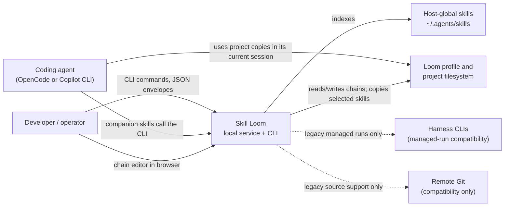
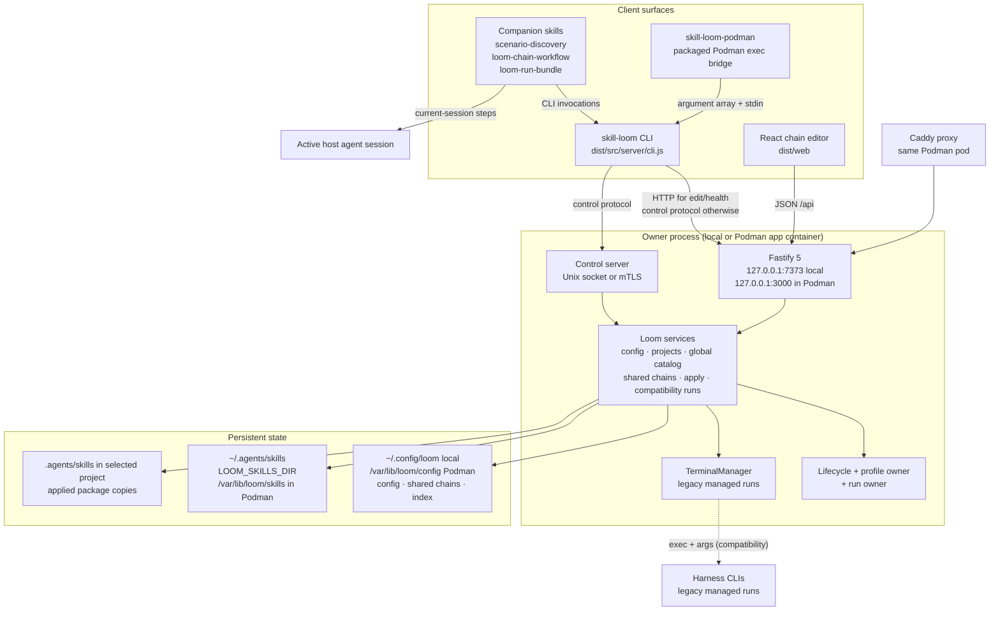
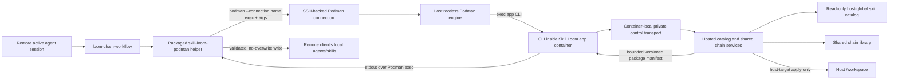
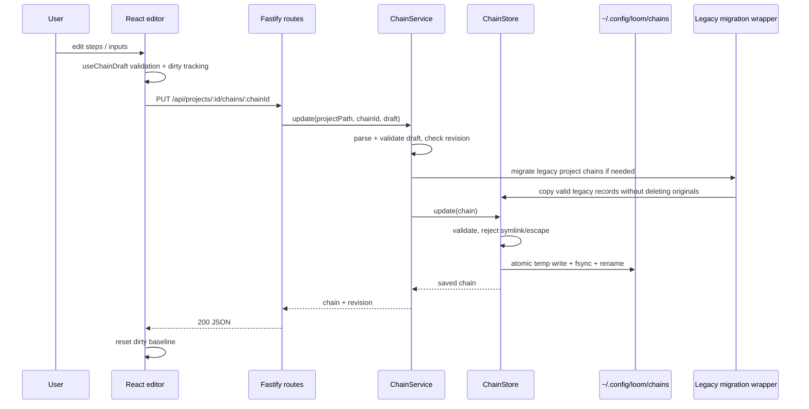
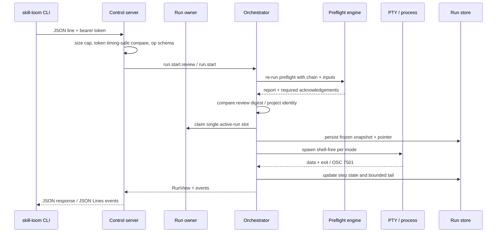
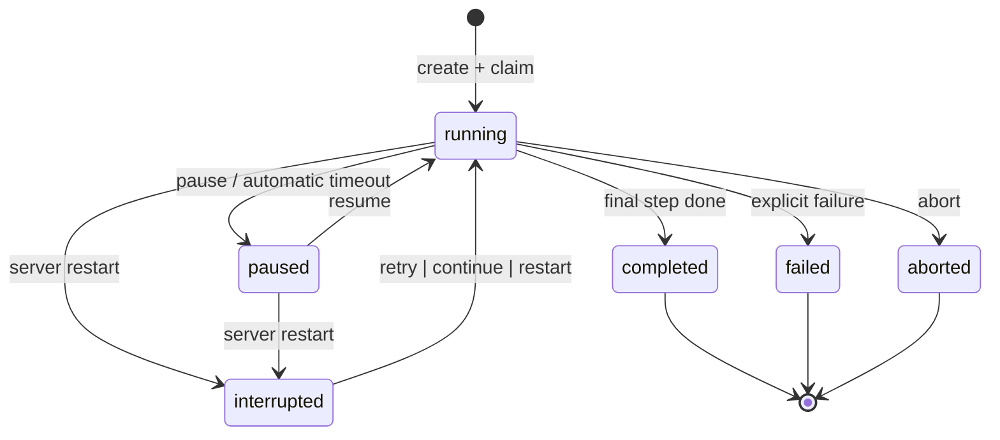
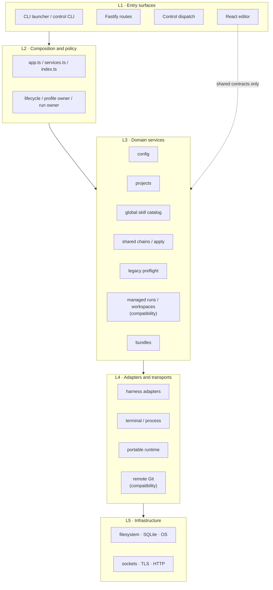
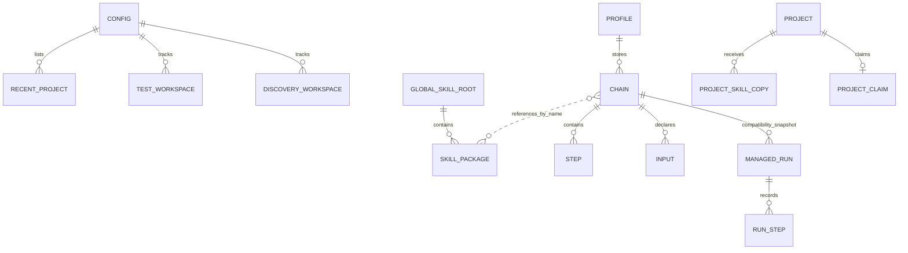

# Project Architecture Blueprint — Skill Loom

*Generated: 2026-11-13 · Package version `0.1.0` · Configuration: `PROJECT_TYPE=Auto-detect`, `ARCHITECTURE_PATTERN=Auto-detect`, `DIAGRAM_TYPE=C4`, `DETAIL_LEVEL=Comprehensive`, `INCLUDES_CODE_EXAMPLES=true`, `INCLUDES_IMPLEMENTATION_PATTERNS=true`, `INCLUDES_DECISION_RECORDS=true`, `FOCUS_ON_EXTENSIBILITY=true`.*

This document is the reference for how Skill Loom is actually built. It describes the code that exists, not an aspirational pattern. File paths and symbols are named so a maintainer can go straight from this document to the implementation.

---

## 1. Architecture Detection and Analysis

### 1.1 Technology stack detected

| Concern | Technology | Evidence |
|---|---|---|
| Runtime | Node.js `>=24`, ESM (`"type": "module"`) | `package.json` engines/type |
| Language | TypeScript `7.0.2`, strict mode, `noUncheckedIndexedAccess`, `exactOptionalPropertyTypes` | `tsconfig.json` |
| HTTP server | Fastify `5.12.8`, `@fastify/static` `10.1.9` | `package.json`, `src/server/app.ts` |
| Browser UI | React `19.3.1`, React DOM, Vite `8.3.5` | `package.json`, `vite.config.ts` |
| Terminal | `node-pty` `1.1.0`, server-owned PTY sessions | `src/server/terminal/pty.ts` |
| Contracts/validation | Zod `4.6.7`, YAML `2.9.1` | `src/server/**/model.ts`, `config/schema.ts`, `catalog/frontmatter.ts` |
| Persistence | Versioned JSON files with atomic replacement and typed corrupt-file handling; SQLite for profile/claim locks | `config/store.ts`, `chains/store.ts`, `runs/store.ts`, `shared/project-claim.ts` |
| Tests | Vitest `5.1.0`, unit and integration suites | `vitest.config.ts`, CI |
| Packaging | npm tarball, postinstall native PTY helper, GitHub Actions matrix | `scripts/package-smoke.mjs`, `.github/workflows/cross-platform-verification.yml` |

### 1.2 Architectural pattern detected

Skill Loom is a **single-user modular monolith** with a **ports-and-adapters** core and a **CLI-first control surface**. It supports a local deployment and a private single-user Podman deployment.

- **Modular monolith**: one Node process serves the browser, owns persistence, and exposes a local control endpoint. The default chain workflow runs in the already-active agent session; the retained managed-run compatibility subsystem can still spawn harnesses.
- **Layered server**: composition root → routes/control dispatch → domain services → stores → filesystem/processes.
- **Ports and adapters**: harness differences live behind `HarnessAdapter`; catalog adapters scan one configured host-global skills root; runner strategies belong to retained managed runs.
- **Command/control split**: chain mutations and project apply go through a private, authenticated local control protocol; the HTTP surface is deliberately minimal. Current-session step execution is performed by the active agent, not the server.
- **Single-user security**: the server is loopback-only, with a private control transport. Podman adds a same-pod proxy and requires localhost publishing or private authenticated ingress.
- **Document-oriented persistence**: versioned JSON documents with Zod schemas and atomic replacement. Shared chains are profile-owned; frozen run snapshots are limited to the compatibility run subsystem.

The classic labels “Clean Architecture” or “Hexagonal” only partly apply. Domain modules do not depend on Fastify, but they do use Node built-ins directly, and several shared contract modules import server model types. The accurate description is **modular monolith with adapter seams**, not a textbook clean-architecture dependency inversion everywhere.

---

## 2. Architectural Overview

### 2.1 Guiding principles evident in the code

1. **The server owns its side effects.** Filesystem, process, PTY, and network operations happen in `src/server`; the active host agent performs the prompts and tool actions for the default current-session workflow. The browser and CLI are typed clients (`src/server/cli.ts`).
2. **One composition root.** `buildApp()` in `src/server/app.ts` constructs config, services, run ownership, terminal management, routes, and error handling. Tests inject the same seams.
3. **Harness differences are data, not branches.** Compatibility preflight and managed-run code consume `HarnessDescriptor`/`HarnessAdapter`; current-session chain execution does not start another harness (`src/server/harness/types.ts`, `.github/skills/loom-chain-workflow/SKILL.md`).
4. **Current-session chains are prompt workflows.** The library stores ordered steps; the active agent follows them in the existing session. The compatibility run subsystem separately snapshots chains and retains only bounded terminal tails.
5. **Persistence is versioned and atomic.** Config, shared chains, and compatibility run records have explicit schemas and atomic writes (`config/store.ts:atomicWriteJson`, `chains/store.ts`).
6. **Explicit signals beat heuristics.** Automatic runs advance only on `osc-working-idle` or `process-exit`; supervised runs advance only when the user says so (`runs/automatic.ts`, `runs/supervised.ts`, ADR-0007).
7. **Review gates are scoped to their operation.** Compatibility mutations and managed-run starts use digests plus explicit confirmations; current global-skill apply uses safe path checks and refuses overwrites without requiring provenance review (`control.ts`, `catalog/install.ts`, ADR-0032).
8. **Project and chain identity is deterministic.** Project ids and chain revisions are path- or content-derived; chain skill steps resolve names against the current host-global catalog when applied (`projects/registry.ts`, `chains/service.ts`, `catalog/install.ts`).
9. **Compatibility uncertainty is surfaced, never guessed.** Managed-run preflight reports ambiguous auth/trust and unobservable skill firing; project apply fails for missing or ambiguous global skill names instead of choosing one (`preflight/engine.ts`, `runs/observations.ts`, `catalog/install.ts`).
10. **The product is CLI/skill-driven with one web screen.** The web UI is only the chain editor (ADR-0027, ADR-0028).

### 2.2 Architectural boundaries

| Boundary | Enforcement |
|---|---|
| Browser ↔ server | Loopback Fastify origin, same-origin shutdown check, shared JSON error envelope |
| CLI ↔ owner process | Private Unix socket or mutually authenticated loopback TLS; 256-bit bearer token; request size caps |
| Active agent ↔ chain workflow | The companion skill reads shared chain data and carries out ordered prompts in the current session; no child harness or run record |
| Server ↔ harness | Shell-free executable + argument array and server-owned PTY only for retained managed-run compatibility |
| Server ↔ filesystem | Canonical paths, global catalog scans, shared chain persistence, bounded no-overwrite copies into project `.agents/skills/` |
| Server ↔ remote Git | Compatibility-only source and snapshot support; not used by the default catalog or chain workflow |
| Host CLI ↔ Podman service | `skill-loom-podman` forwards an argument array and stdin with `podman exec`; no shell string |
| Web UI ↔ execution | No run/workspace HTTP routes; the editor saves chains and drafts only |
| Portable helper ↔ project | Separate legacy bundle run records under `.loom/portable-runs`; opt-in project coordination protocol |

### 2.3 Notable hybrid or adapted patterns

- **CQRS-like split without separate models**: mutations flow through control operations; reads are small HTTP `GET`s. Both share the same domain services.
- **Strategy + registry**: run mode selects a runner strategy; harness/catalog registries resolve adapters.
- **Shared library + project copy**: chains live under the Loom config directory and resolve skill names from the current host-global catalog; apply copies selected packages into a project without overwriting existing ones.
- **Snapshot + pointer (compatibility)**: managed-run documents are snapshots plus a global `active-run.json` pointer for cross-project exclusivity.
- **Reviewed command pattern (compatibility)**: where required, review produces a digest, the mutation re-computes and compares it, then requires `confirmed: true`.
- **Filesystem as database**: one JSON document per aggregate, guarded by naming conventions and atomic replacement rather than a transactional store.

---

## 3. Architecture Visualization

The Mermaid views below stay readable as text. Related explorable views are available for the [system map and run flows](docs/diagrams/skill-loom-architecture.html), [chain-save sequence](docs/diagrams/chain-save-sequence.html), and [portable handoff](docs/diagrams/portable-handoff-workflow.html).

### 3.1 C4 Level 1 — System context



### 3.2 C4 Level 2 — Containers



### 3.2.1 Remote Podman-over-SSH client flow



The client uses its own configured SSH identity and named Podman connection;
the connection authorizes container access rather than adding Skill Loom
authentication. Client-local apply exports only the selected chain's global
packages in a manifest capped at 100 packages, 2,000 files, and 20 MiB. The
local project path never leaves the client. The normal server and control
transport remain loopback/private inside the host.

### 3.3 C4 Level 3 — Server components

```mermaid
flowchart LR
  subgraph Edge
    Routes["routes/<br/>health · server · chains · drafts"]
    Control["control.ts<br/>dispatch + transport"]
  end

  subgraph Domain
    ConfigS["config/store + schema"]
    ProjectS["projects/<br/>registry · paths · coordination"]
    CatalogS["catalog/<br/>global root · capability index<br/>legacy adapters"]
    ChainS["chains/<br/>shared library · migration<br/>drafts · compatibility bundles"]
    Preflight["preflight/<br/>engine · auth · trust · trust-session"]
    Runs["runs/<br/>managed-run compatibility<br/>orchestrator · owner · store"]
    Workspaces["workspaces<br/>test · discovery"]
    Bundles["bundles/<br/>reviewed-import · target-review"]
  end

  subgraph Adapters
    Harness["harness/<br/>types · registry · opencode · copilot"]
    PTY["terminal/pty"]
    Portable["portable/<br/>bundle · runtime · install"]
  end

  Edge --> Domain
  Domain --> Adapters
  Domain --> Store["versioned JSON + SQLite locks"]
  Adapters --> OS["filesystem · child_process · node-pty"]
```



### 3.4 Chain edit data flow



### 3.5 Current-session chain workflow

```mermaid
sequenceDiagram
  participant A as Active agent session
  participant SK as loom-chain-workflow
  participant CLI as skill-loom CLI
  participant CTL as Control server
  participant CAT as Global catalog
  participant ST as Shared chain store
  participant P as Selected project

  A->>SK: request to use a saved chain
  SK->>CLI: list/get chain and project context
  CLI->>CTL: authenticated control request
  CTL->>ST: resolve chain from <configDir>/chains
  ST-->>SK: ordered chain definition
  SK->>CLI: chain project apply
  CLI->>CTL: apply operation
  CTL->>CAT: resolve each skill name in global root
  CAT-->>CTL: unique current packages
  CTL->>P: copy to .agents/skills; refuse overwrite
  SK->>A: guide ordered prompts and declared inputs
  Note over A: Agent uses the current host tools/session; Loom starts no harness and stores no run record for this workflow
```

### 3.6 Compatibility managed-run start flow



### 3.7 Compatibility managed-run lifecycle

This state machine describes the retained server-managed run subsystem, not the default current-session chain workflow.



The status vocabulary is defined in `src/server/runs/model.ts`; recovery actions are restricted to `retry`, `continue`, and `restart` in `orchestrator.ts`.

---

## 4. Core Architectural Components

### 4.1 CLI launcher and control client

**Purpose.** Entry point for users and skills. Parses command families (`service`, `edit`, `catalog`, `project`, `chain`, plus retained `bundle`, `run`, `workspace`, and `discovery` compatibility commands), chooses HTTP or control transport, and prints JSON envelopes.

**Internal structure.** `src/server/cli.ts` (top-level routing, service lifecycle, browser opening), `src/server/control-cli.ts` (control-backed command grammar and help), `src/server/catalog/cli.ts`, `src/server/bundle-cli.ts`, `.github/skills/loom-chain-workflow/scripts/skill-loom-podman.mjs` (portable Podman bridge packaged with the workflow skill), and `src/server/cli-input.ts` (strict stdin JSON).

**Interactions.** HTTP is used for health/lifecycle and the editor API; control operations handle catalog and chain queries, chain apply/export, and compatibility features. `skill-loom-podman` forwards structured arguments and stdin through Podman exec to the CLI inside the container. For a client-local project, it requests a bounded package manifest and writes validated files locally without overwriting existing skill packages.

**Evolution.** Add a command by adding a control operation and a grammar entry, not by adding a second state owner.

### 4.2 Fastify composition root

**Purpose.** Build the server, validate loopback/port settings, construct services, decorate the instance, install hooks, mount routes, and standardize failures.

**Internal structure.** `src/server/app.ts`: `ServerConfigError` hierarchy, `assertLoopbackHost`, `assertValidPort`, `resolveServerSettings`, `buildApp`; `src/server/index.ts`: `startServer`, `installShutdownHandlers`, profile ownership, control startup.

**Interactions.** `buildApp` creates `LoomServices` via `createLoomServices`, `RunOwner` via `createRunOwner`, and `TerminalManager`. Decorators (`loomSettings`, `loomVersion`, `loomTerminalManager`, `loomLifecycle`, `loomRunOwner`, `loomServices`) expose them to plugins. `onRequest` rejects requests during shutdown; `onClose` shuts down PTYs and runs.

**Evolution.** New HTTP routes register in `routes/index.ts`; new cross-cutting decorators should be added to the `FastifyInstance` declaration at the bottom of `app.ts`.

### 4.3 Routes

**Purpose.** Minimal validated HTTP surface for the browser: health, lifecycle, shutdown, chain persistence, and draft persistence. Chain routes retain project context for API compatibility, but persist into the shared profile library.

**Internal structure.** `routes/health.ts`, `routes/server.ts`, `routes/chains.ts`, `routes/drafts.ts`, `routes/index.ts`.

**Interactions.** Routes validate params/body with Zod, call one service method, and map typed errors to the shared envelope. `onRequest` lifecycle gating and `setErrorHandler`/`setNotFoundHandler` are global.

**Evolution.** Keep routes thin. Any operation that mutates runs or workspaces belongs in control, not HTTP (ADR-0027/0028).

### 4.4 Service composition

**Purpose.** One place that wires configuration, project registry, global catalog and capability search, shared chains, drafts, compatibility preflight, and workspaces.

**Internal structure.** `src/server/services.ts:createLoomServices`, returning `LoomServices`.

**Interactions.** Resolves `LOOM_SKILLS_DIR` or `~/.agents/skills`, builds the catalog and derived capability index from that root, and creates the shared chain store under the config directory. The chain service lazily migrates legacy project chain files without deleting originals. Injected services are honored for tests.

**Evolution.** Add a domain service here and thread it through `LoomServices`, then inject into routes/control; do not construct it ad hoc inside handlers.

### 4.5 Configuration

**Purpose.** Versioned global settings and profile state. Legacy fields for extra directories, remote sources, and discovery remain for compatibility, but they do not supply the default authoring catalog.

**Internal structure.** `config/schema.ts` (Zod schemas, `CONFIG_VERSION = 2`, v1 migration), `config/store.ts` (`ConfigStore`, `atomicWriteJson`, serialized updates), `config/canonical-root.ts`.

**Interactions.** Every service receives a `ConfigStore`; chain storage and drafts use its config directory. The global skills root is independently selected by `LOOM_SKILLS_DIR` or the host default and is not copied into config.

**Evolution.** Bump `CONFIG_VERSION` only with an explicit migration branch and a test that rejects unknown versions.

### 4.6 Projects

**Purpose.** Register canonical project directories, derive stable ids, provide project context for shared-chain operations, and coordinate retained managed-run compatibility features.

**Internal structure.** `projects/registry.ts` (canonicalization, `projectIdForPath`, recent-project persistence, Git init), `projects/paths.ts` (typed path errors), `projects/coordination.ts` (reviewed coordination actions), `shared/project-claim.ts` (SQLite claim/transaction), `shared/project-run-records.ts` (bounded run-record scan), `shared/project-coordination.ts` (protocol review).

**Interactions.** Projects are addressed by id in API/control; services resolve id → canonical path. Applying a shared chain copies only its referenced global skills into the project's `.agents/skills/` root without overwriting existing packages. Managed test/discovery workspaces remain for compatibility.

**Evolution.** New project-scoped data belongs under `.loom/` and must be added to the project `.gitignore` policy.

### 4.7 Catalog

**Purpose.** Discover and index skill packages from one configured host-global directory, then search and copy selected packages into projects. Project copies are destinations, not catalog sources.

**Internal structure.** `catalog/global-skills.ts` resolves `LOOM_SKILLS_DIR` or `~/.agents/skills`; `catalog/merge.ts` registers harness-neutral adapters over that root; `catalog/capability-index.ts` builds the derived searchable index; `catalog/frontmatter.ts` parses package metadata; `catalog/install.ts` resolves chain skill names and performs bounded project copies. Remote, extra-source, native-agent, and discovery modules remain compatibility surfaces.

**Interactions.** Both harness adapters scan the same global root. The catalog is rescanned on requests, and the capability index is disposable. Apply requires exactly one global package for each referenced skill name, then copies it into `<project>/.agents/skills/` without overwrite. Remote snapshots are not part of the default authoring path.

**Evolution.** Keep the global root as the default authoring source. External tools provision and update packages; adding a compatibility source must not silently expand the default catalog.

### 4.8 Chains

**Purpose.** Define, validate, persist, duplicate, and version chains in a shared profile library. Bundle import/export remains a compatibility path.

**Internal structure.** `chains/model.ts` (`ChainSchema`, versions, steps, inputs, session modes, agent selection, warnings), `chains/store.ts` (`ChainStore`, safe ids, atomic writes, corrupt-file warnings, shared directory), `chains/service.ts` (`ChainService`, revisions, copy naming, import), `chains/drafts.ts` (profile-owned draft store), and compatibility bundle/preset modules.

**Interactions.** Routes and control call `ChainService` with a registered project as context, while saved chains live in `~/.config/loom/chains`. Valid legacy `<project>/.loom/chains/*.json` files are copied into the shared library on first access; originals remain. Chain steps refer to skill names resolved against the current global catalog at apply time. Drafts remain in `~/.config/loom/drafts`.

**Evolution.** Chain schema changes require version handling, migration tests, editor updates, and compatibility bundle review. Preserve the separation between shared chain ownership and the project selected for apply.

### 4.9 Preflight

**Purpose.** Deterministically decide whether a chain can run and what the user must acknowledge in the retained managed-run compatibility subsystem. The default companion workflow instead runs in the active host session.

**Internal structure.** `preflight/engine.ts` (ordered checks: chain, request, project, harness, inputs, CLI, catalog, skill, agent, authentication, trust, session-mode, fork, permissions, git), `preflight/auth.ts` (redacted evidence), `preflight/trust.ts`, `preflight/trust-session.ts`, `preflight/manual-command.ts`, `preflight/provider.ts`, `preflight/request.ts`.

**Interactions.** Preflight runs before run creation and again for reviewed starts/actions. It reads catalog, harness descriptors, config, trust files, and Git status. It never spawns a harness.

**Evolution.** Add a check with a stable `id`/`key`, an explicit severity, remediation text, and tests for every status. A warning never blocks; ambiguity requires acknowledgement.

### 4.10 Harness adapters

**Purpose.** Encapsulate every harness-specific command, flag, discovery strategy, trust behavior, session/fork capability, permission flag, and advancement signal.

**Internal structure.** `harness/types.ts` (`HarnessDescriptor`, `HarnessAdapter`, `StepInvocation`, executable resolution), `harness/registry.ts` (`createHarnessAdapter`, `createHarnessRegistry`, unsupported-id errors), `harness/opencode.ts`, `harness/copilot.ts`.

**Interactions.** Preflight reads descriptors; orchestrator/runner build commands; trust session service builds trust/manual commands; catalog adapters are separate but aligned.

**Evolution.** See §13.1 for the full checklist.

### 4.11 Managed runs (compatibility subsystem)

**Purpose.** Retain the former server-managed lifecycle: preflight, snapshot, input resolution, single-active-run claim, runner selection, event streaming, persistence, recovery, and cleanup. New shared-chain workflows do not create managed runs or use these records.

**Internal structure.**

| Module | Responsibility |
|---|---|
| `runs/orchestrator.ts` | Only owner of run lifecycle; action vocabulary, revision, recovery |
| `runs/owner.ts` | Lazy orchestrator creation, startup recovery, mutation blocking, shutdown |
| `runs/store.ts` | Project run documents + global active-run pointer |
| `runs/model.ts` | Zod run/step/status schemas, bounded tails, interruption |
| `runs/automatic.ts` | Signal-driven state machine (`osc-working-idle`, `process-exit`) |
| `runs/supervised.ts` | One process per step; explicit user advancement |
| `runs/prompts.ts` | Step prompt assembly, session planning, handoff |
| `runs/osc.ts` | OSC 7501 parser/state machine |
| `runs/observations.ts` | Best-effort skill-firing evidence |
| `runs/headless-process.ts` | Shell-free child-process adapter |
| `runs/process-cleanup.ts` | Dispose/kill/wait helpers |
| `runs/reviewed-start.ts`, `reviewed-start` flows | Digest + confirmation contract |
| `runs/test-workspaces.ts`, `discovery-workspaces.ts`, `workspace-*.ts` | Retained managed workspaces, locks, inspection, bounded evaluation |
| `runs/handoff.ts`, `project-reconciliation.ts` | Recovery and handoff evidence |

**Interactions.** The orchestrator consumes `ChainService`, `HarnessRegistry`, `PreflightEngine`, `ProjectRegistry`, `RunStore`, `TerminalManager`, and spawner seams. It broadcasts `RunStreamMessage` events; control streams them as JSON Lines.

**Evolution.** Any retained managed-run mode must stay behind the orchestrator and preserve its active-run claim and persistence rules. Do not route the default current-session workflow through this subsystem.

### 4.12 Terminal transport

**Purpose.** Server-owned PTY sessions with bounded output, subscriber fan-out, resize/write, and idempotent shutdown for retained managed runs.

**Internal structure.** `terminal/pty.ts`: `TerminalSession`, `TerminalManager`, `TerminalOutputBuffer`, `trimTerminalOutput`, `createTerminalManager`.

**Interactions.** Supervised runs keep one stable terminal id across steps; automatic PTY-backed runs reuse the run terminal id. CLI `run attach` and control terminal attachments subscribe to the same session.

**Evolution.** Any new streaming surface must preserve bounded tails and cleanup on `onClose`.

### 4.13 Portable helper

**Purpose.** Execute legacy exported bundles without the Skill Loom service, using the compatibility bundle format and safety rules. New chains use the shared library and active agent session instead.

**Internal structure.** `portable/bundle.ts` (bundle v1/v2 schema, path validation, fingerprints), `portable/runtime.ts` (install, status, step, record, resume), `portable/install-skill.ts`, `portable/installed-modes.ts`, `portable/run-schema.ts`, `portable/cli.ts`.

**Interactions.** Writes `.loom/portable-runs/*.json`, installs bundle skills into the selected project skill root, optionally participates in project coordination. It is distributed as `dist/skills/loom-run-bundle`.

**Evolution.** Bundle schema changes must keep `parseBundle` strict, preserve `MAX_*` limits, and update the standalone skill guide.

### 4.14 Shared contracts

**Purpose.** Types and helpers used by server, web, and portable code: API envelope, chain shape, bundle shape, terminal messages, remote catalog limits, discovery handoff, coordination, run records.

**Internal structure.** `src/shared/api.ts`, `chain.ts`, `bundles.ts`, `terminal.ts`, `remote-catalog.ts`, `discovery-handoff.ts`, `project-claim.ts`, `project-coordination.ts`, `project-run-records.ts`, `sync-directory.ts`.

**Interactions.** The web client imports shared API/chain types; server routes return shared envelopes; portable code imports shared bundle/claim contracts.

**Evolution.** Keep shared modules dependency-light. Today some shared modules import server model types; moving those types into shared would remove the logical inversion (see §5.4).

### 4.15 Web chain editor

**Purpose.** The only browser screen: reorder steps, edit instructions, manage named inputs, validate, and save a draft or project chain.

**Internal structure.** `web/main.tsx`, `web/App.tsx` (route table), `web/router.tsx` (custom history router with guards), `web/routes/ChainEditorPage.tsx`, `web/hooks/useChainDraft.ts` (editor state machine), `web/components/` (`ChainFlow`, `StepEditor`, `StepList`, `InputsEditor`, `StatusRegion`, `HelpPopover`, `InlineError`, `ErrorBoundary`), `web/api/` (typed fetch clients), `web/ThemeProvider.tsx`, `web/styles/theme.css`, `web/help/topics.ts`.

**Interactions.** Calls only `/api/drafts` and `/api/projects/:id/chains`. It has no run, workspace, catalog, or project-management screens.

**Evolution.** Preserve keyboard semantics, focus management, live announcements, and the dirty-navigation guard when changing the editor.

### 4.16 Companion skills and maintainer agents

**Purpose.** Teach a coding agent how to use the CLI, select shared chains, apply host-global skills, and follow ordered steps in the active session. Other companion skills preserve compatibility workflows.

**Internal structure.** `.github/skills/**` is canonical; `scripts/build-portable-skill.mjs` generates `dist/skills/**` and mirrors `skill/**` and `.opencode/skills/**`. `.opencode/agents/**` defines maintainer agents. Project copies install to `<project>/.agents/skills`, with legacy OpenCode discovery preserved.

**Interactions.** `loom-chain-workflow` invokes the CLI as a subprocess to read chains and apply packages, then guides the active agent through steps; it does not start a child harness or create a run record. Skills do not import server code. Documentation and mirrors are validated by `npm run check`.

---

## 5. Architectural Layers and Dependencies

### 5.1 Layer map



### 5.2 Dependency rules as implemented

- `src/web/**` may import `src/shared/**` and its own modules. It must not import `src/server/**`.
- `src/server/**` may import `src/shared/**` and `src/portable/**` (the CLI delegates to portable for bundle commands), but must not import `src/web/**`.
- `src/portable/**` may import `src/shared/**` and a small set of **server leaf modules** (`catalog/frontmatter.ts`, `chains/model.ts`, run model helpers). It must not import Fastify, routes, or the orchestrator.
- Routes/control depend on service interfaces, not concrete file stores, wherever a seam exists.
- Harness names are not compared outside adapter construction/registry and a few explicit capability checks that read descriptor fields.
- Persistence modules depend on Node built-ins and Zod; they do not depend on Fastify or React.

### 5.3 Dependency injection style

Skill Loom uses **constructor/options injection with production defaults**, not a DI container:

```ts
// src/server/services.ts (excerpt)
const globalSkillsDirectory = () => resolveGlobalSkillsDirectory(
  options.preflightEnv,
  options.preflightHomeDirectory,
);
const catalogService = options.catalogService ?? createCatalogService({
  configStore: options.configStore,
  globalSkillsDirectory,
});
const createGlobalChainStore = () => createChainStore({
  chainsDirectory: globalChainsDirectoryFor(options.configStore.getConfigDir()),
  configDirectory: options.configStore.getConfigDir(),
});
const projectRegistry = createProjectRegistry({
  configStore: options.configStore,
  ...(options.gitInit === undefined ? {} : { gitInit: options.gitInit }),
});
```

Every seam is an optional function or object in an options interface. `BuildAppOptions` in `app.ts` is the widest example: config store, catalog, chain service, version, logger, web root, terminal manager, Git init, harness registry, preflight engine/runner/readers/env, orchestrator, clock, id generator, PTY spawner, automatic spawner, step timeout, and allowed origins.

### 5.4 Layer violations and boundary risks

| Observation | Impact | Guidance |
|---|---|---|
| `src/shared/bundles.ts` imports `Chain`/`ChainStep` from `src/server/chains/model.ts` | Shared contracts are not fully independent; portable/web bundles pull a server type module | Prefer moving chain/run document types to `src/shared`; if not, keep these imports type-only and leaf-safe |
| `src/shared/project-run-records.ts` imports `parseRunDocument` | Shared scanning logic depends on server run validation | Acceptable today for portable use; document the dependency direction |
| `src/portable/*` imports server leaf modules | Portable is not source-independent from the server tree | Treat those modules as a stable “portable kernel”; avoid adding dependencies on routes/orchestrator |
| `buildApp` and `startServer` both call startup recovery | Duplicate recovery path, though idempotent | Keep recovery idempotent; test both entry paths |
| Editor API and control API share services but not one transport | Two mutation surfaces, one domain | Keep the editor limited to chain/draft persistence; use control for apply and compatibility operations |
| JSON files are not cross-file transactional | Partial failure can leave a pointer or workspace record inconsistent | Use ordering, idempotent recovery, locks, and explicit reconciliation; never assume a multi-file atomic commit |

No circular module dependency was found between `web`, `server`, and `portable` directories at the directory level. The shared→server type imports are the main logical inversion.

---

## 6. Data Architecture

### 6.1 Domain model



Core documents:

- **Config** (`version: 2`): harness commands, compatibility fields for extra directories/remote sources, recent projects, test/discovery workspaces, and discovery settings.
- **Global skill root**: externally provisioned package directories under `~/.agents/skills` or `LOOM_SKILLS_DIR`; the catalog and derived index read this root.
- **Chain** (`CHAIN_VERSION`): id, name, harness, session-mode and permission metadata, ordered skill-name or instruction steps, inputs, optional compatibility agent/binding metadata, and timestamps. The profile owns it; a selected project is context for apply and session work. The current-session workflow does not change the active host session mode.
- **Project skill copy**: point-in-time package files copied to `<project>/.agents/skills`; there is no automatic update from the global source.
- **Managed run** (`RUN_VERSION`, compatibility): frozen chain snapshot, mode, status, bounded step tails, session plan, project identity, and revision.
- **Bundle and discovery handoff**: compatibility formats that can carry package contents, fingerprints, selected-agent data, or pinned candidate identities.

### 6.2 Persistence locations

| Location | Data | Durability strategy |
|---|---|---|
| `~/.config/loom/config.json` | Global config | Atomic write, versioned schema, v1 migration |
| `~/.config/loom/drafts/*.json` | Project-independent draft chains | Atomic, versioned chain documents |
| `~/.config/loom/chains/*.json` | Shared chain library | Atomic, versioned chain documents visible from every registered project context |
| `~/.config/loom/capability-index.sqlite` | Derived index of the configured global skill catalog | Disposable cache; rebuild or fresh-scan fallback |
| `~/.agents/skills/` or `LOOM_SKILLS_DIR` | Externally provisioned global skill catalog | Read and indexed by Loom; updates are owned by external installation tools |
| `~/.config/loom/profile-owner.sqlite` | Profile ownership lock | SQLite/OS lock |
| `~/.config/loom/control.json` | Control endpoint + capability (and TLS credentials on Windows) | Private file, process-owned |
| `~/.config/loom/active-run.json` | Compatibility managed-run pointer | Atomic write; not used by current-session chain execution |
| `~/.config/loom/test-workspaces/<uuid>` | Retained managed test projects | Project registry + config records |
| `~/.config/loom/discovery-workspaces/<uuid>` | Discovery handoff, managed project, results | Same |
| `~/.config/loom/catalog-sources/<source>/<commit>` | Compatibility remote snapshots | Content-addressed directories; not the default catalog |
| `<project>/.loom/chains/*.json` | Legacy project chain files | Copied into the shared library on first access; originals remain |
| `<project>/.agents/skills/` | Applied skill package copies | Not overwritten or automatically updated |
| `<project>/.loom/runs/*.json` | Compatibility managed-run snapshots | Atomic write + bounded tails |
| `<project>/.loom/portable-runs/*.json` | Legacy portable helper runs | Atomic write, separate from managed runs |
| `<project>/.loom/project-claim.sqlite` | Compatibility coordination claim | SQLite transactions |
| Podman volume `skill-loom-config` | Container config, shared chains, and capability index | Persists across pod removal |
| Podman bind mounts `/var/lib/loom/skills` and `/workspace` | Global catalog (read-only) and selected project | Host paths are translated by Podman; mounted project is writable |

### 6.3 Access patterns

- **Repository/store**: `ChainStore`, `RunStore`, `ConfigStore` hide filesystem details behind async interfaces.
- **Shared chain store**: `ChainService` writes to `<configDir>/chains`; the project parameter provides context and triggers non-destructive migration of legacy project records. Compatibility `RunStore` remains project-scoped.
- **Read-modify-write**: config updates are serialized per target in-process (`enqueueWrite`) to avoid lost updates; cross-process safety comes from single-owner design.
- **Snapshot isolation (compatibility)**: a managed run stores its own chain copy; later chain edits never change that run. Current-session workflows do not create run snapshots.
- **Bounded reads**: skill-package copies are bounded; managed-run tails cap at 200 lines or 32 KiB per step; compatibility remote/handoff/bundle inputs have explicit caps.
- **Corruption handling**: invalid files are reported as warnings with stable codes; list operations keep going; read-by-id raises a typed error. There is no silent repair.

### 6.4 Identity and integrity

| Identity | Derivation |
|---|---|
| Project id | slug + first 12 hex of SHA-256(canonical path) |
| Chain revision | SHA-256 of canonical chain JSON (`chainRevision`) |
| Run revision | SHA-256 of run JSON (`runRevision`) |
| Bundle fingerprint | SHA-256 of the serialized bundle |
| Chain skill reference | Skill name, resolved uniquely against the current global catalog at apply time |
| Compatibility snapshot id | Source + commit/revision |
| Compatibility skill id | Source kind + harness + package identity |
| Native agent id | Harness + source + path + fingerprint |
| Review digest | SHA-256 of the exact review evidence shown to the caller |

Integrity checks remain in compatibility bundle parsing, remote snapshot review, native-agent copy, and managed-run start/action review. The default chain apply path relies on safe package traversal, unique name resolution, and no-overwrite behavior; it does not require provenance review or immutable fingerprints.

### 6.5 Concurrency and retention

- **Single active managed run globally (compatibility)** via `~/.config/loom/active-run.json` and the run owner.
- **Single profile owner** via profile lock; control endpoint metadata is written by the owner.
- **Workspace lifecycle lock** prevents create/remove races.
- **Project coordination** (opt-in, versioned SQLite protocol) reconciles claims and prior run records across clients.
- **Retention is explicit**: shared chains and external global skills persist independently of projects; compatibility test/discovery workspaces persist until `workspace remove`, and old remote snapshots/portable records have separate cleanup rules.

---

## 7. Cross-Cutting Concerns

### 7.1 Security and authorization

- **Network**: loopback-only host assertion (`assertLoopbackHost`); shutdown route validates loopback host, same origin, JSON content type, per-instance token, and `confirm: true`.
- **Control**: Unix socket in a private temp/profile directory or Windows loopback TLS with generated client certificates; 32-byte bearer token; timing-safe comparison; 64 KiB request cap; 32-client cap; 5-second initial timeout; protocol version check.
- **Process execution**: the default chain workflow starts no process; retained managed-run compatibility uses an executable plus argument array, never a shell string, with server-owned PTY handling.
- **Filesystem**: global catalog reads and project package copies use bounded traversal, path validation, symlink refusal, and no-overwrite publication; chain documents use safe ids and atomic writes.
- **Remote content**: validated Git sources and immutable snapshots remain compatibility features, not inputs to the default catalog or chain apply path.
- **Review gates**: legacy managed-run and compatibility mutations retain their digest/confirmation contracts. Default chain apply resolves intentional global packages by unique name and refuses destination conflicts without requiring provenance review.

### 7.2 Error handling and resilience

- A **typed error family** per module (`ConfigError`, `ChainStoreError`, `RunStoreError`, `RunOrchestratorError`, `HarnessError`, `ControlError`, `BundleError`, etc.) with stable codes and safe details.
- Control `failure()` maps known errors to `{ ok: false, error }`; HTTP uses `createApiErrorEnvelope`; unknown errors become generic `INTERNAL_ERROR` without leaking internals.
- Cause chains are preserved where useful (`{ cause }`); details avoid prompts, credentials, terminal output, and file contents.
- Recovery: startup marks compatibility managed runs `interrupted`; stale/ambiguous/claimed records are retained with warnings; active pointers are cleared only with evidence.
- Failure isolation: a corrupt chain/run file becomes a list warning, not a service outage; a failed workspace cleanup is typed and retryable.

### 7.3 Logging and observability

- Fastify request logging is injectable (disabled by default `logger: false`; enabled by the CLI `startServer`).
- Server logs record unhandled 5xx errors with `{ err }` but respond generically.
- Compatibility run recovery emits structured warning codes (`RUN_RECOVERY_AMBIGUOUS`, `RUN_RECOVERY_CLAIMED`).
- Health endpoint reports status, version, config directory, port, and compatibility active-run summary.
- No metrics/tracing subsystem exists; observability is logs, JSON envelopes, compatibility run records, and live evidence files under `docs/evidence/`.

### 7.4 Validation

Validation is distributed by responsibility:

| Layer | Validates |
|---|---|
| Route/control input | Zod request schemas, strict objects, size caps |
| Chain model | Chain shape, versions, steps, inputs, placeholders, session mode |
| Stores | Decoded document schema, ids, paths, versions, file type/symlink |
| Current-session apply | Unique current global package per skill name, bounded safe copy, destination conflict |
| Compatibility preflight | Chain, project, harness, catalog, skills, agent, auth, trust, permissions, git |
| Compatibility review layer | Recomputed digest vs reviewed digest, confirmations |
| Compatibility managed runtime | Session ids, shell-free args, input values, timeouts, process identity |

Business rules that must survive reload (for example “a run must never mutate after final status”) are enforced in domain functions, not only routes.

### 7.5 Configuration management

- Global config is a versioned JSON document; environment overrides are explicit and read per operation: `LOOM_CONFIG_DIR`, `LOOM_SKILLS_DIR`, `LOOM_HOST`, `LOOM_PORT`, and `LOOM_DEV_SUPERVISOR`. Podman deployment also accepts `LOOM_PROJECT_DIR`, `LOOM_PODMAN_PORT`, and `LOOM_PODMAN_PLATFORM`.
- Harness executable overrides live in config (`harnessCommands`), with PATH fallback and typed resolution evidence.
- No secrets are stored in config for harness auth; Skill Loom reads local evidence and never writes Copilot trust.
- Test seams are option fields, not environment hacks.

### 7.6 Accessibility

The editor implements skip-to-content, `aria-live` status announcements, focus-visible styling, keyboard reordering, modal step editing, non-color status text, and a dirty-navigation guard. These are part of the architecture because the web surface is small and must remain fully operable without a mouse.

### 7.7 Privacy

- Run tails are bounded and never full transcripts.
- Current-session chain inputs and outcomes are not persisted by Loom; the shared chain definition itself remains in the profile library.
- Auth evidence is redacted.
- Evidence JSON is privacy-reviewed before check-in.
- Control metadata and TLS credentials are private and excluded from backups/commits.
- Project paths are persisted by design; users are told how to back up and clean them.

---

## 8. Service Communication Patterns

### 8.1 HTTP API

- **Style**: REST-ish JSON over loopback; no version prefix in paths.
- **Success**: decoded resource or `{ chain, revision }`-style object.
- **Failure**: one envelope, `{ error: { code, message, details? } }`.
- **Surface**: `/api/health`, `/api/server/lifecycle`, `/api/server/shutdown`, `/api/projects/:projectId/chains[...]`, `/api/drafts[...]`.
- **Versioning**: additive fields; chain/run/config documents carry explicit versions; unknown document versions are rejected.

### 8.2 Local control protocol

- **Transport**: Unix domain socket (non-Windows) or mutual TLS on loopback (Windows).
- **Framing**: one newline-delimited JSON request per connection; one JSON response; event subscriptions stream JSON Lines.
- **Envelope**: `{ version, token, operation, input }`; response `{ protocolVersion, ok, result | error }`; events `{ protocolVersion, ok, event }`.
- **Operations**: grouped by `status`, `service.stop`, `project.*`, `draft.*`, `chain.project.*` (including `chain.project.apply`), `catalog.*`, and retained `bundle.*`, `run.*`, `workspace.*`, and `discovery.handoff`.
- **Idempotency and concurrency**: mutation blocking during run operations; control returns `CONTROL_BUSY` rather than interleaving.
- **Resilience**: protocol version mismatch is explicit; stale endpoints are removed only after safe checks; sockets and active operations are drained on close.

### 8.3 Process and PTY communication

- **Compatibility supervised mode**: one fresh harness process per step on a stable PTY; exit is a signal only; user decides advancement.
- **Compatibility automatic mode**: either PTY + OSC 7501 working→idle edge, or headless process exit; bounded per-step timeout pauses instead of guessing.
- **Backpressure/retention**: output is fanned out to subscribers and trimmed at append time; no unbounded transcript.
- **Cleanup**: `disposeAndWait` and terminal manager shutdown ensure children do not orphan.

### 8.4 Git and remote catalog

- Remote source registration, refresh, validation, and immutable snapshots remain compatibility functionality. The default global catalog does not fetch remote repositories.
- Compatibility refresh stages content under limits, validates packages/agents, computes fingerprints, and publishes an immutable snapshot.
- No command executes fetched content; compatibility import/copy behavior remains separate from the current global-root apply path.
- Bundle export/import is file-based and content-addressed; compatibility imports retain their review and confirmation requirements.

### 8.5 Agent/skill integration

`loom-chain-workflow` invokes the CLI with JSON stdin to select a shared chain and apply its referenced packages, then guides the active agent through ordered steps in the current session. It does not launch a child harness or store run inputs/outcomes. The standalone bundle runner remains a separate compatibility entry point for existing exported bundles. Neither path depends on the browser UI.

---

## 9. Technology-Specific Architectural Patterns

### 9.1 Node.js / TypeScript / Fastify

- **ESM everywhere**, `.js` extensions in TypeScript imports, `NodeNext` for server and `Bundler` for web.
- **Composition root + decorators** rather than global singletons; `FastifyInstance` is augmented with loom-specific properties.
- **Plugin registration** for routes and static files; global hooks for lifecycle/error/not-found handling.
- **Strict types**: `exactOptionalPropertyTypes` forces explicit optional-field handling; `noUncheckedIndexedAccess` forces array safety.
- **Async I/O** with Node `fs/promises`, `net`, `tls`, `crypto`, `child_process`; no ORM.
- **Zod at boundaries** and in document parsing; domain functions operate on inferred types.

### 9.2 React

- **Custom router** (`web/router.tsx`) instead of a dependency: history API, `useSyncExternalStore`, push/replace, modified-click preservation, and a capture-phase navigation guard for dirty screens.
- **Hook-owned editor state** (`useChainDraft`): draft document, local row identity, validation, dirty baseline, save mutation, abort handling.
- **Typed API clients** (`web/api/*`) with a single `requestJson` that decodes the shared error envelope.
- **Provider composition** in `App.tsx`: Router → Theme → StatusAnnouncer → HelpPopover.
- **Accessibility as structure**: semantic sections/headings, native `<dialog>`, live regions, real anchors for links, focus restoration.
- **No global state library**; server state is fetched per screen and local editor state is explicit.

### 9.3 Testing and build tooling

- Vitest with Node environment, 15-second timeouts, mock restoration/clearing.
- Vite builds the SPA to `dist/web`; Fastify serves it from the same origin.
- `tsx` runs TypeScript scripts and live probes.
- CI runs typecheck, docs gate, tests, and package smoke on Linux/macOS/Windows, plus Node 26 on Ubuntu.

---

## 10. Implementation Patterns

### 10.1 Adapter contract

```ts
// src/server/harness/types.ts (excerpt)
export interface HarnessAdapter extends HarnessDescriptor {
  resolveExecutable(): ResolvedExecutable;
  createSessionId(): string;
  isSessionId(value: string): boolean;
  supportsSessionMode(mode: string): mode is ChainSessionMode;
  assertSessionMode(mode: string): ChainSessionMode;
  buildInteractiveCommand(invocation: StepInvocation): HarnessCommand;
  buildHeadlessCommand(invocation: StepInvocation): HarnessCommand;
  buildTrustCommand?: ((options: { projectPath: string }) => HarnessTrustCommand) | undefined;
}
```

Descriptors are serializable capability data. Methods are limited to executable resolution, session identity, command construction, and trust. They never spawn.

### 10.2 Registry pattern

```ts
// src/server/harness/registry.ts (excerpt)
export function createHarnessAdapter(harness: string, options: HarnessAdapterOptions = {}): HarnessAdapter {
  if (harness === 'opencode') return createOpenCodeAdapter(options);
  if (harness === 'copilot') return createCopilotAdapter(options);
  throw new HarnessUnsupportedError(harness, HARNESS_IDS);
}
```

The registry is the only place that maps ids to concrete adapters. Order is frozen so capability listings are deterministic. Listing always works even when a CLI is absent.

### 10.3 Typed error taxonomy

```ts
// src/server/runs/orchestrator.ts (excerpt)
export class RunOrchestratorError extends Error {
  readonly code: RunOrchestratorErrorCode;
  readonly details: Record<string, unknown>;
  constructor(code, message, details = {}, options: { cause?: unknown } = {}) {
    super(message, options.cause === undefined ? undefined : { cause: options.cause });
    this.name = new.target.name;
    this.code = code;
    this.details = details;
  }
}
```

Pattern: stable code union → class → safe details → route/control maps code to transport response. Never branch on message text or raw errno.

### 10.4 Atomic persistence

```ts
// src/server/config/store.ts (excerpt)
const temporary = join(directory, `.${basename(target)}.${processId}.${makeTempId()}.tmp`);
handle = await openFile(temporary, 'w', 0o600);
await handle.writeFile(`${JSON.stringify(value, null, 2)}\n`, 'utf8');
await handle.sync();
await handle.close();
await renameFile(temporary, target);
await syncDirectory(directory);
```

Guarantees: same-directory temp file, `0600`, fsync file, atomic rename, fsync directory, temp cleanup on error, Windows `EPERM` retry, `EXDEV` surfaced as typed failure (no non-atomic fallback).

### 10.5 Service factory and store factory

```ts
// src/server/services.ts (excerpt)
export function createLoomServices(options): LoomServices {
  const getConfigDirectory = () => options.configStore.getConfigDir();
  const globalSkillsDirectory = () => resolveGlobalSkillsDirectory(
    options.preflightEnv,
    options.preflightHomeDirectory,
  );
  const catalogService = options.catalogService ?? createCatalogService({
    configStore: options.configStore,
    globalSkillsDirectory,
  });
  const createGlobalChainStore = () => createChainStore({
    chainsDirectory: globalChainsDirectoryFor(getConfigDirectory()),
    configDirectory: getConfigDirectory(),
  });
  const chainService = options.chainService ?? createMigratingChainService(
    createChainService({ createStore: createGlobalChainStore }),
    createGlobalChainStore,
    getConfigDirectory,
  );
  let draftService: ChainService | undefined;
  const getDraftService = () => draftService ??= createGlobalDraftService(options.configStore.getConfigDir());
  return { configStore, projectRegistry, catalogService, chainService, getDraftService, preflightProvider, testWorkspaceService };
}
```

Use lazy initialization for services that are expensive or only sometimes used. Keep production defaults but allow complete injection for tests.

### 10.6 Review-then-mutate

```ts
// src/server/runs/reviewed-start.ts (excerpt)
const evidence = { version: 1, projectId, projectPath, projectDevice, projectInode,
  testWorkspaceId, chain, request: { ...request, mode }, preflight: report };
return { evidence, reviewDigest: startEvidenceDigest(evidence) };
```

The mutation re-runs preflight and compares the digest, project identity, and required confirmations before changing state. This prevents stale approvals and TOCTOU drift.

### 10.7 Runner strategy

- `SupervisedRunner` owns one process per step and never auto-advances.
- `AutomaticRunner` owns signal parsing, timeouts, pause-on-missing-signal, and process cleanup.
- Both consume the same prompt/session planner and run model helpers.
- The orchestrator selects the runner by mode, not by harness name.

### 10.8 Route pattern

1. Validate params/body with Zod.
2. Resolve project/chain via service.
3. Call one service method.
4. Map typed errors to status + envelope.
5. Return a stable response shape.

No business logic in handlers; no filesystem access in routes.

### 10.9 Bounded I/O

Every unbounded surface has a cap: request bytes, response bytes, terminal tail lines/bytes, step timeout, remote packages/files/bytes, handoff packages/files/bytes, bundle files/bytes, coordination record scan. New I/O should reuse these patterns rather than inventing unbounded reads.

---

## 11. Testing Architecture

### 11.1 Test layers

| Layer | Location | What it proves |
|---|---|---|
| Unit | `tests/unit/*.test.ts` | Model parsers, stores, adapters, preflight checks, runners, PTY behavior, CLI parsing, docs gate |
| Integration | `tests/integration/*.test.ts` | Fastify composition root, routes, control channel, run orchestration, platform-specific native scope |
| Live probes | `scripts/live-*.ts`, `tests/integration/live-*.test.ts` | Real harness discovery/execution, version probes, session continuation, managed runs |
| Package smoke | `scripts/package-smoke.mjs` | Tarball contents, install, service startup, authenticated control, clean shutdown |
| Docs gate | `scripts/check-docs.mjs` | Required headings, commands, safety statements, links/anchors, ADR index consistency, skill mirrors |

There is no browser E2E suite in the current tree; the web editor is covered by TypeScript checks and component-level expectations where present. Current-session workflow rules are documented; chain selection and apply are covered through CLI/control tests. Legacy managed-run and live harness behavior are verified separately.

### 11.2 Test boundary patterns

- **Injection over environment**: clock, ids, PTY spawner, process spawner, command runner, file readers, home directory, env, config store, and services are options.
- **Filesystem fixtures**: temporary directories; native scope fixtures for Linux/macOS/Windows; crash fixtures.
- **Contract tests**: shared envelope, bundle round-trip, chain/run schema versions, control protocol.
- **Negative-path tests**: corrupt files, symlink escapes, invalid ids, stale revisions, blocked preflight, failed cleanup, auth redaction.
- **Live evidence**: failed probes are retained with `failed` in the filename and never treated as acceptance evidence.

### 11.3 Test data and isolation

- Config directory overrides isolate profile state.
- Managed workspaces are disposable and hidden from recent projects.
- Integration tests build the real app with test seams rather than mocking Fastify.
- Run tests assert bounded tails, single-active-run conflicts, and interruption recovery.

---

## 12. Deployment Architecture

### 12.1 Build and package

```text
npm run build
  ├─ build:portable-skill  → dist/skills/** + checked-in mirrors
  ├─ build:web             → dist/web/** (Vite)
  └─ build:server          → dist/src/** (tsc) + copy scenario skills
```

The npm tarball contains `dist/src`, `dist/web`, `dist/skills`, the PTY helper installer, and `docs/OPERATIONS.md`. `postinstall` builds/installs the native PTY helper. The main `skill-loom` binary points to `dist/src/server/cli.js`.
The optional Podman deployment builds the same server from `Containerfile`; it exposes `skill-loom-podman` as a second npm binary and packages the same bridge with the standalone workflow skill for clients that do not install the Loom npm package.

### 12.2 Runtime topology

- One owner process per profile, started by `skill-loom service start` or `skill-loom`/`edit`.
- Fastify listens on `127.0.0.1:7373` (or `LOOM_PORT`); it refuses non-loopback hosts.
- Static SPA served from `dist/web`; missing non-API GETs fall back to `index.html`.
- Control endpoint runs alongside HTTP in the same process.
- Harness CLIs are spawned only by the retained managed-run compatibility subsystem. The default chain workflow runs in the active host agent session.
- All persistent state is local in a host profile or Podman named volume; there is no cloud dependency.

### 12.3 Platform adaptation

| Platform | Control transport | Notes |
|---|---|---|
| Linux/macOS | Private Unix socket under a private temp/runtime directory | Directory mode checks; path length guard |
| Windows | Mutually authenticated loopback TLS + client certificate/PFX | Requires protected private profile on local NTFS/ReFS; PowerShell helper; unsafe profiles rejected |

Native scope and identity have platform-specific tests and fixtures. CI runs the full verification matrix on Ubuntu, macOS, and Windows, plus Node 26 on Ubuntu.

### 12.4 Podman deployment

- `scripts/podman.mjs` builds and starts the app and Caddy proxy in one pod. The app remains bound to loopback inside the pod.
- The default publication is a host loopback port (`127.0.0.1:4317`); `--private-network` publishes no host port and requires private authenticated platform/VPN ingress.
- The named volume `skill-loom-config` stores config, the shared chain library, and the derived capability index. `podman:down` removes the pod but retains this volume.
- The host-global skills directory is mounted read-only at `/var/lib/loom/skills`; one selected project is mounted read-write at `/workspace`.
- `scripts/podman-host.mjs` manages a persistent Linux host installation as rootless Podman Quadlets under the user's systemd manager. It builds commit-tagged app images when the tracked checkout is clean, installs lifecycle units, retains the previous app unit for rollback, and exports the config volume only when the app is stopped.
- The dedicated user's `podman.socket` provides rootless Podman API activation for SSH-backed remote clients. It remains a Unix socket; the service manager does not publish an unauthenticated Podman TCP API.
- The hosted Quadlet deployment publishes no host HTTP port by default. Remote client control remains `podman exec` over an SSH-backed Podman connection; it does not expose the loopback-only app or editor to the VPN.
- `skill-loom-podman` runs the CLI inside the app container using a structured `podman exec` argument array and forwards stdin. A remote client selects a preconfigured SSH-backed connection with `LOOM_PODMAN_CONNECTION`; Podman/SSH authorization is the host access boundary. Host `skill-loom` cannot reach the container-local control socket.
- Client-local apply requests `chain.project.export`, which returns a bounded, versioned manifest of selected host-global packages; the bridge validates and writes it into the client's local `.agents/skills/` without sending the local project path to the host or overwriting existing packages. Remote clients cannot provision the host-global catalog.
- This second-machine SSH flow has not received a live end-to-end test; see [known gaps](docs/current-gaps.md#platform-and-version-coverage).
- On macOS and Windows the launcher starts Podman Machine and relies on Podman's host-path translation. `LOOM_PODMAN_PLATFORM` can select `linux/amd64` or `linux/arm64`. Linux Podman runtime/persistence has been exercised; macOS/Windows runtime mounts remain unverified.

### 12.5 Development topology

- `npm run dev` runs `scripts/dev-supervisor.mjs`: forks the backend with `LOOM_DEV_SUPERVISOR=1`, starts Vite, watches `src/server`, restarts on change, and coordinates graceful shutdown/restart.
- Vite proxies `/api` to `127.0.0.1:7373`; the server owns the API.
- `npm start` runs the built server.

### 12.6 Operations and upgrade path

- Back up the config directory (including shared chains), the externally managed global skill root, and project `.agents/skills` copies as needed. For Podman, back up `skill-loom-config` and the mounted host directories.
- Treat run records and active-run pointers as compatibility state; control metadata is process state, not a backup target.
- Stop the service before upgrading; one owner per profile.
- Schema versions are explicit; older versions are rejected rather than silently reinterpreted.
- Live verification is opt-in and documented; evidence is retained separately from unit tests.

---

## 13. Extension and Evolution Patterns

### 13.1 Adding a harness

1. Extend `HARNESS_IDS` and `HarnessCommandsSchema` in `config/schema.ts`.
2. Implement `createXAdapter` in `src/server/harness/` returning a complete `HarnessAdapter` descriptor + methods.
3. Register it in `harness/registry.ts` (`createHarnessAdapter` and the ordered id list).
4. Keep skill discovery on the configured global root across harnesses; add or adjust a catalog adapter only for harness-specific metadata or compatibility behavior.
5. Add auth evidence strategy if needed (`preflight/auth.ts`, `PreflightProviderOptions.preflightAuthStrategies`).
6. Add trust behavior only if the harness has a folder dialog; otherwise set `behavior: 'none'`.
7. Add command builders for interactive/headless and session id rules.
8. Add preflight/session/fork/permission tests and update docs/ADRs.
9. Keep all harness-name comparisons inside adapter construction; consume descriptors elsewhere.

### 13.2 Provisioning the global skill catalog

1. Install or update packages with the user's existing skill provisioning tool in `~/.agents/skills` or the configured `LOOM_SKILLS_DIR`.
2. Keep the directory layout compatible with the supported skill package metadata.
3. Use the existing catalog and capability-index paths; external additions/changes are observed on subsequent scans or index rebuilds.
4. Apply selected chain packages with `chain project apply`; it copies only referenced packages and refuses to overwrite a project destination.
5. Do not add a remote source or provenance-review requirement to the default catalog. Compatibility source code is separate from the current authoring model.

### 13.3 Adding an HTTP route

1. Add a Zod schema and handler in `src/server/routes/`.
2. Register it in `routes/index.ts`.
3. Keep it thin: one service call, typed error mapping.
4. Add integration coverage in `tests/integration/`.
5. Update the API contract if the browser consumes it.

Do not add run/workspace/catalog mutations to HTTP without revisiting ADR-0027/0028.

### 13.4 Adding a control operation

1. Add the operation to `dispatch()` in `control.ts` with a strict Zod input schema.
2. Add a CLI grammar entry in `control-cli.ts` (or the relevant CLI module).
3. Decide whether it needs review digest + confirmation.
4. Map known errors in `failure()`.
5. Add unit/control integration tests, including invalid/unauthorized/stale cases.
6. Update CLI help and the administrator/user guide.

### 13.5 Adding a persisted document or field

1. Add/extend a Zod schema with a version.
2. Add migration or explicit rejection for unknown versions.
3. Use `atomicWriteJson` and safe id/path validation.
4. Bound any list/scan/read.
5. Add corruption, version, and round-trip tests.
6. Update data-location docs and backup guidance.

### 13.6 Adding a run mode or runner

1. Add the mode to the preflight/run model and action vocabulary.
2. Implement a runner strategy behind the orchestrator.
3. Keep advancement explicit and bounded; no output-idle heuristics.
4. Reuse prompt/session planning, observation tracking, and cleanup helpers.
5. Add state-machine tests for every transition and failure.
6. Update ADRs and live verification scope.

### 13.7 Adding a platform surface

1. Add the transport/capability under `src/server/` (for example Windows control).
2. Provide a typed error and no-op fallback where safe.
3. Add platform-specific integration tests and fixtures.
4. Update CI matrix and operator docs.
5. Never weaken loopback/private-profile guarantees for convenience.

### 13.8 Modifying existing behavior safely

- **Backward compatibility**: document versions; add fields as optional; reject unknown versions.
- **Deprecation**: keep the old code path until tests and docs move; mark superseded ADRs rather than deleting them.
- **Migration**: explicit, tested, one-way where possible; never silently reinterpret old data.
- **Contract changes**: update shared types, CLI help, docs gate expectations, and skill mirrors together.

---

## 14. Architectural Pattern Examples

### 14.1 Capability descriptor (data over branching)

```ts
// src/server/harness/types.ts (excerpt)
export interface HarnessDescriptor {
  readonly id: HarnessId;
  readonly displayName: string;
  readonly executableName: string;
  readonly executableResolution: HarnessExecutableResolutionStrategy;
  readonly installHint: string;
  readonly discovery: HarnessDiscoveryDescriptor;
  readonly supportedSessionModes: readonly ChainSessionMode[];
  readonly nativeAgentSelection: { readonly interactive: boolean; readonly headless: boolean };
  readonly nativeFork: boolean;
  readonly forkMechanisms: HarnessForkMechanisms;
  readonly trust: HarnessTrustDescriptor;
  readonly automaticAdvancement: HarnessAdvancementSignal;
  readonly supervisedAdvancement: HarnessSupervisedAdvancement;
  readonly skillObservation: HarnessSkillObservation;
  readonly automaticPermissions: readonly string[];
  readonly requiresAutomaticPermissionOptIn: boolean;
  readonly permissionOptInField: 'automaticPermissionOptIn' | null;
}
```

Why: preflight, orchestrator, trust, and UI read the same data. Adding a harness does not add `if (harness === ...)` branches across the codebase.

### 14.2 Composition root (single wiring point)

```ts
// src/server/app.ts (excerpt)
const lifecycle = new ServerLifecycle();
const terminalManager = options.terminalManager ?? createTerminalManager();
const configStore = options.configStore ?? createConfigStore({ env });
const services = createLoomServices({ ...options, configStore, preflightEnv: options.preflightEnv ?? env });
const runOwner = createRunOwner({ ...options, configStore, projectRegistry, catalogService, chainService,
  preflightProvider: services.preflightProvider, terminalManager, preflightEnv: options.preflightEnv ?? env });

app.decorate('loomSettings', { host, port });
app.decorate('loomTerminalManager', terminalManager);
app.decorate('loomLifecycle', lifecycle);
app.decorate('loomRunOwner', runOwner);
app.decorate('loomServices', services);
```

Why: one place to see dependencies and one place to inject test seams. Routes and control receive services; they do not construct them.

### 14.3 Typed store interface

```ts
// src/server/chains/store.ts (excerpt)
export interface ChainStore {
  list(): Promise<ChainListResult>;
  read(chainId: string): Promise<Chain>;
  create(chain: Chain): Promise<Chain>;
  update(chain: Chain): Promise<Chain>;
  delete(chainId: string): Promise<void>;
}
```

Why: the store owns path safety, corruption handling, and atomic writes. The service owns revisions, copy naming, and validation. Routes own neither.

### 14.4 Explicit advancement state machine

```ts
// src/server/runs/automatic.ts (header excerpt)
// - `osc-working-idle` (OpenCode): one PTY process per step. A step advances
//   only when `OSC 7501;state=idle` follows `state=working` in the same step.
// - `process-exit` (Copilot): one headless process per step. A step advances
//   only when that process exits; a non-zero exit fails the step.
// There is deliberately no output-idle heuristic, no animation-quiescence
// check, and no fixed sleep that can advance a step.
```

Why: removes a whole class of flaky, unsafe progression bugs and makes behavior testable with a deterministic state machine.

### 14.5 Browser API client (single envelope decode)

```ts
// src/web/api/client.ts (excerpt)
export async function requestJson<T>(path, options = {}, fetchImpl = fetch): Promise<T> {
  // ...
  if (!response.ok) {
    if (isApiErrorEnvelope(payload)) {
      throw new ApiClientError(payload.error.message, {
        code: payload.error.code, status: response.status, details: payload.error.details,
      });
    }
    // ...
  }
  return payload as T;
}
```

Why: every screen gets consistent, render-safe errors; raw response bodies never leak.

### 14.6 Review digest contract

```ts
// src/server/runs/reviewed-start.ts (excerpt)
export function startEvidenceDigest(value: unknown): string {
  return createHash('sha256').update(JSON.stringify(value)).digest('hex');
}
```

Why: the review and the mutation share one canonical evidence object. If the chain, project identity, preflight report, or required confirmations change, the digest changes and the mutation is rejected as stale.

### 14.7 Bounded terminal buffer

```ts
// src/server/terminal/pty.ts (excerpt)
export function trimTerminalOutput(text: string, maxLines = DEFAULT_MAX_TAIL_LINES, maxBytes = DEFAULT_MAX_TAIL_BYTES): string {
  // keep newest lines, then newest bytes; never split a UTF-8 continuation byte
}
```

Why: reconnects and run records stay useful without retaining unbounded model output.

---

## 15. Architectural Decision Records

The durable decisions live in `docs/adr/`. The index is authoritative; this table is a navigation aid and must not diverge from it.

| ADR | Decision | Architectural consequence |
|---|---|---|
| 0001 | Loopback-only, no browser auth | Simple local trust model; control still authenticates |
| 0002 | Harness capability descriptors | Harness differences centralized; no route/runner name branches |
| 0003 | Skills are model-invoked prompt context | No plugin runtime/execution of skill code by Skill Loom |
| 0004 | Frozen run snapshots + bounded tails | Reproducible runs; bounded storage; no full transcripts |
| 0005 | Versioned atomic JSON | Crash-safe single-document writes; explicit migrations |
| 0006 | One active run + interrupt recovery | Global exclusivity; conservative recovery |
| 0007 | Explicit advancement signals | No timing heuristics; deterministic automatic runs |
| 0008 | Session modes + deterministic handoff | Compatibility chain metadata; the current-session workflow does not change host session mode |
| 0009 | Read-only Copilot trust + permission opt-in | No trust writes; permission behavior remains in compatibility runs |
| 0010 | Global chain library snapshots | Historical storage decision; superseded by ADR-0027/0028 and the shared-library model in ADR-0032 |
| 0011 | Shell-free spawn + server-owned PTY | Injection-resistant process control; centralized cleanup |
| 0012 | Shared project skill install root | One `.agents/skills` destination; legacy discovery preserved |
| 0013 | Deterministic bundle skill resolution | Compatibility bundle behavior; superseded for default chains by ADR-0032 |
| 0014 | Portable agent-skill execution | Retained for old bundles; superseded for default chains by ADR-0032 |
| 0015 | Pinned remote snapshots | Compatibility remote inputs; not used by default chain authoring |
| 0016 | Pinned native agent selection | Compatibility selection remains harness-specific and source-pinned |
| 0017 | Managed disposable test workspaces | Tests isolated from source project; explicit cleanup |
| 0018 | Versioned bundles for native agents | Bundle v2 carries agent assets |
| 0019 | Project-independent drafts | Drafts keyed to profile, not a project |
| 0020 | Local shared bundle library | Historical bundle-sharing design; superseded by ADR-0027/0028 and shared chains in ADR-0032 |
| 0021 | Validated discovery handoff | Pinned, bounded, redistributable-only-with-review |
| 0022 | Managed interactive discovery | Retained workspace + supervised execution |
| 0023 | Profile owner lock | One owner per profile |
| 0024 | Local control transport | Private socket / mTLS + bearer capability |
| 0025 | Reviewed CLI approval contract | Digests remain for compatibility mutations; current chain apply has no review digest |
| 0026 | Bounded opt-in workspace evaluation | Explicit checks, bounded output, no arbitrary execution |
| 0027 | CLI and skill-driven workflow | CLI is the primary product surface |
| 0028 | Single-purpose chain editor | Web UI limited to editing; no run/project screens |
| 0029 | Catalog-resolved global skill reuse | Superseded for the default workflow by ADR-0032 |
| 0030 | Capability index and model reranking | Derived search index now reads the single global root; review requirements superseded by ADR-0032 |
| 0031 | Reviewed skill installation | Superseded for shared-chain apply by ADR-0032 |
| 0032 | Host-global skills and shared chains in the current session | Global catalog, shared chain library, project copy, active-session execution, private Podman deployment |

### 15.1 Decision rationale patterns

- **Local-first over multi-user**: removes auth/identity complexity and matches the product (a developer’s local machine).
- **Explicit over implicit**: signals, acknowledgements, confirmations, versions, and error codes are all explicit.
- **Current inputs for new chains; snapshots for compatibility**: default chain references resolve to the current global package at apply time, while retained bundles and managed runs keep their immutable review/recovery model.
- **Bounded over complete**: tails, scans, bundles, and handoffs have hard limits to protect memory, disk, and privacy.
- **Adapters over conditionals**: capability descriptors keep harness evolution localized.

### 15.2 Consequences accepted

- Recovery can leave ambiguous records rather than guessing ownership.
- Managed-run compatibility limitations remain; the current-session workflow does not claim to change the active host session mode or to verify that the host loaded a named skill.
- The editor is intentionally not a full project manager.
- JSON document storage is not a transactional database; consistency relies on ordering, locks, single ownership, and reconciliation.
- Platform-specific control transport adds Windows-specific setup and verification burden.

---

## 16. Architecture Governance

### 16.1 Automated checks

| Check | Command | Enforces |
|---|---|---|
| Type safety | `npm run typecheck` | Server and web project configs, strict flags |
| Documentation | `npm run check` | Required headings/commands/safety statements, links, anchors, ADR index, skill mirrors |
| Tests | `npm test` | Unit + integration suites |
| Packaging | `npm run test:package` | Tarball contents, install, service start, authenticated control, clean shutdown |
| CI matrix | GitHub Actions | Linux/macOS/Windows, Node 24; Node 26 on Ubuntu |
| Live probes | `npm run test:live:*` (opt-in) | Real harness discovery/execution evidence |

### 16.2 Review and documentation practices

- Every durable decision gets an ADR; superseded records are updated, not deleted.
- `docs/README.md` is the documentation map; moving a document requires updating links.
- `docs/evidence/` retains privacy-reviewed probe output; failed probes are clearly named.
- ADR index rows are filled from the record itself, with status and date.
- Companion skill sources are canonical in `.github/skills`; generated mirrors are checked.

### 16.3 Change review checklist

- Does the change preserve the process/ownership boundary (server owns I/O)?
- Does it add a harness-name branch outside an adapter?
- Does it mutate without a review digest where the contract requires one?
- Does it read/write unbounded data?
- Does it write a new document without a version and atomic replacement?
- Does it expose run/workspace behavior over HTTP?
- Does it update ADRs, docs, CLI help, and mirrors?
- Does it add a dependency without a pin and a documented reason?

---

## 17. Blueprint for New Development

### 17.1 Development workflow by feature type

**New HTTP read/save behavior**
1. Define the shared response/error shape.
2. Add a route + Zod schema.
3. Call an existing service; add a service method if the domain owns the rule.
4. Add unit/integration tests.
5. Update web client/hook if consumed by the editor.

**New CLI/control capability**
1. Define request/response types and a strict schema.
2. Add `dispatch()` operation + service call.
3. Add CLI grammar/help.
4. Decide review/confirmation requirements.
5. Add control integration tests (auth, invalid, stale, happy path).
6. Update user/admin docs.

**New shared-chain workflow**
1. Read or create the chain in the profile-owned `<configDir>/chains` library (default: `~/.config/loom/chains`).
2. Resolve referenced skill names against the configured host-global catalog.
3. Use `chain project apply` to copy only the selected packages into the chosen project's `.agents/skills`; preserve existing destinations.
4. Update the canonical companion skill so it guides ordered work in the active session without launching a harness or persisting run state.
5. Test chain lookup, missing/ambiguous names, no-overwrite behavior, and session instructions; document compatibility boundaries.

**New harness**
Follow §13.1 end to end; add descriptor, registry entry, catalog adapter, auth/trust strategy, command builders, tests, docs.

**New persisted data**
Follow §13.5; prefer extending an existing versioned document over creating a new one.

**New editor behavior**
1. Extend `useChainDraft` state/actions.
2. Add component + accessible semantics.
3. Add validation and dirty tracking.
4. Add API client method if needed.
5. Verify keyboard, focus, announcements, and guarded navigation.

### 17.2 File placement template

```text
src/shared/<contract>.ts                # only cross-surface types/helpers
src/server/<domain>/<module>.ts         # model, store, service, adapter
src/server/routes/<domain>.ts           # thin HTTP handlers
src/server/control.ts                   # control dispatch operation
src/server/cli.ts / control-cli.ts      # CLI grammar/help
src/web/api/<domain>.ts                 # typed client
src/web/hooks/use<Thing>.ts             # editor state
src/web/components/<Component>.tsx      # accessible UI
tests/unit/<module>.test.ts
tests/integration/<surface>.test.ts
docs/adr/NNNN-<decision>.md             # durable choice
```

### 17.3 Common pitfalls

| Pitfall | Why it hurts | Do instead |
|---|---|---|
| Comparing `'opencode'`/`'copilot'` in routes/runners | Breaks adapter isolation | Read descriptor fields or add an adapter method |
| Spawning with a shell string | Injection and quoting bugs | Executable + args array; use PTY/process helpers |
| Advancing on output quiescence | Flaky, unsafe automatic runs | Use declared signals; pause on timeout |
| Unbounded tail/scan/read | Memory/disk/privacy risk | Reuse caps and trimming patterns |
| Direct `writeFile` for state | Torn/corrupt documents | `atomicWriteJson` with fsync + rename |
| Mutating after a review without rechecking | Stale approval / TOCTOU | Recompute digest + identity + confirmations |
| Adding run mutations to HTTP | Bypasses control review/transport | Add a control operation |
| Importing server code into the web app | Bundle bloat and boundary break | Use shared contracts and HTTP |
| Adding shared→server type imports casually | Deepens logical inversion | Move pure types to shared or keep leaf/type-only |
| Forgetting docs/ADR/mirror updates | Docs gate fails; behavior drifts | Run `npm run check`; update docs map and ADRs |
| Assuming JSON files are transactional | Partial state after crash | Order writes, make recovery idempotent, use locks/reconciliation |
| Treating project skill copies as catalog sources | Makes chain selection depend on project-local duplicates | Author from the one configured global root; copy only when applying |
| Reusing bundles or managed runs as the normal workflow | Reintroduces snapshots, nested harness execution, and persistent run records | Use the shared library and active agent session; keep old paths explicitly compatibility-only |
| Requiring provenance review for intentionally selected global skills | Adds process without improving the chosen host catalog model | Keep basic path, copy-bound, and no-overwrite safety; do not add snapshot review to default apply |

### 17.4 Testing blind spots to close

- Browser-level keyboard/focus journeys for the editor are not a full E2E suite.
- Live harness behavior is environment-dependent; probes are opt-in and evidence is point-in-time.
- Cross-file consistency (pointer vs. run document vs. workspace record) relies on recovery tests; add cases for new ordering.
- Windows control/TLS and native scope have platform-specific coverage; changes there require the CI matrix, not just Linux.

---

## 18. Keeping This Blueprint Current

Refresh this document when any of the following changes:

- A new harness, catalog source, run mode, transport, or persistence document is added.
- The global skill root, shared chain store, project apply behavior, or current-session companion workflow changes.
- Podman image, persistent volume, mount layout, CLI bridge, host-platform behavior, or ingress boundary changes.
- A route family or control operation family is added/removed.
- The web surface expands beyond the chain editor.
- An ADR is added or superseded.
- Build/deployment topology or platform support changes.
- A boundary exception in §5.4 is introduced or removed.

A good refresh is evidence-driven: read `package.json`, `src/server/app.ts`, `src/server/services.ts`, `src/server/catalog/global-skills.ts`, `src/server/catalog/install.ts`, `src/server/chains/store.ts`, `src/server/control.ts`, `.github/skills/loom-chain-workflow/SKILL.md`, `scripts/podman.mjs`, `Containerfile`, the relevant ADRs, and the CI workflow before editing. Distinguish default current-session behavior from retained compatibility subsystems, and record platform runtime evidence without claiming unverified Podman Machine behavior. Then run `npm run typecheck && npm run check && npm test` to confirm the documented commands still exist and the tree still agrees with the blueprint.
