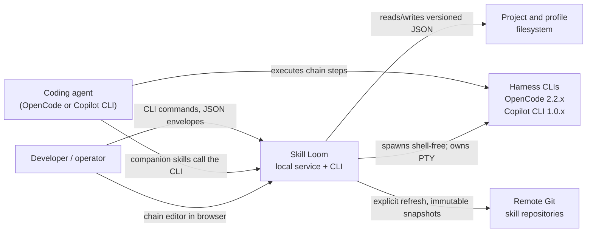
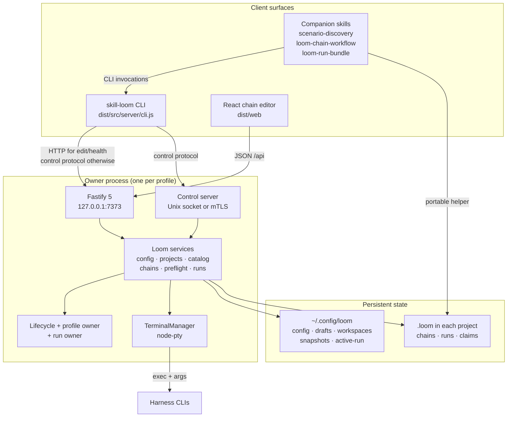
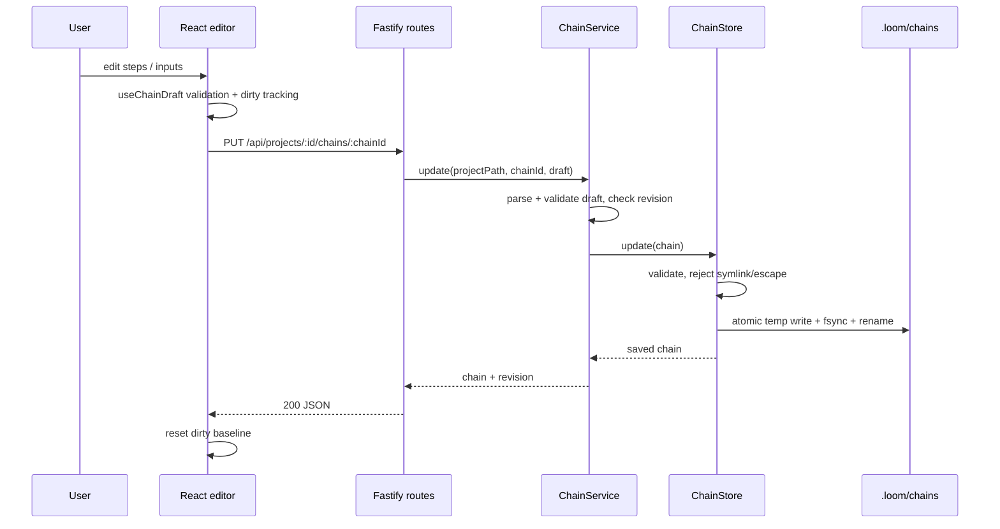
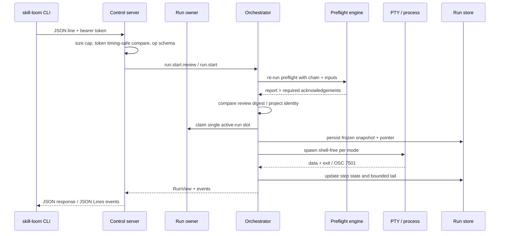
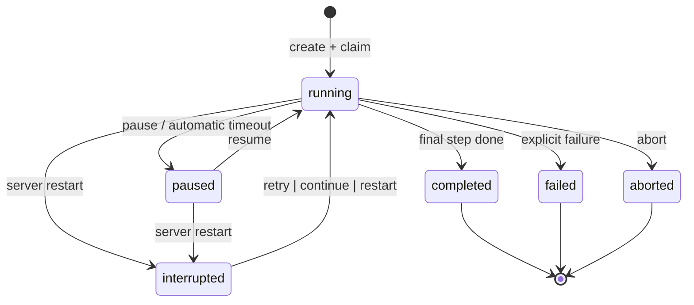
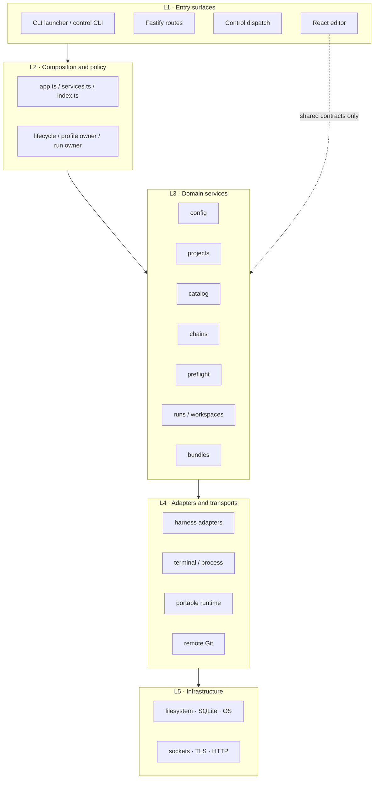
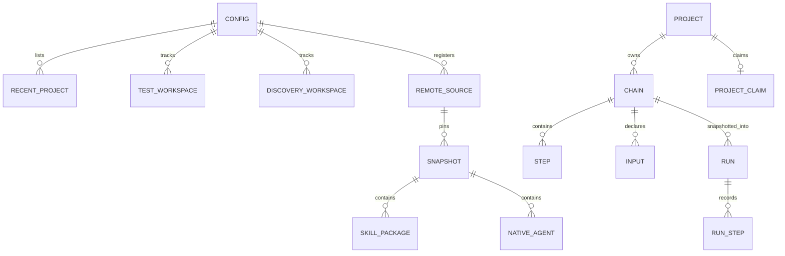

# Project Architecture Blueprint — Skill Loom

*Generated: 2026-11-10 · Package version `0.1.0` · Configuration: `PROJECT_TYPE=Auto-detect`, `ARCHITECTURE_PATTERN=Auto-detect`, `DIAGRAM_TYPE=C4`, `DETAIL_LEVEL=Comprehensive`, `INCLUDES_CODE_EXAMPLES=true`, `INCLUDES_IMPLEMENTATION_PATTERNS=true`, `INCLUDES_DECISION_RECORDS=true`, `FOCUS_ON_EXTENSIBILITY=true`.*

This document is the reference for how Skill Loom is actually built. It describes the code that exists, not an aspirational pattern. File paths and symbols are named so a maintainer can go straight from this document to the implementation.

---

## 1. Architecture Detection and Analysis

### 1.1 Technology stack detected

| Concern | Technology | Evidence |
|---|---|---|
| Runtime | Node.js `>=24`, ESM (`"type": "module"`) | `package.json` engines/type |
| Language | TypeScript `7.0.2`, strict mode, `noUncheckedIndexedAccess`, `exactOptionalPropertyTypes` | `tsconfig.json` |
| HTTP server | Fastify `5.12.8`, `@fastify/static` `10.1.9` | `package.json`, `src/server/app.ts` |
| Browser UI | React `19.3.1`, React DOM, Vite `8.3.5` | `package.json`, `vite.config.ts` |
| Terminal | `node-pty` `1.1.0`, server-owned PTY sessions | `src/server/terminal/pty.ts` |
| Contracts/validation | Zod `4.6.7`, YAML `2.9.1` | `src/server/**/model.ts`, `config/schema.ts`, `catalog/frontmatter.ts` |
| Persistence | Versioned JSON files with atomic replacement; SQLite for profile/claim locks | `config/store.ts`, `runs/store.ts`, `shared/project-claim.ts` |
| Tests | Vitest `5.1.0`, 60 suites under `tests/unit` and `tests/integration` | `vitest.config.ts`, CI |
| Packaging | npm tarball, postinstall native PTY helper, GitHub Actions matrix | `scripts/package-smoke.mjs`, `.github/workflows/cross-platform-verification.yml` |

### 1.2 Architectural pattern detected

Skill Loom is a **local-first modular monolith** with a **ports-and-adapters** core and a **CLI-first control surface**.

- **Modular monolith**: one Node process serves the browser, owns persistence, spawns harnesses, and exposes a local control endpoint. There is no separately deployed backend service.
- **Layered server**: composition root → routes/control dispatch → domain services → stores → filesystem/processes.
- **Ports and adapters**: harness differences live behind `HarnessAdapter`; skill discovery differences live behind `CatalogAdapter`; run execution uses runner strategies (`SupervisedRunner`, `AutomaticRunner`).
- **Command/control split**: most mutations and all run execution go through a private, authenticated local control protocol; the HTTP surface is deliberately minimal.
- **Local-first security**: loopback-only with no authentication for the browser surface, private-socket or mutually authenticated TLS for control.
- **Document-oriented persistence**: versioned JSON documents with Zod schemas, atomic replacement, corruption quarantine, and frozen run snapshots.

The classic labels “Clean Architecture” or “Hexagonal” only partly apply. Domain modules do not depend on Fastify, but they do use Node built-ins directly, and several shared contract modules import server model types. The accurate description is **modular monolith with adapter seams**, not a textbook clean-architecture dependency inversion everywhere.

---

## 2. Architectural Overview

### 2.1 Guiding principles evident in the code

1. **The server owns every side effect.** Filesystem, Git, process, PTY, and network operations happen in `src/server`. The browser and CLI are typed clients (`README.md` Architecture; `src/server/cli.ts`).
2. **One composition root.** `buildApp()` in `src/server/app.ts` constructs config, services, run ownership, terminal management, routes, and error handling. Tests inject the same seams.
3. **Harness differences are data, not branches.** Routes, preflight, and runners consume `HarnessDescriptor`/`HarnessAdapter`; they do not compare `'opencode'` or `'copilot'` (`src/server/harness/types.ts`, `runs/orchestrator.ts` header).
4. **Runs are frozen and bounded.** A run snapshots its chain at creation and retains only a bounded terminal tail (`src/server/runs/model.ts`, `terminal/pty.ts`).
5. **Persistence is versioned and atomic.** Config, chains, and runs have explicit versions, Zod validation, same-directory temporary files, fsync, and rename (`config/store.ts:atomicWriteJson`).
6. **Explicit signals beat heuristics.** Automatic runs advance only on `osc-working-idle` or `process-exit`; supervised runs advance only when the user says so (`runs/automatic.ts`, `runs/supervised.ts`, ADR-0007).
7. **Irreversible actions are reviewed.** Mutating CLI operations and run starts use digests plus explicit confirmations (`control.ts`, `runs/reviewed-start.ts`, ADRs 0025–0026).
8. **Identity is deterministic.** Project ids, skill ids, agent ids, chain revisions, run revisions, and bundle fingerprints are content- or path-derived hashes (`projects/registry.ts`, `catalog/types.ts`, `chains/service.ts`, `runs/orchestrator.ts`, `portable/bundle.ts`).
9. **Uncertainty is surfaced, never guessed.** Ambiguous auth/trust becomes an acknowledgement-required preflight finding; unobservable skill firing becomes `not-observable` (`preflight/engine.ts`, `runs/observations.ts`).
10. **The product is CLI/skill-driven with one web screen.** The web UI is only the chain editor (ADR-0027, ADR-0028).

### 2.2 Architectural boundaries

| Boundary | Enforcement |
|---|---|
| Browser ↔ server | Loopback Fastify origin, same-origin shutdown check, shared JSON error envelope |
| CLI ↔ owner process | Private Unix socket or mutually authenticated loopback TLS; 256-bit bearer token; request size caps |
| Server ↔ harness | Shell-free executable + argument array; server-owned PTY/child process; adapter descriptors |
| Server ↔ filesystem | Canonical paths, symlink checks, safe filename patterns, atomic writes, bounded reads |
| Server ↔ remote Git | HTTPS/SSH only, explicit refresh, bounded staging, immutable snapshots, no execution |
| Web UI ↔ run execution | No run/workspace HTTP routes; execution is CLI/control-only |
| Portable helper ↔ managed server | Separate run records under `.loom/portable-runs`; opt-in project coordination protocol |

### 2.3 Notable hybrid or adapted patterns

- **CQRS-like split without separate models**: mutations flow through control operations; reads are small HTTP `GET`s. Both share the same domain services.
- **Strategy + registry**: run mode selects a runner strategy; harness/catalog registries resolve adapters.
- **Snapshot + pointer**: run documents are immutable-ish snapshots plus a single global `active-run.json` pointer for cross-project exclusivity.
- **Reviewed command pattern**: review produces a digest, the mutation re-computes and compares it, then requires `confirmed: true`.
- **Filesystem as database**: one JSON document per aggregate, guarded by naming conventions and atomic replacement rather than a transactional store.

---

## 3. Architecture Visualization

The Mermaid views below stay readable as text. The same revision also has an explorable form: [system map and run flows](docs/diagrams/skill-loom-architecture.html), [chain-save sequence](docs/diagrams/chain-save-sequence.html), and [portable handoff](docs/diagrams/portable-handoff-workflow.html).

### 3.1 C4 Level 1 — System context



### 3.2 C4 Level 2 — Containers



### 3.3 C4 Level 3 — Server components

```mermaid
flowchart LR
  subgraph Edge
    Routes["routes/<br/>health · server · chains · drafts"]
    Control["control.ts<br/>dispatch + transport"]
  end

  subgraph Domain
    ConfigS["config/store + schema"]
    ProjectS["projects/<br/>registry · paths · coordination"]
    CatalogS["catalog/<br/>merge · opencode · copilot · remote"]
    ChainS["chains/<br/>model · store · service · drafts · bundle"]
    Preflight["preflight/<br/>engine · auth · trust · trust-session"]
    Runs["runs/<br/>orchestrator · owner · store<br/>automatic · supervised · prompts"]
    Workspaces["workspaces<br/>test · discovery"]
    Bundles["bundles/<br/>reviewed-import · target-review"]
  end

  subgraph Adapters
    Harness["harness/<br/>types · registry · opencode · copilot"]
    PTY["terminal/pty"]
    Portable["portable/<br/>bundle · runtime · install"]
  end

  Edge --> Domain
  Domain --> Adapters
  Domain --> Store["versioned JSON + SQLite locks"]
  Adapters --> OS["filesystem · child_process · node-pty"]
```



### 3.4 Chain edit data flow



### 3.5 Control request and run start flow



### 3.6 Run lifecycle



The status vocabulary is defined in `src/server/runs/model.ts`; recovery actions are restricted to `retry`, `continue`, and `restart` in `orchestrator.ts`.

---

## 4. Core Architectural Components

### 4.1 CLI launcher and control client

**Purpose.** Entry point for users and skills. Parses command families (`service`, `edit`, `bundle`, `catalog`, `project`, `chain`, `run`, `workspace`, `discovery`), chooses HTTP or control transport, and prints JSON envelopes.

**Internal structure.** `src/server/cli.ts` (top-level routing, service lifecycle, browser opening), `src/server/control-cli.ts` (control-backed command grammar and help), `src/server/catalog/cli.ts`, `src/server/bundle-cli.ts`, `src/server/cli-input.ts` (strict stdin JSON).

**Interactions.** HTTP only for health/lifecycle and the editor's own API; everything else goes through `callControl`, `streamControlEvents`, or `attachControlTerminal`. The CLI never imports server domain internals to perform work; it calls the owner.

**Evolution.** Add a command by adding a control operation and a grammar entry, not by adding a second state owner.

### 4.2 Fastify composition root

**Purpose.** Build the server, validate loopback/port settings, construct services, decorate the instance, install hooks, mount routes, and standardize failures.

**Internal structure.** `src/server/app.ts`: `ServerConfigError` hierarchy, `assertLoopbackHost`, `assertValidPort`, `resolveServerSettings`, `buildApp`; `src/server/index.ts`: `startServer`, `installShutdownHandlers`, profile ownership, control startup.

**Interactions.** `buildApp` creates `LoomServices` via `createLoomServices`, `RunOwner` via `createRunOwner`, and `TerminalManager`. Decorators (`loomSettings`, `loomVersion`, `loomTerminalManager`, `loomLifecycle`, `loomRunOwner`, `loomServices`) expose them to plugins. `onRequest` rejects requests during shutdown; `onClose` shuts down PTYs and runs.

**Evolution.** New HTTP routes register in `routes/index.ts`; new cross-cutting decorators should be added to the `FastifyInstance` declaration at the bottom of `app.ts`.

### 4.3 Routes

**Purpose.** Minimal validated HTTP surface for the browser: health, lifecycle, shutdown, chain persistence, and draft persistence.

**Internal structure.** `routes/health.ts`, `routes/server.ts`, `routes/chains.ts`, `routes/drafts.ts`, `routes/index.ts`.

**Interactions.** Routes validate params/body with Zod, call one service method, and map typed errors to the shared envelope. `onRequest` lifecycle gating and `setErrorHandler`/`setNotFoundHandler` are global.

**Evolution.** Keep routes thin. Any operation that mutates runs or workspaces belongs in control, not HTTP (ADR-0027/0028).

### 4.4 Service composition

**Purpose.** One place that wires configuration, project registry, catalog, chains, drafts, preflight, and workspaces.

**Internal structure.** `src/server/services.ts:createLoomServices`, returning `LoomServices`.

**Interactions.** Lazily creates the global draft service. Injected stores/services are honored for tests. `control.ts` can create the same services when started standalone.

**Evolution.** Add a domain service here and thread it through `LoomServices`, then inject into routes/control; do not construct it ad hoc inside handlers.

### 4.5 Configuration

**Purpose.** Versioned global preferences: harness command overrides, extra skill directories, remote sources, recent projects, workspaces, and discovery settings.

**Internal structure.** `config/schema.ts` (Zod schemas, `CONFIG_VERSION = 2`, v1 migration), `config/store.ts` (`ConfigStore`, `atomicWriteJson`, serialized updates), `config/canonical-root.ts`.

**Interactions.** Every service receives a `ConfigStore`; project registration, remote refresh, workspace creation, and control operations all use `update()` read-modify-write with per-target in-process queues.

**Evolution.** Bump `CONFIG_VERSION` only with an explicit migration branch and a test that rejects unknown versions.

### 4.6 Projects

**Purpose.** Register canonical project directories, derive stable ids, create `.loom` state, and coordinate access.

**Internal structure.** `projects/registry.ts` (canonicalization, `projectIdForPath`, recent-project persistence, Git init), `projects/paths.ts` (typed path errors), `projects/coordination.ts` (reviewed coordination actions), `shared/project-claim.ts` (SQLite claim/transaction), `shared/project-run-records.ts` (bounded run-record scan), `shared/project-coordination.ts` (protocol review).

**Interactions.** Projects are addressed by id in API/control; services resolve id → canonical path. Managed test/discovery workspaces are projects with `managedWorkspace: true`, hidden from ordinary listings.

**Evolution.** New project-scoped data belongs under `.loom/` and must be added to the project `.gitignore` policy.

### 4.7 Catalog

**Purpose.** Discover local, bundled, project, and pinned remote skills and native agents; merge deterministically; search; copy into projects.

**Internal structure.** `catalog/merge.ts` (`CatalogService`, adapter registry, merge order, performance budget), `catalog/opencode.ts`, `catalog/copilot.ts`, `catalog/frontmatter.ts`, `catalog/types.ts` (stable ids, source order), `catalog/remote.ts` (Git snapshot ingestion), `catalog/project-pages.ts` (paged project views), `catalog/agent-copy.ts`, `catalog/skill-resolution.ts`, `catalog/discovery-handoff.ts`.

**Interactions.** Discovery adapters return harness-neutral entries. Duplicate names are preserved with source badges. Remote snapshots are immutable and refreshed only on explicit request. Preflight resolves a chain step’s skill against the catalog.

**Evolution.** Add a harness by adding a `CatalogAdapter`; do not special-case it in merge or routes.

### 4.8 Chains

**Purpose.** Define, validate, persist, duplicate, import, export, and version chains.

**Internal structure.** `chains/model.ts` (`ChainSchema`, versions, steps, inputs, session modes, agent selection, warnings), `chains/store.ts` (`ChainStore`, safe ids, symlink checks, atomic writes, corrupt-file warnings), `chains/service.ts` (`ChainService`, revisions, copy naming, import), `chains/drafts.ts` (global draft store), `chains/bundle.ts` (export/import bundles), `chains/presets.ts`, `chains/git-file-modes.ts`.

**Interactions.** Routes and control both call `ChainService`. Project chains live in `<project>/.loom/chains`; drafts in `~/.config/loom/drafts`. Bundle export resolves skills deterministically and embeds package files plus optional native agent.

**Evolution.** Chain schema changes require version handling, migration tests, editor updates, and bundle compatibility review.

### 4.9 Preflight

**Purpose.** Deterministically decide whether a chain can run and what the user must acknowledge.

**Internal structure.** `preflight/engine.ts` (ordered checks: chain, request, project, harness, inputs, CLI, catalog, skill, agent, authentication, trust, session-mode, fork, permissions, git), `preflight/auth.ts` (redacted evidence), `preflight/trust.ts`, `preflight/trust-session.ts`, `preflight/manual-command.ts`, `preflight/provider.ts`, `preflight/request.ts`.

**Interactions.** Preflight runs before run creation and again for reviewed starts/actions. It reads catalog, harness descriptors, config, trust files, and Git status. It never spawns a harness.

**Evolution.** Add a check with a stable `id`/`key`, an explicit severity, remediation text, and tests for every status. A warning never blocks; ambiguity requires acknowledgement.

### 4.10 Harness adapters

**Purpose.** Encapsulate every harness-specific command, flag, discovery strategy, trust behavior, session/fork capability, permission flag, and advancement signal.

**Internal structure.** `harness/types.ts` (`HarnessDescriptor`, `HarnessAdapter`, `StepInvocation`, executable resolution), `harness/registry.ts` (`createHarnessAdapter`, `createHarnessRegistry`, unsupported-id errors), `harness/opencode.ts`, `harness/copilot.ts`.

**Interactions.** Preflight reads descriptors; orchestrator/runner build commands; trust session service builds trust/manual commands; catalog adapters are separate but aligned.

**Evolution.** See §13.1 for the full checklist.

### 4.11 Runs

**Purpose.** Own the complete run lifecycle: preflight, snapshot, input resolution, single-active-run claim, runner selection, event streaming, persistence, recovery, and cleanup.

**Internal structure.**

| Module | Responsibility |
|---|---|
| `runs/orchestrator.ts` | Only owner of run lifecycle; action vocabulary, revision, recovery |
| `runs/owner.ts` | Lazy orchestrator creation, startup recovery, mutation blocking, shutdown |
| `runs/store.ts` | Project run documents + global active-run pointer |
| `runs/model.ts` | Zod run/step/status schemas, bounded tails, interruption |
| `runs/automatic.ts` | Signal-driven state machine (`osc-working-idle`, `process-exit`) |
| `runs/supervised.ts` | One process per step; explicit user advancement |
| `runs/prompts.ts` | Step prompt assembly, session planning, handoff |
| `runs/osc.ts` | OSC 7501 parser/state machine |
| `runs/observations.ts` | Best-effort skill-firing evidence |
| `runs/headless-process.ts` | Shell-free child-process adapter |
| `runs/process-cleanup.ts` | Dispose/kill/wait helpers |
| `runs/reviewed-start.ts`, `reviewed-start` flows | Digest + confirmation contract |
| `runs/test-workspaces.ts`, `discovery-workspaces.ts`, `workspace-*.ts` | Retained managed workspaces, locks, inspection, bounded evaluation |
| `runs/handoff.ts`, `project-reconciliation.ts` | Recovery and handoff evidence |

**Interactions.** The orchestrator consumes `ChainService`, `HarnessRegistry`, `PreflightEngine`, `ProjectRegistry`, `RunStore`, `TerminalManager`, and spawner seams. It broadcasts `RunStreamMessage` events; control streams them as JSON Lines.

**Evolution.** New run modes are runner strategies behind the orchestrator; never bypass the active-run claim or persistence.

### 4.12 Terminal transport

**Purpose.** Server-owned PTY sessions with bounded output, subscriber fan-out, resize/write, and idempotent shutdown.

**Internal structure.** `terminal/pty.ts`: `TerminalSession`, `TerminalManager`, `TerminalOutputBuffer`, `trimTerminalOutput`, `createTerminalManager`.

**Interactions.** Supervised runs keep one stable terminal id across steps; automatic PTY-backed runs reuse the run terminal id. CLI `run attach` and control terminal attachments subscribe to the same session.

**Evolution.** Any new streaming surface must preserve bounded tails and cleanup on `onClose`.

### 4.13 Portable helper

**Purpose.** Execute exported bundles without the Skill Loom service, using the same bundle format and safety rules.

**Internal structure.** `portable/bundle.ts` (bundle v1/v2 schema, path validation, fingerprints), `portable/runtime.ts` (install, status, step, record, resume), `portable/install-skill.ts`, `portable/installed-modes.ts`, `portable/run-schema.ts`, `portable/cli.ts`.

**Interactions.** Writes `.loom/portable-runs/*.json`, installs bundle skills into the selected project skill root, optionally participates in project coordination. It is distributed as `dist/skills/loom-run-bundle`.

**Evolution.** Bundle schema changes must keep `parseBundle` strict, preserve `MAX_*` limits, and update the standalone skill guide.

### 4.14 Shared contracts

**Purpose.** Types and helpers used by server, web, and portable code: API envelope, chain shape, bundle shape, terminal messages, remote catalog limits, discovery handoff, coordination, run records.

**Internal structure.** `src/shared/api.ts`, `chain.ts`, `bundles.ts`, `terminal.ts`, `remote-catalog.ts`, `discovery-handoff.ts`, `project-claim.ts`, `project-coordination.ts`, `project-run-records.ts`, `sync-directory.ts`.

**Interactions.** The web client imports shared API/chain types; server routes return shared envelopes; portable code imports shared bundle/claim contracts.

**Evolution.** Keep shared modules dependency-light. Today some shared modules import server model types; moving those types into shared would remove the logical inversion (see §5.4).

### 4.15 Web chain editor

**Purpose.** The only browser screen: reorder steps, edit instructions, manage named inputs, validate, and save a draft or project chain.

**Internal structure.** `web/main.tsx`, `web/App.tsx` (route table), `web/router.tsx` (custom history router with guards), `web/routes/ChainEditorPage.tsx`, `web/hooks/useChainDraft.ts` (editor state machine), `web/components/` (`ChainFlow`, `StepEditor`, `StepList`, `InputsEditor`, `StatusRegion`, `HelpPopover`, `InlineError`, `ErrorBoundary`), `web/api/` (typed fetch clients), `web/ThemeProvider.tsx`, `web/styles/theme.css`, `web/help/topics.ts`.

**Interactions.** Calls only `/api/drafts` and `/api/projects/:id/chains`. It has no run, workspace, catalog, or project-management screens.

**Evolution.** Preserve keyboard semantics, focus management, live announcements, and the dirty-navigation guard when changing the editor.

### 4.16 Companion skills and maintainer agents

**Purpose.** Teach a coding agent how to use the CLI, discover skills, run bundles, and maintain the repository.

**Internal structure.** `.github/skills/**` is canonical; `scripts/build-portable-skill.mjs` generates `dist/skills/**` and mirrors `skill/**` and `.opencode/skills/**`. `.opencode/agents/**` defines maintainer agents. Project copies install to `<project>/.agents/skills`, with legacy OpenCode discovery preserved.

**Interactions.** Skills invoke the CLI as a subprocess; they do not import server code. Documentation and mirrors are validated by `npm run check`.

---

## 5. Architectural Layers and Dependencies

### 5.1 Layer map



### 5.2 Dependency rules as implemented

- `src/web/**` may import `src/shared/**` and its own modules. It must not import `src/server/**`.
- `src/server/**` may import `src/shared/**` and `src/portable/**` (the CLI delegates to portable for bundle commands), but must not import `src/web/**`.
- `src/portable/**` may import `src/shared/**` and a small set of **server leaf modules** (`catalog/frontmatter.ts`, `chains/model.ts`, run model helpers). It must not import Fastify, routes, or the orchestrator.
- Routes/control depend on service interfaces, not concrete file stores, wherever a seam exists.
- Harness names are not compared outside adapter construction/registry and a few explicit capability checks that read descriptor fields.
- Persistence modules depend on Node built-ins and Zod; they do not depend on Fastify or React.

### 5.3 Dependency injection style

Skill Loom uses **constructor/options injection with production defaults**, not a DI container:

```ts
// src/server/services.ts (excerpt)
const catalogService =
  options.catalogService ?? createCatalogService({ configStore: options.configStore });
const projectRegistry = createProjectRegistry({
  configStore: options.configStore,
  ...(options.gitInit === undefined ? {} : { gitInit: options.gitInit }),
});
```

Every seam is an optional function or object in an options interface. `BuildAppOptions` in `app.ts` is the widest example: config store, catalog, chain service, version, logger, web root, terminal manager, Git init, harness registry, preflight engine/runner/readers/env, orchestrator, clock, id generator, PTY spawner, automatic spawner, step timeout, and allowed origins.

### 5.4 Layer violations and boundary risks

| Observation | Impact | Guidance |
|---|---|---|
| `src/shared/bundles.ts` imports `Chain`/`ChainStep` from `src/server/chains/model.ts` | Shared contracts are not fully independent; portable/web bundles pull a server type module | Prefer moving chain/run document types to `src/shared`; if not, keep these imports type-only and leaf-safe |
| `src/shared/project-run-records.ts` imports `parseRunDocument` | Shared scanning logic depends on server run validation | Acceptable today for portable use; document the dependency direction |
| `src/portable/*` imports server leaf modules | Portable is not source-independent from the server tree | Treat those modules as a stable “portable kernel”; avoid adding dependencies on routes/orchestrator |
| `buildApp` and `startServer` both call startup recovery | Duplicate recovery path, though idempotent | Keep recovery idempotent; test both entry paths |
| Editor API and control API share services but not one transport | Two mutation surfaces, one domain | Do not add run/workspace mutations to HTTP; keep review digests in control |
| JSON files are not cross-file transactional | Partial failure can leave a pointer or workspace record inconsistent | Use ordering, idempotent recovery, locks, and explicit reconciliation; never assume a multi-file atomic commit |

No circular module dependency was found between `web`, `server`, and `portable` directories at the directory level. The shared→server type imports are the main logical inversion.

---

## 6. Data Architecture

### 6.1 Domain model



Core documents:

- **Config** (`version: 2`): harness commands, extra skill directories, remote sources, project catalog pages, recent projects, test/discovery workspaces, discovery settings, remote limits.
- **Chain** (`CHAIN_VERSION`): id, name, harness, session mode, steps (skill or instruction), inputs, automatic-permission opt-in, optional pinned native agent, timestamps.
- **Run** (`RUN_VERSION`): frozen chain snapshot, mode, status, steps with status/tail/attempts/reason, session plan, project/test-workspace identity, skill observations, revision.
- **Bundle** (`version: 1 | 2`): chain, skill packages with content and fingerprints, optional selected agent plus agent inventory.
- **Discovery handoff**: goal, harness, pinned candidate identities, selected package files, fingerprints, size bounds.

### 6.2 Persistence locations

| Location | Data | Durability strategy |
|---|---|---|
| `~/.config/loom/config.json` | Global config | Atomic write, versioned schema, v1 migration |
| `~/.config/loom/drafts/*.json` | Draft chains | Same chain store as projects |
| `~/.config/loom/profile-owner.sqlite` | Profile ownership lock | SQLite/OS lock |
| `~/.config/loom/control.json` | Control endpoint + capability (and TLS credentials on Windows) | Private file, process-owned |
| `~/.config/loom/active-run.json` | Global active pointer | Atomic write |
| `~/.config/loom/test-workspaces/<uuid>` | Retained managed test projects | Project registry + config records |
| `~/.config/loom/discovery-workspaces/<uuid>` | Discovery handoff, managed project, results | Same |
| `~/.config/loom/catalog-sources/<source>/<commit>` | Immutable remote snapshots | Content-addressed directories |
| `<project>/.loom/chains/*.json` | Project chains | Atomic write + safe id/symlink checks |
| `<project>/.loom/runs/*.json` | Run snapshots | Atomic write + bounded tails |
| `<project>/.loom/portable-runs/*.json` | Portable helper runs | Atomic write, separate from managed runs |
| `<project>/.loom/project-claim.sqlite` | Coordination claim | SQLite transactions |

### 6.3 Access patterns

- **Repository/store**: `ChainStore`, `RunStore`, `ConfigStore` hide filesystem details behind async interfaces.
- **Factory per project**: `ChainService` uses a `ChainStoreFactory`; `RunStore` is created per project path.
- **Read-modify-write**: config updates are serialized per target in-process (`enqueueWrite`) to avoid lost updates; cross-process safety comes from single-owner design.
- **Snapshot isolation**: a run stores its own chain copy; later chain edits never change a run.
- **Bounded reads**: run tails cap at 200 lines or 32 KiB per step; remote/handoff/bundle inputs have explicit byte/file/package caps; directory scans have limits (1,000 records / 64 MiB for portable coordination).
- **Corruption handling**: invalid files are reported as warnings with stable codes; list operations keep going; read-by-id raises a typed error. There is no silent repair.

### 6.4 Identity and integrity

| Identity | Derivation |
|---|---|
| Project id | slug + first 12 hex of SHA-256(canonical path) |
| Chain revision | SHA-256 of canonical chain JSON (`chainRevision`) |
| Run revision | SHA-256 of run JSON (`runRevision`) |
| Bundle fingerprint | SHA-256 of the serialized bundle |
| Snapshot id | Source + commit/revision |
| Skill id | Source kind + harness + package identity |
| Native agent id | Harness + source + path + fingerprint |
| Review digest | SHA-256 of the exact review evidence shown to the caller |

Integrity checks appear at bundle parse (file hashes/paths), agent copy (fingerprint), remote snapshot review, and run-start/action review. A digest is evidence that the reviewed payload has not changed; it is not proof a human reviewed it (documented in CLI help and ADRs).

### 6.5 Concurrency and retention

- **Single active run globally** via `~/.config/loom/active-run.json` and the run owner.
- **Single profile owner** via profile lock; control endpoint metadata is written by the owner.
- **Workspace lifecycle lock** prevents create/remove races.
- **Project coordination** (opt-in, versioned SQLite protocol) reconciles claims and prior run records across clients.
- **Retention is explicit**: test/discovery workspaces persist until `workspace remove`; remote snapshots persist after source unregistration; completed portable records should be archived by the operator.

---

## 7. Cross-Cutting Concerns

### 7.1 Security and authorization

- **Network**: loopback-only host assertion (`assertLoopbackHost`); shutdown route validates loopback host, same origin, JSON content type, per-instance token, and `confirm: true`.
- **Control**: Unix socket in a private temp/profile directory or Windows loopback TLS with generated client certificates; 32-byte bearer token; timing-safe comparison; 64 KiB request cap; 32-client cap; 5-second initial timeout; protocol version check.
- **Process execution**: no shell; executable + argument array; resolved from config or PATH; PTY input only from explicit attach/subscribe surfaces.
- **Filesystem**: canonical paths, absolute-path requirements, safe id regexes, symlink/regular-file checks, private directory modes, output published with `link` to avoid overwrite.
- **Remote content**: validated Git remotes, bounded staging, immutable snapshots, fingerprints, no execution of fetched content.
- **Review gates**: mutations that change project state or start/advance runs require a digest and explicit confirmations; skill-bearing runs remain blocked where unverified.

### 7.2 Error handling and resilience

- A **typed error family** per module (`ConfigError`, `ChainStoreError`, `RunStoreError`, `RunOrchestratorError`, `HarnessError`, `ControlError`, `BundleError`, etc.) with stable codes and safe details.
- Control `failure()` maps known errors to `{ ok: false, error }`; HTTP uses `createApiErrorEnvelope`; unknown errors become generic `INTERNAL_ERROR` without leaking internals.
- Cause chains are preserved where useful (`{ cause }`); details avoid prompts, credentials, terminal output, and file contents.
- Recovery: startup marks active runs `interrupted`; stale/ambiguous/claimed records are retained with warnings; active pointers are cleared only with evidence.
- Failure isolation: a corrupt chain/run file becomes a list warning, not a service outage; a failed workspace cleanup is typed and retryable.

### 7.3 Logging and observability

- Fastify request logging is injectable (disabled by default `logger: false`; enabled by the CLI `startServer`).
- Server logs record unhandled 5xx errors with `{ err }` but respond generically.
- Run recovery emits structured warning codes (`RUN_RECOVERY_AMBIGUOUS`, `RUN_RECOVERY_CLAIMED`).
- Health endpoint reports status, version, config directory, port, and active-run summary.
- No metrics/tracing subsystem exists; observability is logs, JSON envelopes, run records, and live evidence files under `docs/evidence/`.

### 7.4 Validation

Validation is distributed by responsibility:

| Layer | Validates |
|---|---|
| Route/control input | Zod request schemas, strict objects, size caps |
| Chain model | Chain shape, versions, steps, inputs, placeholders, session mode |
| Stores | Decoded document schema, ids, paths, versions, file type/symlink |
| Preflight | Chain, project, harness, catalog, skills, agent, auth, trust, permissions, git |
| Review layer | Recomputed digest vs reviewed digest, confirmations |
| Runtime | Session ids, shell-free args, input values, timeouts, process identity |

Business rules that must survive reload (for example “a run must never mutate after final status”) are enforced in domain functions, not only routes.

### 7.5 Configuration management

- Global config is a versioned JSON document; environment overrides are explicit and read per operation: `LOOM_CONFIG_DIR`, `LOOM_HOST`, `LOOM_PORT`, `LOOM_DEV_SUPERVISOR`.
- Harness executable overrides live in config (`harnessCommands`), with PATH fallback and typed resolution evidence.
- No secrets are stored in config for harness auth; Skill Loom reads local evidence and never writes Copilot trust.
- Test seams are option fields, not environment hacks.

### 7.6 Accessibility

The editor implements skip-to-content, `aria-live` status announcements, focus-visible styling, keyboard reordering, modal step editing, non-color status text, and a dirty-navigation guard. These are part of the architecture because the web surface is small and must remain fully operable without a mouse.

### 7.7 Privacy

- Run tails are bounded and never full transcripts.
- Auth evidence is redacted.
- Evidence JSON is privacy-reviewed before check-in.
- Control metadata and TLS credentials are private and excluded from backups/commits.
- Project paths are persisted by design; users are told how to back up and clean them.

---

## 8. Service Communication Patterns

### 8.1 HTTP API

- **Style**: REST-ish JSON over loopback; no version prefix in paths.
- **Success**: decoded resource or `{ chain, revision }`-style object.
- **Failure**: one envelope, `{ error: { code, message, details? } }`.
- **Surface**: `/api/health`, `/api/server/lifecycle`, `/api/server/shutdown`, `/api/projects/:projectId/chains[...]`, `/api/drafts[...]`.
- **Versioning**: additive fields; chain/run/config documents carry explicit versions; unknown document versions are rejected.

### 8.2 Local control protocol

- **Transport**: Unix domain socket (non-Windows) or mutual TLS on loopback (Windows).
- **Framing**: one newline-delimited JSON request per connection; one JSON response; event subscriptions stream JSON Lines.
- **Envelope**: `{ version, token, operation, input }`; response `{ protocolVersion, ok, result | error }`; events `{ protocolVersion, ok, event }`.
- **Operations**: grouped by `status`, `service.stop`, `project.*`, `draft.*`, `chain.project.*`, `bundle.*`, `run.*`, `workspace.*`, `catalog.*`, `discovery.handoff`.
- **Idempotency and concurrency**: mutation blocking during run operations; control returns `CONTROL_BUSY` rather than interleaving.
- **Resilience**: protocol version mismatch is explicit; stale endpoints are removed only after safe checks; sockets and active operations are drained on close.

### 8.3 Process and PTY communication

- **Supervised**: one fresh harness process per step on a stable PTY; exit is a signal only; user decides advancement.
- **Automatic**: either PTY + OSC 7501 working→idle edge, or headless process exit; bounded per-step timeout pauses instead of guessing.
- **Backpressure/retention**: output is fanned out to subscribers and trimmed at append time; no unbounded transcript.
- **Cleanup**: `disposeAndWait` and terminal manager shutdown ensure children do not orphan.

### 8.4 Git and remote catalog

- Remote sources are registered explicitly with validated HTTPS/SSH URLs.
- Refresh stages content under limits, validates packages/agents, computes fingerprints, and publishes an immutable snapshot.
- No command executes fetched content; copying/installation is a separate reviewed action.
- Bundle export/import is file-based and content-addressed; import is reviewed with digests and confirmations.

### 8.5 Agent/skill integration

Companion skills invoke the CLI with JSON stdin and parse JSON stdout. The portable `loom-bundle.mjs` is a separate entry point for service-free execution. Neither path depends on the browser UI.

---

## 9. Technology-Specific Architectural Patterns

### 9.1 Node.js / TypeScript / Fastify

- **ESM everywhere**, `.js` extensions in TypeScript imports, `NodeNext` for server and `Bundler` for web.
- **Composition root + decorators** rather than global singletons; `FastifyInstance` is augmented with loom-specific properties.
- **Plugin registration** for routes and static files; global hooks for lifecycle/error/not-found handling.
- **Strict types**: `exactOptionalPropertyTypes` forces explicit optional-field handling; `noUncheckedIndexedAccess` forces array safety.
- **Async I/O** with Node `fs/promises`, `net`, `tls`, `crypto`, `child_process`; no ORM.
- **Zod at boundaries** and in document parsing; domain functions operate on inferred types.

### 9.2 React

- **Custom router** (`web/router.tsx`) instead of a dependency: history API, `useSyncExternalStore`, push/replace, modified-click preservation, and a capture-phase navigation guard for dirty screens.
- **Hook-owned editor state** (`useChainDraft`): draft document, local row identity, validation, dirty baseline, save mutation, abort handling.
- **Typed API clients** (`web/api/*`) with a single `requestJson` that decodes the shared error envelope.
- **Provider composition** in `App.tsx`: Router → Theme → StatusAnnouncer → HelpPopover.
- **Accessibility as structure**: semantic sections/headings, native `<dialog>`, live regions, real anchors for links, focus restoration.
- **No global state library**; server state is fetched per screen and local editor state is explicit.

### 9.3 Testing and build tooling

- Vitest with Node environment, 15-second timeouts, mock restoration/clearing.
- Vite builds the SPA to `dist/web`; Fastify serves it from the same origin.
- `tsx` runs TypeScript scripts and live probes.
- CI runs typecheck, docs gate, tests, and package smoke on Linux/macOS/Windows, plus Node 26 on Ubuntu.

---

## 10. Implementation Patterns

### 10.1 Adapter contract

```ts
// src/server/harness/types.ts (excerpt)
export interface HarnessAdapter extends HarnessDescriptor {
  resolveExecutable(): ResolvedExecutable;
  createSessionId(): string;
  isSessionId(value: string): boolean;
  supportsSessionMode(mode: string): mode is ChainSessionMode;
  assertSessionMode(mode: string): ChainSessionMode;
  buildInteractiveCommand(invocation: StepInvocation): HarnessCommand;
  buildHeadlessCommand(invocation: StepInvocation): HarnessCommand;
  buildTrustCommand?: ((options: { projectPath: string }) => HarnessTrustCommand) | undefined;
}
```

Descriptors are serializable capability data. Methods are limited to executable resolution, session identity, command construction, and trust. They never spawn.

### 10.2 Registry pattern

```ts
// src/server/harness/registry.ts (excerpt)
export function createHarnessAdapter(harness: string, options: HarnessAdapterOptions = {}): HarnessAdapter {
  if (harness === 'opencode') return createOpenCodeAdapter(options);
  if (harness === 'copilot') return createCopilotAdapter(options);
  throw new HarnessUnsupportedError(harness, HARNESS_IDS);
}
```

The registry is the only place that maps ids to concrete adapters. Order is frozen so capability listings are deterministic. Listing always works even when a CLI is absent.

### 10.3 Typed error taxonomy

```ts
// src/server/runs/orchestrator.ts (excerpt)
export class RunOrchestratorError extends Error {
  readonly code: RunOrchestratorErrorCode;
  readonly details: Record<string, unknown>;
  constructor(code, message, details = {}, options: { cause?: unknown } = {}) {
    super(message, options.cause === undefined ? undefined : { cause: options.cause });
    this.name = new.target.name;
    this.code = code;
    this.details = details;
  }
}
```

Pattern: stable code union → class → safe details → route/control maps code to transport response. Never branch on message text or raw errno.

### 10.4 Atomic persistence

```ts
// src/server/config/store.ts (excerpt)
const temporary = join(directory, `.${basename(target)}.${processId}.${makeTempId()}.tmp`);
handle = await openFile(temporary, 'w', 0o600);
await handle.writeFile(`${JSON.stringify(value, null, 2)}\n`, 'utf8');
await handle.sync();
await handle.close();
await renameFile(temporary, target);
await syncDirectory(directory);
```

Guarantees: same-directory temp file, `0600`, fsync file, atomic rename, fsync directory, temp cleanup on error, Windows `EPERM` retry, `EXDEV` surfaced as typed failure (no non-atomic fallback).

### 10.5 Service factory and store factory

```ts
// src/server/services.ts (excerpt)
export function createLoomServices(options): LoomServices {
  const catalogService = options.catalogService ?? createCatalogService({ configStore: options.configStore });
  const chainService = options.chainService ?? createChainService();
  let draftService: ChainService | undefined;
  const getDraftService = () => draftService ??= createGlobalDraftService(options.configStore.getConfigDir());
  return { configStore, projectRegistry, catalogService, chainService, getDraftService, preflightProvider, testWorkspaceService };
}
```

Use lazy initialization for services that are expensive or only sometimes used. Keep production defaults but allow complete injection for tests.

### 10.6 Review-then-mutate

```ts
// src/server/runs/reviewed-start.ts (excerpt)
const evidence = { version: 1, projectId, projectPath, projectDevice, projectInode,
  testWorkspaceId, chain, request: { ...request, mode }, preflight: report };
return { evidence, reviewDigest: startEvidenceDigest(evidence) };
```

The mutation re-runs preflight and compares the digest, project identity, and required confirmations before changing state. This prevents stale approvals and TOCTOU drift.

### 10.7 Runner strategy

- `SupervisedRunner` owns one process per step and never auto-advances.
- `AutomaticRunner` owns signal parsing, timeouts, pause-on-missing-signal, and process cleanup.
- Both consume the same prompt/session planner and run model helpers.
- The orchestrator selects the runner by mode, not by harness name.

### 10.8 Route pattern

1. Validate params/body with Zod.
2. Resolve project/chain via service.
3. Call one service method.
4. Map typed errors to status + envelope.
5. Return a stable response shape.

No business logic in handlers; no filesystem access in routes.

### 10.9 Bounded I/O

Every unbounded surface has a cap: request bytes, response bytes, terminal tail lines/bytes, step timeout, remote packages/files/bytes, handoff packages/files/bytes, bundle files/bytes, coordination record scan. New I/O should reuse these patterns rather than inventing unbounded reads.

---

## 11. Testing Architecture

### 11.1 Test layers

| Layer | Location | What it proves |
|---|---|---|
| Unit | `tests/unit/*.test.ts` | Model parsers, stores, adapters, preflight checks, runners, PTY behavior, CLI parsing, docs gate |
| Integration | `tests/integration/*.test.ts` | Fastify composition root, routes, control channel, run orchestration, platform-specific native scope |
| Live probes | `scripts/live-*.ts`, `tests/integration/live-*.test.ts` | Real harness discovery/execution, version probes, session continuation, managed runs |
| Package smoke | `scripts/package-smoke.mjs` | Tarball contents, install, service startup, authenticated control, clean shutdown |
| Docs gate | `scripts/check-docs.mjs` | Required headings, commands, safety statements, links/anchors, ADR index consistency, skill mirrors |

There are 60 Vitest suites. There is no browser E2E suite in the current tree; the web editor is covered by TypeScript checks and component-level expectations where present, while live harness behavior is verified by probes rather than mocked assertions.

### 11.2 Test boundary patterns

- **Injection over environment**: clock, ids, PTY spawner, process spawner, command runner, file readers, home directory, env, config store, and services are options.
- **Filesystem fixtures**: temporary directories; native scope fixtures for Linux/macOS/Windows; crash fixtures.
- **Contract tests**: shared envelope, bundle round-trip, chain/run schema versions, control protocol.
- **Negative-path tests**: corrupt files, symlink escapes, invalid ids, stale revisions, blocked preflight, failed cleanup, auth redaction.
- **Live evidence**: failed probes are retained with `failed` in the filename and never treated as acceptance evidence.

### 11.3 Test data and isolation

- Config directory overrides isolate profile state.
- Managed workspaces are disposable and hidden from recent projects.
- Integration tests build the real app with test seams rather than mocking Fastify.
- Run tests assert bounded tails, single-active-run conflicts, and interruption recovery.

---

## 12. Deployment Architecture

### 12.1 Build and package

```text
npm run build
  ├─ build:portable-skill  → dist/skills/** + checked-in mirrors
  ├─ build:web             → dist/web/** (Vite)
  └─ build:server          → dist/src/** (tsc) + copy scenario skills
```

The npm tarball contains `dist/src`, `dist/web`, `dist/skills`, the PTY helper installer, and `docs/OPERATIONS.md`. `postinstall` builds/installs the native PTY helper. The `bin` entry is `dist/src/server/cli.js`.

### 12.2 Runtime topology

- One owner process per profile, started by `skill-loom service start` or `skill-loom`/`edit`.
- Fastify listens on `127.0.0.1:7373` (or `LOOM_PORT`); it refuses non-loopback hosts.
- Static SPA served from `dist/web`; missing non-API GETs fall back to `index.html`.
- Control endpoint runs alongside HTTP in the same process.
- Harness CLIs are child processes/PTYs spawned on demand.
- All persistent state is local; no cloud dependency.

### 12.3 Platform adaptation

| Platform | Control transport | Notes |
|---|---|---|
| Linux/macOS | Private Unix socket under a private temp/runtime directory | Directory mode checks; path length guard |
| Windows | Mutually authenticated loopback TLS + client certificate/PFX | Requires protected private profile on local NTFS/ReFS; PowerShell helper; unsafe profiles rejected |

Native scope and identity have platform-specific tests and fixtures. CI runs the full verification matrix on Ubuntu, macOS, and Windows, plus Node 26 on Ubuntu.

### 12.4 Development topology

- `npm run dev` runs `scripts/dev-supervisor.mjs`: forks the backend with `LOOM_DEV_SUPERVISOR=1`, starts Vite, watches `src/server`, restarts on change, and coordinates graceful shutdown/restart.
- Vite proxies `/api` to `127.0.0.1:7373`; the server owns the API.
- `npm start` runs the built server.

### 12.5 Operations and upgrade path

- Back up the config directory and project `.loom` data; control metadata and active-run pointers are process state, not backup targets.
- Stop the service before upgrading; one owner per profile.
- Schema versions are explicit; older versions are rejected rather than silently reinterpreted.
- Live verification is opt-in and documented; evidence is retained separately from unit tests.

---

## 13. Extension and Evolution Patterns

### 13.1 Adding a harness

1. Extend `HARNESS_IDS` and `HarnessCommandsSchema` in `config/schema.ts`.
2. Implement `createXAdapter` in `src/server/harness/` returning a complete `HarnessAdapter` descriptor + methods.
3. Register it in `harness/registry.ts` (`createHarnessAdapter` and the ordered id list).
4. Add catalog discovery if the harness owns skill locations (`CatalogAdapter` in `catalog/merge.ts` + adapter file).
5. Add auth evidence strategy if needed (`preflight/auth.ts`, `PreflightProviderOptions.preflightAuthStrategies`).
6. Add trust behavior only if the harness has a folder dialog; otherwise set `behavior: 'none'`.
7. Add command builders for interactive/headless and session id rules.
8. Add preflight/session/fork/permission tests and update docs/ADRs.
9. Keep all harness-name comparisons inside adapter construction; consume descriptors elsewhere.

### 13.2 Adding a skill source

1. Extend `SkillSource`/`SKILL_SOURCES` ordering in `catalog/types.ts`.
2. Add discovery in the relevant adapter or a new adapter.
3. Define stable id derivation and source badge.
4. Add merge ordering, search behavior, and duplicate preservation tests.
5. If remote, add snapshot validation, limits, and provenance notices.

### 13.3 Adding an HTTP route

1. Add a Zod schema and handler in `src/server/routes/`.
2. Register it in `routes/index.ts`.
3. Keep it thin: one service call, typed error mapping.
4. Add integration coverage in `tests/integration/`.
5. Update the API contract if the browser consumes it.

Do not add run/workspace/catalog mutations to HTTP without revisiting ADR-0027/0028.

### 13.4 Adding a control operation

1. Add the operation to `dispatch()` in `control.ts` with a strict Zod input schema.
2. Add a CLI grammar entry in `control-cli.ts` (or the relevant CLI module).
3. Decide whether it needs review digest + confirmation.
4. Map known errors in `failure()`.
5. Add unit/control integration tests, including invalid/unauthorized/stale cases.
6. Update CLI help and the administrator/user guide.

### 13.5 Adding a persisted document or field

1. Add/extend a Zod schema with a version.
2. Add migration or explicit rejection for unknown versions.
3. Use `atomicWriteJson` and safe id/path validation.
4. Bound any list/scan/read.
5. Add corruption, version, and round-trip tests.
6. Update data-location docs and backup guidance.

### 13.6 Adding a run mode or runner

1. Add the mode to the preflight/run model and action vocabulary.
2. Implement a runner strategy behind the orchestrator.
3. Keep advancement explicit and bounded; no output-idle heuristics.
4. Reuse prompt/session planning, observation tracking, and cleanup helpers.
5. Add state-machine tests for every transition and failure.
6. Update ADRs and live verification scope.

### 13.7 Adding a platform surface

1. Add the transport/capability under `src/server/` (for example Windows control).
2. Provide a typed error and no-op fallback where safe.
3. Add platform-specific integration tests and fixtures.
4. Update CI matrix and operator docs.
5. Never weaken loopback/private-profile guarantees for convenience.

### 13.8 Modifying existing behavior safely

- **Backward compatibility**: document versions; add fields as optional; reject unknown versions.
- **Deprecation**: keep the old code path until tests and docs move; mark superseded ADRs rather than deleting them.
- **Migration**: explicit, tested, one-way where possible; never silently reinterpret old data.
- **Contract changes**: update shared types, CLI help, docs gate expectations, and skill mirrors together.

---

## 14. Architectural Pattern Examples

### 14.1 Capability descriptor (data over branching)

```ts
// src/server/harness/types.ts (excerpt)
export interface HarnessDescriptor {
  readonly id: HarnessId;
  readonly displayName: string;
  readonly executableName: string;
  readonly executableResolution: HarnessExecutableResolutionStrategy;
  readonly installHint: string;
  readonly discovery: HarnessDiscoveryDescriptor;
  readonly supportedSessionModes: readonly ChainSessionMode[];
  readonly nativeAgentSelection: { readonly interactive: boolean; readonly headless: boolean };
  readonly nativeFork: boolean;
  readonly forkMechanisms: HarnessForkMechanisms;
  readonly trust: HarnessTrustDescriptor;
  readonly automaticAdvancement: HarnessAdvancementSignal;
  readonly supervisedAdvancement: HarnessSupervisedAdvancement;
  readonly skillObservation: HarnessSkillObservation;
  readonly automaticPermissions: readonly string[];
  readonly requiresAutomaticPermissionOptIn: boolean;
  readonly permissionOptInField: 'automaticPermissionOptIn' | null;
}
```

Why: preflight, orchestrator, trust, and UI read the same data. Adding a harness does not add `if (harness === ...)` branches across the codebase.

### 14.2 Composition root (single wiring point)

```ts
// src/server/app.ts (excerpt)
const lifecycle = new ServerLifecycle();
const terminalManager = options.terminalManager ?? createTerminalManager();
const configStore = options.configStore ?? createConfigStore({ env });
const services = createLoomServices({ ...options, configStore, preflightEnv: options.preflightEnv ?? env });
const runOwner = createRunOwner({ ...options, configStore, projectRegistry, catalogService, chainService,
  preflightProvider: services.preflightProvider, terminalManager, preflightEnv: options.preflightEnv ?? env });

app.decorate('loomSettings', { host, port });
app.decorate('loomTerminalManager', terminalManager);
app.decorate('loomLifecycle', lifecycle);
app.decorate('loomRunOwner', runOwner);
app.decorate('loomServices', services);
```

Why: one place to see dependencies and one place to inject test seams. Routes and control receive services; they do not construct them.

### 14.3 Typed store interface

```ts
// src/server/chains/store.ts (excerpt)
export interface ChainStore {
  list(): Promise<ChainListResult>;
  read(chainId: string): Promise<Chain>;
  create(chain: Chain): Promise<Chain>;
  update(chain: Chain): Promise<Chain>;
  delete(chainId: string): Promise<void>;
}
```

Why: the store owns path safety, corruption handling, and atomic writes. The service owns revisions, copy naming, and validation. Routes own neither.

### 14.4 Explicit advancement state machine

```ts
// src/server/runs/automatic.ts (header excerpt)
// - `osc-working-idle` (OpenCode): one PTY process per step. A step advances
//   only when `OSC 7501;state=idle` follows `state=working` in the same step.
// - `process-exit` (Copilot): one headless process per step. A step advances
//   only when that process exits; a non-zero exit fails the step.
// There is deliberately no output-idle heuristic, no animation-quiescence
// check, and no fixed sleep that can advance a step.
```

Why: removes a whole class of flaky, unsafe progression bugs and makes behavior testable with a deterministic state machine.

### 14.5 Browser API client (single envelope decode)

```ts
// src/web/api/client.ts (excerpt)
export async function requestJson<T>(path, options = {}, fetchImpl = fetch): Promise<T> {
  // ...
  if (!response.ok) {
    if (isApiErrorEnvelope(payload)) {
      throw new ApiClientError(payload.error.message, {
        code: payload.error.code, status: response.status, details: payload.error.details,
      });
    }
    // ...
  }
  return payload as T;
}
```

Why: every screen gets consistent, render-safe errors; raw response bodies never leak.

### 14.6 Review digest contract

```ts
// src/server/runs/reviewed-start.ts (excerpt)
export function startEvidenceDigest(value: unknown): string {
  return createHash('sha256').update(JSON.stringify(value)).digest('hex');
}
```

Why: the review and the mutation share one canonical evidence object. If the chain, project identity, preflight report, or required confirmations change, the digest changes and the mutation is rejected as stale.

### 14.7 Bounded terminal buffer

```ts
// src/server/terminal/pty.ts (excerpt)
export function trimTerminalOutput(text: string, maxLines = DEFAULT_MAX_TAIL_LINES, maxBytes = DEFAULT_MAX_TAIL_BYTES): string {
  // keep newest lines, then newest bytes; never split a UTF-8 continuation byte
}
```

Why: reconnects and run records stay useful without retaining unbounded model output.

---

## 15. Architectural Decision Records

The durable decisions live in `docs/adr/`. The index is authoritative; this table is a navigation aid and must not diverge from it.

| ADR | Decision | Architectural consequence |
|---|---|---|
| 0001 | Loopback-only, no browser auth | Simple local trust model; control still authenticates |
| 0002 | Harness capability descriptors | Harness differences centralized; no route/runner name branches |
| 0003 | Skills are model-invoked prompt context | No plugin runtime/execution of skill code by Skill Loom |
| 0004 | Frozen run snapshots + bounded tails | Reproducible runs; bounded storage; no full transcripts |
| 0005 | Versioned atomic JSON | Crash-safe single-document writes; explicit migrations |
| 0006 | One active run + interrupt recovery | Global exclusivity; conservative recovery |
| 0007 | Explicit advancement signals | No timing heuristics; deterministic automatic runs |
| 0008 | Session modes + deterministic handoff | Fork limitations are explicit, not simulated |
| 0009 | Read-only Copilot trust + permission opt-in | No trust writes; broad permissions require chain opt-in |
| 0010 | Global chain library snapshots | Superseded by CLI-driven workflow |
| 0011 | Shell-free spawn + server-owned PTY | Injection-resistant process control; centralized cleanup |
| 0012 | Shared project skill install root | One `.agents/skills` destination; legacy discovery preserved |
| 0013 | Deterministic bundle skill resolution | Project-local precedence; ambiguity rejected |
| 0014 | Portable agent-skill execution | Bundles run without the service |
| 0015 | Pinned remote snapshots | Immutable, content-addressed remote inputs |
| 0016 | Pinned native agent selection | Agents are harness-specific, source-pinned, adapter-gated |
| 0017 | Managed disposable test workspaces | Tests isolated from source project; explicit cleanup |
| 0018 | Versioned bundles for native agents | Bundle v2 carries agent assets |
| 0019 | Project-independent drafts | Drafts keyed to profile, not a project |
| 0020 | Local shared bundle library | Superseded by CLI-driven workflow |
| 0021 | Validated discovery handoff | Pinned, bounded, redistributable-only-with-review |
| 0022 | Managed interactive discovery | Retained workspace + supervised execution |
| 0023 | Profile owner lock | One owner per profile |
| 0024 | Local control transport | Private socket / mTLS + bearer capability |
| 0025 | Reviewed CLI approval contract | Digests + explicit confirmations for mutations |
| 0026 | Bounded opt-in workspace evaluation | Explicit checks, bounded output, no arbitrary execution |
| 0027 | CLI and skill-driven workflow | CLI is the primary product surface |
| 0028 | Single-purpose chain editor | Web UI limited to editing; no run/project screens |

### 15.1 Decision rationale patterns

- **Local-first over multi-user**: removes auth/identity complexity and matches the product (a developer’s local machine).
- **Explicit over implicit**: signals, acknowledgements, confirmations, versions, and error codes are all explicit.
- **Immutable over mutable history**: snapshots and content-addressed fingerprints make reviews and recovery possible.
- **Bounded over complete**: tails, scans, bundles, and handoffs have hard limits to protect memory, disk, and privacy.
- **Adapters over conditionals**: capability descriptors keep harness evolution localized.

### 15.2 Consequences accepted

- Recovery can leave ambiguous records rather than guessing ownership.
- Some capabilities remain blocked or unverified (skill-bearing CLI starts, non-process-exit automatic advancement, native fork differences).
- The editor is intentionally not a full project manager.
- JSON document storage is not a transactional database; consistency relies on ordering, locks, single ownership, and reconciliation.
- Platform-specific control transport adds Windows-specific setup and verification burden.

---

## 16. Architecture Governance

### 16.1 Automated checks

| Check | Command | Enforces |
|---|---|---|
| Type safety | `npm run typecheck` | Server and web project configs, strict flags |
| Documentation | `npm run check` | Required headings/commands/safety statements, links, anchors, ADR index, skill mirrors |
| Tests | `npm test` | Unit + integration suites |
| Packaging | `npm run test:package` | Tarball contents, install, service start, authenticated control, clean shutdown |
| CI matrix | GitHub Actions | Linux/macOS/Windows, Node 24; Node 26 on Ubuntu |
| Live probes | `npm run test:live:*` (opt-in) | Real harness discovery/execution evidence |

### 16.2 Review and documentation practices

- Every durable decision gets an ADR; superseded records are updated, not deleted.
- `docs/README.md` is the documentation map; moving a document requires updating links.
- `docs/evidence/` retains privacy-reviewed probe output; failed probes are clearly named.
- ADR index rows are filled from the record itself, with status and date.
- Companion skill sources are canonical in `.github/skills`; generated mirrors are checked.

### 16.3 Change review checklist

- Does the change preserve the process/ownership boundary (server owns I/O)?
- Does it add a harness-name branch outside an adapter?
- Does it mutate without a review digest where the contract requires one?
- Does it read/write unbounded data?
- Does it write a new document without a version and atomic replacement?
- Does it expose run/workspace behavior over HTTP?
- Does it update ADRs, docs, CLI help, and mirrors?
- Does it add a dependency without a pin and a documented reason?

---

## 17. Blueprint for New Development

### 17.1 Development workflow by feature type

**New HTTP read/save behavior**
1. Define the shared response/error shape.
2. Add a route + Zod schema.
3. Call an existing service; add a service method if the domain owns the rule.
4. Add unit/integration tests.
5. Update web client/hook if consumed by the editor.

**New CLI/control capability**
1. Define request/response types and a strict schema.
2. Add `dispatch()` operation + service call.
3. Add CLI grammar/help.
4. Decide review/confirmation requirements.
5. Add control integration tests (auth, invalid, stale, happy path).
6. Update user/admin docs.

**New harness**
Follow §13.1 end to end; add descriptor, registry entry, catalog adapter, auth/trust strategy, command builders, tests, docs.

**New persisted data**
Follow §13.5; prefer extending an existing versioned document over creating a new one.

**New editor behavior**
1. Extend `useChainDraft` state/actions.
2. Add component + accessible semantics.
3. Add validation and dirty tracking.
4. Add API client method if needed.
5. Verify keyboard, focus, announcements, and guarded navigation.

### 17.2 File placement template

```text
src/shared/<contract>.ts                # only cross-surface types/helpers
src/server/<domain>/<module>.ts         # model, store, service, adapter
src/server/routes/<domain>.ts           # thin HTTP handlers
src/server/control.ts                   # control dispatch operation
src/server/cli.ts / control-cli.ts      # CLI grammar/help
src/web/api/<domain>.ts                 # typed client
src/web/hooks/use<Thing>.ts             # editor state
src/web/components/<Component>.tsx      # accessible UI
tests/unit/<module>.test.ts
tests/integration/<surface>.test.ts
docs/adr/NNNN-<decision>.md             # durable choice
```

### 17.3 Common pitfalls

| Pitfall | Why it hurts | Do instead |
|---|---|---|
| Comparing `'opencode'`/`'copilot'` in routes/runners | Breaks adapter isolation | Read descriptor fields or add an adapter method |
| Spawning with a shell string | Injection and quoting bugs | Executable + args array; use PTY/process helpers |
| Advancing on output quiescence | Flaky, unsafe automatic runs | Use declared signals; pause on timeout |
| Unbounded tail/scan/read | Memory/disk/privacy risk | Reuse caps and trimming patterns |
| Direct `writeFile` for state | Torn/corrupt documents | `atomicWriteJson` with fsync + rename |
| Mutating after a review without rechecking | Stale approval / TOCTOU | Recompute digest + identity + confirmations |
| Adding run mutations to HTTP | Bypasses control review/transport | Add a control operation |
| Importing server code into the web app | Bundle bloat and boundary break | Use shared contracts and HTTP |
| Adding shared→server type imports casually | Deepens logical inversion | Move pure types to shared or keep leaf/type-only |
| Forgetting docs/ADR/mirror updates | Docs gate fails; behavior drifts | Run `npm run check`; update docs map and ADRs |
| Assuming JSON files are transactional | Partial state after crash | Order writes, make recovery idempotent, use locks/reconciliation |

### 17.4 Testing blind spots to close

- Browser-level keyboard/focus journeys for the editor are not a full E2E suite.
- Live harness behavior is environment-dependent; probes are opt-in and evidence is point-in-time.
- Cross-file consistency (pointer vs. run document vs. workspace record) relies on recovery tests; add cases for new ordering.
- Windows control/TLS and native scope have platform-specific coverage; changes there require the CI matrix, not just Linux.

---

## 18. Keeping This Blueprint Current

Refresh this document when any of the following changes:

- A new harness, catalog source, run mode, transport, or persistence document is added.
- A route family or control operation family is added/removed.
- The web surface expands beyond the chain editor.
- An ADR is added or superseded.
- Build/deployment topology or platform support changes.
- A boundary exception in §5.4 is introduced or removed.

A good refresh is evidence-driven: read `package.json`, `src/server/app.ts`, `src/server/services.ts`, `src/server/control.ts`, `src/server/harness/types.ts`, `src/server/runs/orchestrator.ts`, `src/portable/bundle.ts`, `src/web/App.tsx`, `docs/adr/README.md`, and the CI workflow before editing. Then run `npm run typecheck && npm run check && npm test` to confirm the documented commands still exist and the tree still agrees with the blueprint.
