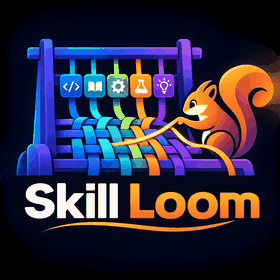
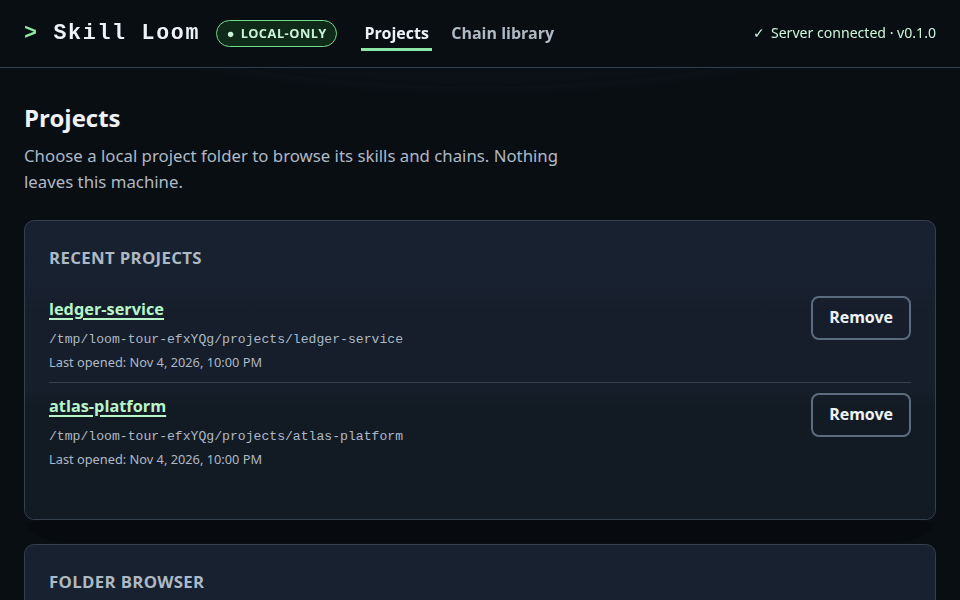
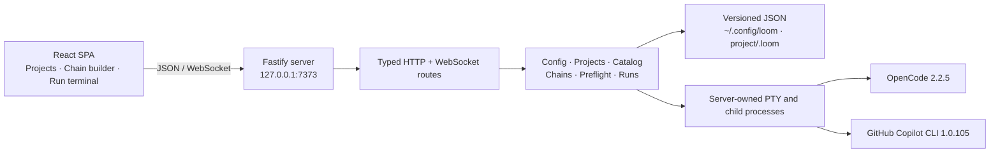

<p align="center">
  
</p>

# Skill Loom

[](package.json)

Skill Loom is a local workspace for discovering, designing, saving, and bundling reusable workflows built from agent skills and standalone instructions. Start with a goal: prepare a reviewed, project-independent discovery handoff, open a repository to build or run chains, or browse examples and saved work. Portable `.loom.json` bundles can be reviewed and moved into other repositories.

Skill Loom does not author skills and does not execute a skill as a callable command. Each chain step is sent to a local harness as a prompt; skills are **model-invoked** context. The chain order is prompt order, **not a guarantee** that a harness loads or fires a named skill. A harness may decline to load a skill even when preflight resolved it.



See the [visual tour](docs/visual-tour.md) for captions and full-size screenshots.

Start with the [user guide](docs/user-guide.md) to design and share a workflow, or the [administrator guide](docs/admin-guide.md) to install, configure, back up, and upgrade the application.

## Table of Contents

- [About](#about)
- [Features](#features)
- [Tech Stack](#tech-stack)
- [Architecture](#architecture)
- [Project Structure](#project-structure)
- [Getting Started](#getting-started)
- [Requirements](#requirements)
- [Install](#install)
- [Development](#development)
- [Build and run](#build-and-run)
- [Run from a package](#run-from-a-package)
- [Commands](#commands)
- [First run](#first-run)
- [Configuration](#configuration)
- [Security and privacy](#security-and-privacy)
- [Security](#security)
- [How to Contribute](#how-to-contribute)
- [What's Next](#whats-next)
- [License](#license)
- [Acknowledgements](#acknowledgements)
- [Author](#author)
- [Operations guide](#operations-guide)

## About

Agent CLIs such as OpenCode and GitHub Copilot can load installed skills, but turning a set of skills into a repeatable, ordered workflow is manual and easy to get wrong. Skill Loom provides a local workspace to inspect available skills, assemble and save chains, keep reusable templates in a library, and export reviewed bundles for use in other repositories. Register a project when you want its skill catalog for authoring or optional local tests.

The product promise is deliberately narrow:

- **Portable workflow design.** Skill Loom organizes steps and named inputs into reusable chains, with a global library for templates and reviewable bundles for sharing.
- **Deterministic prompt order.** When a chain is run, Skill Loom builds the prompt for each step and sends steps in the saved order.
- **Model-invoked skills.** The harness decides whether to load a named skill. Skill Loom reports skill observation only when the harness exposes evidence, and never blocks a step on it.
- **Local by construction.** The server binds to loopback, owns all filesystem and process access, and has no telemetry or hosted backend.
- **Optional local testing.** A run freezes the chain definition, resolved inputs, harness, mode, and session plan at creation. Editing the saved chain later does not change an existing run.

## Features

| Capability | What it does |
|---|---|
| Global chain library | Keep reusable chain templates outside any project, then copy them into a project to adapt or test. |
| Project-independent workflows | Select skills from already refreshed pinned snapshots, review complete package contents, and prepare a standalone discovery handoff for an existing compatible CLI session. Manual goal drafts remain a separate authoring path. |
| Portable chain bundles | Export a saved chain with complete referenced skill packages as `.loom.json`; version 2 also preserves one selected native agent. Review, download, and move it into another repository or installation. |
| Shared bundle library | Review and publish a locally selected bundle without a project, or browse, download, and explicitly import a shared bundle into a project. Publication never overwrites existing files. |
| Start and library overview | Choose discovery, project work, or saved libraries from `/`; drafts, templates, shared bundles, and scenario examples remain distinct. |
| Chain builder | Create a chain bound to one harness, add skill or standalone instruction steps, optionally select one exact remote native agent, reorder steps, and declare named inputs. |
| Projects | Register existing folders or create new ones, browse the filesystem, optionally initialize Git, and keep a recent-project list. Removing a recent entry never deletes project files. |
| Skill catalog | Discover OpenCode filesystem skills and Copilot CLI skills, read `SKILL.md` metadata, search, add extra global directories, and copy non-project packages into the shared `.agents/skills/` root. |
| Remote repositories | Register HTTPS/SSH Git repositories, explicitly refresh pinned skill and native-agent snapshots, and inspect artifacts without checking out or running repository scripts. |
| Workspace and appearance | Navigate project skills, chains, and details separately; choose system, light, or dark appearance. |
| Scenario catalog | Browse illustrative starter chains for business, student, app developer, and game developer workflows; inspect pinned third-party skill sources, copy examples into the builder, and explicitly add bundled skills to a project when needed. See the [scenario chain guide](docs/scenario-chains.md). |
| Optional local testing | Test a saved chain or project-independent draft in a fresh managed project directory, then inspect or explicitly remove retained workspaces; the directory is separate from the source project, not an OS security sandbox. |
| Terminal and accessibility | Serve a server-owned PTY to xterm.js with screen-reader mode, Escape-to-leave focus, skip links, keyboard reordering, and polite/assertive status announcements. |
| Local CLI | Run the packaged local design workspace as `skill-loom` with `--help`, `--version`, `--no-open`, `--port`, and `--config-dir`. |

The CLI can also inspect a bundle without starting the workspace:
`skill-loom bundle inspect --bundle /absolute/path/to/chain.loom.json`. Add
`--project /absolute/path/to/project` to inspect installed-package conflicts.
This read-only command emits JSON and does not install or run the bundle.
`skill-loom catalog --help` describes commands for listing and refreshing Git
sources and searching pinned snapshots or a registered project's local catalog.
Start the shared owner without opening a browser with
`skill-loom service start`; use
`skill-loom service status` and `skill-loom service stop` to check and stop it.
Unix uses a private socket; Windows uses mutually authenticated loopback TLS
and requires a protected private profile on local NTFS/ReFS storage, Windows
PowerShell 5.1 and .NET 4.7.2+. Unsafe existing Windows profiles are rejected,
not silently reconfigured; see the administrator guide.
The owner also supports project registration, draft creation and model
validation, bundle export, and reviewed import without package reuse; see the
[administrator guide](docs/admin-guide.md#cli-flags). Managed run start and
other planned capabilities remain in the [tracked plan](docs/standalone-cli-plan.md).

## Tech Stack

| Layer | Technology |
|---|---|
| Runtime | Node.js `>=24`; npm |
| Server | Fastify `5.12.8`, `@fastify/websocket` `11.3.6`, `@fastify/static` `10.1.9`, `ws` `8.22.1` |
| Language | TypeScript `7.0.2` (server and web project configs) |
| Web UI | React `19.3.1`, React DOM `19.3.1`, Vite `8.3.5`, `@vitejs/plugin-react` `6.2.1` |
| Terminal | `@xterm/xterm` `6.0.0`, fit/unicode/web-links addons, `node-pty` `1.1.0` |
| Validation and data | Zod `4.6.7`, `yaml` `2.9.1` |
| Tests | Vitest `5.1.0`, Playwright `1.64.1`, `tsx` `4.23.15` |
| Native build | Python 3, `make`, and a C++ compiler for `node-pty` |

Versions are pinned in `package.json` and `package-lock.json`.

## Architecture

The browser is a typed API and terminal client. Every filesystem, persistence, process, and PTY operation happens in the server, which is mounted through one Fastify composition root. Harness-specific behavior lives behind adapters rather than in routes or run orchestration.



A one-page [end-to-end explainer](docs/skill-loom-end-to-end.html) walks through the components, the folder-to-run journey, the step request path, and the OpenCode/Copilot differences.

Key boundaries and the decisions behind them:

- The server is loopback-only with no authentication — [ADR-0001](docs/adr/0001-loopback-only-single-user-server.md).
- Harness command, discovery, trust, fork, and advancement differences live in adapters — [ADR-0002](docs/adr/0002-harness-capability-descriptors.md) and [ADR-0008](docs/adr/0008-session-modes-with-deterministic-handoff.md).
- Skills remain model-invoked prompt context — [ADR-0003](docs/adr/0003-model-invoked-skill-prompts.md).
- Runs freeze their chain and keep only a bounded tail — [ADR-0004](docs/adr/0004-frozen-run-snapshots-and-bounded-tails.md).
- Config, chains, and runs use versioned atomic JSON — [ADR-0005](docs/adr/0005-atomic-versioned-json-persistence.md).
- Native agents remain harness-specific, source-pinned, and are selected only through adapter-supported command surfaces — [ADR-0016](docs/adr/0016-pinned-native-agent-selection.md).
- One active run is enforced globally with explicit interruption recovery — [ADR-0006](docs/adr/0006-single-active-run-and-interrupt-recovery.md).
- Automatic runs rely on explicit signals, not output quiescence — [ADR-0007](docs/adr/0007-explicit-advancement-signals.md).
- Copilot trust is read-only and broad permissions need an opt-in — [ADR-0009](docs/adr/0009-read-only-copilot-trust-and-explicit-permissions.md).
- The global library stores independent snapshots — [ADR-0010](docs/adr/0010-global-chain-library-snapshots.md).
- Processes are spawned without a shell and PTYs are server-owned — [ADR-0011](docs/adr/0011-shell-free-process-and-pty-transport.md).
- New project skill copies share `.agents/skills/`, with legacy OpenCode discovery preserved — [ADR-0012](docs/adr/0012-shared-project-skill-installation-root.md).
- Bundle export prefers one project-local package and rejects remaining ambiguity — [ADR-0013](docs/adr/0013-deterministic-chain-bundle-skill-resolution.md).

The full decision directory is in [docs/adr/README.md](docs/adr/README.md).

## Project Structure

- `src/server/` — Fastify composition root, routes, config, projects, catalog, chains, preflight, harness adapters, runs, and PTY transport.
- `src/server/chains/scenario-skills/` — pinned third-party scenario skill snapshots and provenance notices, copied only on explicit project action.
- `src/shared/` — Shared API and terminal message contracts.
- `src/web/` — React application: router, layout, route screens, components, hooks, and API clients.
- `tests/unit/` — Vitest unit suites for models, stores, adapters, preflight, runners, PTY, CLI, and documentation gates.
- `tests/integration/` — Fastify composition-root suites for routes, WebSocket transport, and run orchestration.
- `tests/e2e/` — Playwright browser journeys against an isolated app instance.
- `scripts/` — Documentation gate, package smoke test, and live harness probes.
- `docs/` — User, administrator, and operations guides, ADRs, release notes, support ownership, and live evidence.
- `.github/skills/` — Project-maintained Copilot skills and their references.
- `skill/scenario-discovery/` — Mirrored standalone project-independent discovery skill and helpers.
- `skill/loom-chain-workflow/` — Mirrored CLI workflow skill that coordinates discovery, optional workspace testing, reviewed import, and current-session execution using the companion skills.
- `.opencode/agents/` and `.opencode/skills/` — OpenCode agent definitions and mirrored project skills.
- `<project>/.agents/skills/` — Shared destination for new project skill copies and bundle imports; OpenCode also discovers legacy `.opencode/skills/`.
- `dist/` — Build output for the server and web UI; generated, not source.

## Getting Started

The short path is:

```bash
git clone https://github.com/McFuzzySquirrel/skill-loom.git
cd skill-loom
npm install
npm run dev
```

Open `http://127.0.0.1:5173` for the development UI. For a production build, use `npm run build` then `npm start` and open `http://127.0.0.1:7373`.

The [administrator guide](docs/admin-guide.md#installation) covers the native toolchain, packaged tarball, configuration directory, backups, and upgrades. The sections below are the repository's exact command contract.

## Requirements

- **Node.js 24 or newer** (`package.json` declares `>=24`; the validation recorded for 0.1.0 ran on Node 26.13.0, while Node 24.22.2 was used earlier in development).
- npm.
- A native build toolchain for `node-pty`: Python 3, `make`, and a C++ compiler. On Debian/Ubuntu install `build-essential` and `python3`; on macOS install the Xcode Command Line Tools.
- **OpenCode CLI 2.2.5** for OpenCode chains, installed and authenticated.
- **GitHub Copilot CLI 1.0.105** for Copilot chains, installed and authenticated.
- Git, optional but used for the `git init` option and the dirty-tree preflight warning.
- A Chromium browser for Playwright e2e; install it once with `npx playwright install chromium`.

## Install

```bash
npm install
```

`node-pty` compiles native code during installation. If the install fails at that step, install the native toolchain above and run `npm install` again (or `npm rebuild node-pty`). Skill Loom does not hide a native build failure behind a generic install success message.

Harness CLIs are deliberately not installed by this project. Install OpenCode 2.2.5 and/or GitHub Copilot CLI 1.0.105 with their own installers, then confirm they are on `PATH`; alternatively set `harnessCommands.opencode` or `harnessCommands.copilot` in the Skill Loom config.

## Development

```bash
npm run dev
```

This starts the Fastify API on `http://127.0.0.1:7373` and the Vite dev server on `http://127.0.0.1:5173`. Open the Vite URL in a browser. Vite proxies `/api` (including WebSocket upgrades) to the API server. Both processes bind to loopback only.

## Build and run

```bash
npm run build
npm start
```

`npm run build` builds the React UI into `dist/web` and compiles the server into `dist/src`. `npm start` runs the compiled server, which serves both the API and the built UI from the single loopback origin `http://127.0.0.1:7373`. The production server does not use the Vite dev proxy.

## Run from a package

The package is named `skill-loom-cli` and exposes the `skill-loom` command. It remains local-only for now (`"private": true`), so build a tarball instead of publishing:

```bash
npm pack
npx --yes --package=./skill-loom-cli-0.1.0.tgz skill-loom
```

Flags:

```bash
npx --yes --package=./skill-loom-cli-0.1.0.tgz skill-loom --help
npx --yes --package=./skill-loom-cli-0.1.0.tgz skill-loom --version
npx --yes --package=./skill-loom-cli-0.1.0.tgz skill-loom --no-open --port 7399
npx --yes --package=./skill-loom-cli-0.1.0.tgz skill-loom --config-dir /absolute/path/to/profile
```

The unambiguous `npm exec` form is also supported:

```bash
npm exec --package ./skill-loom-cli-0.1.0.tgz -- skill-loom --help
```

The CLI starts the same production server and prints the loopback URL and config directory. It opens the default browser only when stdout is a TTY; `--no-open` and `CI` disable that. Once the package is published, the command becomes `npx skill-loom-cli`.

The packed package contains `dist/src`, `dist/web`, the compiled package metadata, a macOS PTY installation helper, `docs/OPERATIONS.md`, and the package manifest. It excludes source, tests, build scripts, and the other documentation files. The native `node-pty` toolchain may still be required when npm installs the package.

## Commands

| Capability | Command | Notes |
|------------|---------|-------|
| Install dependencies | `npm install` | Native `node-pty` build requires the toolchain above. |
| Development | `npm run dev` | API on 7373, Vite UI on 5173. |
| Build | `npm run build` | Web then server. |
| Bundled skill modes | `npm run update:scenario-modes` | Regenerate the content-bound manifest from current files and Git index modes after changing bundled scenario packages. |
| Start built app | `npm start` | Serves `dist/web` and the API on 7373. |
| Typecheck | `npm run typecheck` | Runs server and web project checks. |
| Unit tests | `npm run test:unit` | Vitest, Node environment. |
| Integration tests | `npm run test:integration` | Vitest, real Fastify composition root. |
| All Node tests | `npm test` | Unit and integration suites. |
| Browser end-to-end | `npm run test:e2e` | Builds and starts an isolated app; see below. |
| Package smoke test | `npm run test:package` | Packs, inspects, and starts the packaged CLI on a spare loopback port. |
| Live discovery probe | `npm run test:live:discovery` | Requires real harness CLIs. |
| Live execution probe | `npm run test:live:execution` | Requires real harness CLIs and may make paid model calls. |
| Documentation gate | `npm run check` | Runs `scripts/check-docs.mjs`. |
| Capture docs visuals | `npm run docs:capture` | Builds the app, captures the visual-tour screenshots, and assembles the slow README GIF under `docs/assets/`. |

Playwright never reads or writes your real Skill Loom or harness state. `npm run test:e2e` builds the app, starts it with a temporary `LOOM_CONFIG_DIR`, a temporary `HOME`, a temporary project area, and an isolated harness `PATH`; it never attaches to an already-running developer instance.

The default live probes exercise real OpenCode and Copilot CLIs. They fail with a clear diagnostic when a required CLI is absent; they do not silently skip. Run them only when you intend to use the installed harnesses and credentials. For an OpenCode-only execution probe, see the [verification guide](docs/OPERATIONS.md#opencode-only-live-verification); it does not invoke Copilot and writes separate evidence.

## First run

1. Start the development app with `npm run dev` and open `http://127.0.0.1:5173`, or build and run production with `npm run build && npm start` and open `http://127.0.0.1:7373`.
2. On the Projects screen, open an existing folder or create a new project. Registering a project records it in the recent-projects list; removing a recent entry does not delete project files.
3. Open **Project skills**, choose the harness, and search or expand a skill's `SKILL.md`. You can add extra skill directories in the settings dialog. A skill from a personal, plugin, custom, or extra source can be copied into the project with **Copy into this project**; new copies for either harness go to `.agents/skills/`. OpenCode also discovers legacy `.opencode/skills/` packages, while Copilot discovery remains authoritative through its CLI.
4. Create a chain, add at least one step, choose the harness, optionally select a compatible native agent from a remote source, give every step an instruction, declare any named inputs, and save. A saved chain is stored under `<project>/.loom/chains/`. **Save and run** saves the chain and opens its run-start screen.
5. On run start, choose supervised or automatic mode, provide required inputs, and run preflight. Preflight never makes a model call.
6. Resolve every blocking finding and acknowledge every required warning, then choose **Start run**. Skill Loom creates the run through `POST /api/projects/<projectId>/runs`, re-runs the blocking preflight on the server, and opens the dedicated terminal page at `/runs/<runId>/terminal`.
7. The terminal page keeps xterm and the compact run controls together without scrolling past step details; **Run details** opens `/runs/<runId>` for the step rail, full controls, and recovery guidance. A run never advances because of terminal output, a timer, or a page load. A chain card's **Run** action returns to the run-start screen, and the project screen links to any active run.
8. To reuse a recipe, choose **Save copy to library** in the builder. The global library at `/chains` stores independent snapshots; importing one into another project copies it with a new chain id.

The full workflow, run controls, statuses, recovery, accessibility, and privacy behavior are in the [user guide](docs/user-guide.md).

## Configuration

| Setting | Default | Purpose |
|---|---|---|
| `LOOM_CONFIG_DIR` | `~/.config/loom` | Global config, recent projects, active-run pointer, and global chain templates. |
| `LOOM_HOST` | `127.0.0.1` | Loopback bind host. Any non-loopback value aborts startup. |
| `LOOM_PORT` | `7373` | TCP port from 1 to 65535. |
| `LOOM_WEB_ROOT` | discovered `dist/web` | Optional built-UI directory override for controlled deployments and tests. |

The versioned config document contains `version`, `harnessCommands`, `extraSkillDirectories`, `recentProjects`, and `uiPreferences`. `harnessCommands` may override the executable name or absolute path for `opencode` or `copilot`; a missing entry resolves from `PATH`. The schema is strict: credential-like fields such as `apiKey`, `token`, or `secret` are invalid and are never stored. Configuration writes use an atomic temporary-file replacement; a corrupt or unsupported-version config is reported rather than silently rewritten.

The CLI flags `--port` and `--config-dir` set `LOOM_PORT` and `LOOM_CONFIG_DIR`. See the [administrator guide](docs/admin-guide.md#configuration) for the full configuration and backup contract.

## Security and privacy

Skill Loom is **loopback-only**. The server binds to `127.0.0.1` by default, refuses any non-loopback `LOOM_HOST`, and has **no authentication** because there is no remote access. Never expose the port through a reverse proxy, tunnel, container port publish, or remote host.

The server owns all filesystem traversal, persistence, process spawning, and PTY handling. The browser performs no shell execution and receives only typed API and WebSocket data. Skill Loom sends no telemetry, crash reports, or remote logs. Git network access occurs only when a user explicitly refreshes a registered repository; user-invoked harness CLIs and package installation may also use the network. Harness credentials are not persisted or logged. Local control uses a separate, temporary bearer capability in a private profile file; Windows also stores temporary client TLS credentials there. See the [administrator guide](docs/admin-guide.md#identity-secrets-and-tls).

Harness children are spawned with an executable plus an argument array, never a shell command string. Project paths are canonicalized, path traversal outside the intended data directory is rejected, and harness, skill, and run content is rendered as escaped text or raw terminal text, never as HTML.

Copilot folder trust is read-only: Skill Loom reads `trustedFolders` from `~/.copilot/config.json` and never writes it. Automatic Copilot mode requires an explicit per-chain opt-in before passing `--allow-all-paths` and `--allow-all-tools`; those flags grant broad filesystem and tool access inside the selected project.

## Security

Report security issues privately to the maintainer through the repository's GitHub profile rather than opening a public issue with credentials, tokens, or private paths. There is no bug bounty or formal security policy file.

Operational hardening, secret handling, the Copilot trust boundary, the automatic-permission review, backup sensitivity, and the full privacy checklist are in the [administrator guide](docs/admin-guide.md#security-and-privacy-checklist) and [OPERATIONS.md](docs/OPERATIONS.md#security-model).

## How to Contribute

There is no `CONTRIBUTING.md` yet. The working agreement is:

1. Install with `npm install`, develop with `npm run dev`, and run `npm run check`, `npm run typecheck`, and `npm test` before proposing a change.
2. Keep harness-specific behavior inside `src/server/harness/`, keep routes thin, and preserve the loopback-only and shell-free boundaries described in the ADRs.
3. Add or update a test for behavior changes; use the unit, integration, and Playwright suites as appropriate.
4. Route work through the ownership table in [docs/SUPPORT.md](docs/SUPPORT.md). Cross-module or product decisions go to the support lead; the human maintainer owns scope and release decisions.
5. Do not add a dependency, a remote service, or a new persisted field without checking the security and persistence ADRs.

Skill Loom is released under the [MIT License](LICENSE). Contributions are accepted under the same terms.

## What's Next

There is no committed roadmap. These are known gaps and possible follow-up work, not shipped behavior:

- Resolve the observed OpenCode `OSC 7501` `clear` ordering and rerun the live execution probe before claiming automatic OpenCode advancement; the parser now accepts the observed colon-separated form.
- Expand live evidence beyond Linux ARM64 and the pinned OpenCode 2.2.5 / Copilot CLI 1.0.105 versions.
- Decide whether to publish `skill-loom-cli`; add repository/release metadata and a published upgrade path.
- Consider per-step model or harness selection only as a new product decision; it is not supported today.

## License

Skill Loom is licensed under the [MIT License](LICENSE). The npm package remains `"private": true`, so there is still no registry release or supported upgrade path.

## Acknowledgements

Skill Loom builds on Fastify, React, Vite, TypeScript, Zod, YAML, `ws`, `node-pty`, xterm.js, Vitest, Playwright, and `tsx`. It integrates with OpenCode and GitHub Copilot CLI, whose own licenses and terms govern those tools. The live evidence and support workflow were produced by the project's agent team, documented in [docs/SUPPORT.md](docs/SUPPORT.md).

## Author

Maintained by **McFuzzySquirrel** ([GitHub](https://github.com/McFuzzySquirrel)) with the agent team described in [docs/SUPPORT.md](docs/SUPPORT.md). Use GitHub issues for non-sensitive bugs and questions; report security matters privately.

## Operations guide

- [Visual tour](docs/visual-tour.md) — captioned screenshots of the project, catalog, chain builder, preflight, terminal, run view, and global library.
- [End-to-end explainer](docs/skill-loom-end-to-end.html) — one-page visual tour of the components, run journey, step path, and harness differences.
- [User guide](docs/user-guide.md) — build, preflight, run, recover, accessibility, and privacy.
- [Administrator guide](docs/admin-guide.md) — install, configure, back up, upgrade, monitor, and harden.
- [Operations guide](docs/OPERATIONS.md) — the full operator contract: data locations, harness prerequisites, Copilot trust, permissions, fork behavior, and troubleshooting.
- [Architecture decision records](docs/adr/README.md) — one record per durable decision, with agent rules and verification.
- [Draft release notes for package version 0.1.0](docs/releases/0.1.0.md) — highlights, compatibility, limitations, and validation status; not a published release.
- [Changelog](CHANGELOG.md) — Keep a Changelog history.
- [Support](docs/SUPPORT.md) — ownership, intake, and escalation.
