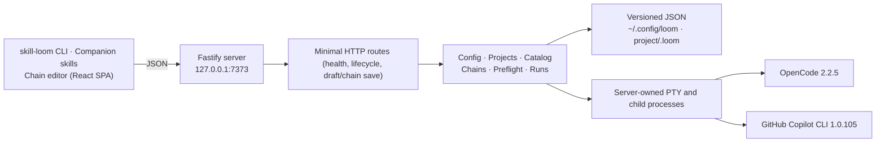

<p align="center">
  
</p>

# Skill Loom

[](package.json)

Skill Loom is a single-user workspace for building shared chains from skills already installed in a host-global `.agents/skills` directory. Its CLI and companion Agent Skills find and save ordered workflows, copy selected packages into a project when needed, and run steps in the current agent session. The only web screen is a visual chain editor, opened with `skill-loom edit`. Podman is available for private, persistent hosting; trusted remote clients can use an SSH-backed Podman connection without exposing the server. Exported bundles remain a compatibility feature.

Skill Loom does not author skills and does not execute a skill as a callable command. Each chain step is sent to a local harness as a prompt; skills are **model-invoked** context. The chain order is prompt order, **not a guarantee** that a harness loads or fires a named skill. A harness may decline to load a skill even when preflight resolved it.


See the [visual tour](docs/visual-tour.md) for the chain editor.

New users: follow the [quick start](docs/quick-start.md) to find global skills, create or select a shared chain, apply it to a project, and run it in the current session. For the full workflow, see the [user guide](docs/user-guide.md); for installation and operations, see the [administrator guide](docs/admin-guide.md) and [host catalog operations guide](docs/host-catalog-operations.md). The [standalone skill guide](docs/standalone-skill-guide.md) covers repo-first chains, hosted selected-skill copies, and the compatibility bundle workflow.

## Table of Contents

- [About](#about)
- [Features](#features)
- [Tech Stack](#tech-stack)
- [Architecture](#architecture)
- [Project Structure](#project-structure)
- [Getting Started](#getting-started)
- [Requirements](#requirements)
- [Install](#install)
- [Development](#development)
- [Build and run](#build-and-run)
- [Run from a package](#run-from-a-package)
- [Commands](#commands)
- [First run](#first-run)
- [Configuration](#configuration)
- [Security and privacy](#security-and-privacy)
- [Security](#security)
- [How to Contribute](#how-to-contribute)
- [What's Next](#whats-next)
- [License](#license)
- [Third-party skills and licenses](#third-party-skills-and-licenses)
- [Acknowledgements](#acknowledgements)
- [Author](#author)
- [Operations guide](#operations-guide)

## About

Agent CLIs such as OpenCode and GitHub Copilot can load installed skills, but turning them into a repeatable, ordered workflow is manual and easy to get wrong. Skill Loom indexes the host-global `~/.agents/skills/` catalog (or `LOOM_SKILLS_DIR`), saves chains in a shared Loom library, and applies the selected packages to a registered project. The `loom-chain-workflow` companion skill then carries out the saved order in the active conversation. Register a project as the target for skill copies and for the visual chain editor.

The product promise is deliberately narrow:

- **Shared workflow design.** Skill Loom organizes steps and named inputs into a shared chain library, then copies the chain's required skills into a project.
- **Current-session execution.** The companion workflow carries out ordered steps in the agent session already in use; it does not start a child harness.
- **One host catalog.** Skills are indexed from `~/.agents/skills` (or `LOOM_SKILLS_DIR`) and provisioned by the user's existing installation method.
- **Deterministic prompt order.** The active agent follows the saved step order, but the host decides whether to load a named skill.
- **Model-invoked skills.** The harness decides whether to load a named skill. Skill Loom reports skill observation only when the harness exposes evidence, and never blocks a step on it.
- **Private single-user deployment.** The server remains loopback-bound. Podman can host persistent Loom state behind a local loopback port or a private authenticated platform/VPN ingress; anonymous public access is unsupported.

## Features

| Capability | What it does |
|---|---|
| Companion workflow | `loom-chain-workflow` selects a shared chain, applies its global skills to a project, and carries out its ordered steps in the current agent session. |
| Visual chain editor | `skill-loom edit` opens a local editor to drag steps into a new order, edit instructions, manage `{{inputs}}`, and save back to the draft or project chain. It is the only web screen. |
| Shared chain library | Create, validate, update, and remove chains in one Loom library, visible from every registered project context. Legacy project chain files are copied on first access and retained. |
| Repo-first chains | Keep canonical chains in tracked `chains/<id>.json` files and explicitly publish revision-checked copies to the hosted library. |
| Global skill catalog | Search only the configured host-global `.agents/skills` tree. Existing external tools own package installation and updates. |
| Apply chain to project | `skill-loom chain project apply` copies only the chain's referenced global packages into `<project>/.agents/skills/`; it never overwrites an existing package. |
| Podman deployment | `npm run podman:up`, `podman:down`, and `podman:plan` support cross-platform local deployment; `podman:host` installs and manages a persistent Linux rootless Quadlet service. |
| Podman CLI bridge | `skill-loom-podman` forwards commands over a named SSH-backed Podman connection, copies exact reviewed catalog selections, and publishes repo chains without sending the client path. |
| Scenario examples | Illustrative starter chains for business, student, app developer, and game developer workflows. See the [scenario chain guide](docs/scenario-chains.md). |
| Compatibility surfaces | Bundle, remote-source, and managed-run commands remain during the pivot but are not part of the default chain workflow. |

Typical commands (run `skill-loom --help` for the full surface; structured input is JSON on stdin and every command prints a JSON envelope):

```sh
skill-loom service start                      # shared owner; no browser
skill-loom edit --draft <draft-id>            # visual chain editor
skill-loom chain project list                 # JSON on stdin; shared library
skill-loom chain project apply                # JSON on stdin; copy referenced skills
npm run podman:plan                           # inspect the Podman deployment plan
npm run podman:host -- plan                   # inspect a persistent Linux host plan
skill-loom-podman service status              # use the CLI bridge for a Podman deployment
LOOM_PODMAN_CONNECTION=loom-host skill-loom-podman service status # remote Podman host
```

Unix uses a private socket; Windows uses mutually authenticated loopback TLS and requires a protected private profile on local NTFS/ReFS storage (PowerShell 7, or Windows PowerShell 5.1 with .NET 4.7.2+). Unsafe existing Windows profiles are rejected, not reconfigured; see the [administrator guide](docs/admin-guide.md#cli-flags). For trusted remote Podman clients, see [remote client access](docs/admin-guide.md#remote-client-access). Remaining blocked and unverified capabilities are listed in [known gaps](docs/current-gaps.md).

For a persistent rootless Linux host and same-VPN client, follow the [hosted Podman setup runbook](docs/admin-guide.md#persistent-linux-host-service-quadlet).

## Tech Stack

| Layer | Technology |
|---|---|
| Runtime | Node.js `>=24`; npm |
| Server | Fastify `5.12.8`, `@fastify/static` `10.1.9` |
| Language | TypeScript `7.0.2` (server and web project configs) |
| Chain editor | React `19.3.1`, React DOM `19.3.1`, Vite `8.3.5`, `@vitejs/plugin-react` `6.2.1` |
| Terminal | `node-pty` `1.1.0` (server-owned PTY; `run attach` streams it to the CLI) |
| Validation and data | Zod `4.6.7`, `yaml` `2.9.1` |
| Tests | Vitest `5.1.0`, `tsx` `4.23.15` |
| Native build | Python 3, `make`, and a C++ compiler for `node-pty` |

Versions are pinned in `package.json` and `package-lock.json`.

## Architecture

The CLI and the chain editor are typed API clients. Every filesystem, persistence, process, and PTY operation happens in the server, which is mounted through one Fastify composition root. Harness-specific behavior lives behind adapters rather than in routes or run orchestration.



The pre-pivot end-to-end explainer is kept in the [documentation archive](docs/archive/README.md) for history only; its browser and project screens no longer exist.

Key boundaries and the decisions behind them:

- The server is loopback-only with no authentication — [ADR-0001](docs/adr/0001-loopback-only-single-user-server.md).
- Harness command, discovery, trust, fork, and advancement differences live in adapters — [ADR-0002](docs/adr/0002-harness-capability-descriptors.md) and [ADR-0008](docs/adr/0008-session-modes-with-deterministic-handoff.md).
- Skills remain model-invoked prompt context — [ADR-0003](docs/adr/0003-model-invoked-skill-prompts.md).
- Runs freeze their chain and keep only a bounded tail — [ADR-0004](docs/adr/0004-frozen-run-snapshots-and-bounded-tails.md).
- Config, chains, and runs use versioned atomic JSON — [ADR-0005](docs/adr/0005-atomic-versioned-json-persistence.md).
- Native agents remain harness-specific, source-pinned, and are selected only through adapter-supported command surfaces — [ADR-0016](docs/adr/0016-pinned-native-agent-selection.md).
- One active run is enforced globally with explicit interruption recovery — [ADR-0006](docs/adr/0006-single-active-run-and-interrupt-recovery.md).
- Automatic runs rely on explicit signals, not output quiescence — [ADR-0007](docs/adr/0007-explicit-advancement-signals.md).
- Copilot trust is read-only and broad permissions need an opt-in — [ADR-0009](docs/adr/0009-read-only-copilot-trust-and-explicit-permissions.md).
- The product is CLI- and skill-driven with one chain editor screen — [ADR-0027](docs/adr/0027-cli-and-skill-driven-workflow.md) and [ADR-0028](docs/adr/0028-single-purpose-chain-editor.md).
- Processes are spawned without a shell and PTYs are server-owned — [ADR-0011](docs/adr/0011-shell-free-process-and-pty-transport.md).
- New project skill copies share `.agents/skills/`; the active catalog comes from the configured host-global skills directory — [ADR-0032](docs/adr/0032-host-global-skills-and-current-session-chains.md).
- Bundle export prefers one project-local package and rejects remaining ambiguity — [ADR-0013](docs/adr/0013-deterministic-chain-bundle-skill-resolution.md).
- Portable runs reuse a host-global package only when the host catalog resolves it and review binds its path and fingerprint; otherwise the package is installed into the project — [ADR-0029](docs/adr/0029-catalog-resolved-global-skill-reuse.md).
- Chain authoring locates skills through a derived capability index and lets the harness model expand and rerank; the index never replaces package review or exact remote binding — [ADR-0030](docs/adr/0030-capability-index-and-model-reranking.md).

The full decision directory is in [docs/adr/README.md](docs/adr/README.md).

## Project Structure

- `src/server/` — Fastify composition root, routes, config, projects, catalog, chains, preflight, harness adapters, runs, and PTY transport.
- `src/server/chains/scenario-skills/` — pinned third-party scenario skill snapshots and provenance notices, copied only on explicit project action.
- `src/shared/` — Shared API and terminal message contracts.
- `src/web/` — React chain editor: router, editor route, flow and step components, and API clients.
- `tests/unit/` — Vitest unit suites for models, stores, adapters, preflight, runners, PTY, CLI, and documentation gates.
- `tests/integration/` — Fastify composition-root suites for routes, the control channel, and run orchestration.
- `scripts/` — Documentation gate, package smoke test, and live harness probes.
- `docs/` — User, administrator, and operations guides, ADRs, release notes, support ownership, and live evidence.
- `.github/skills/` — Canonical companion and harness skill packages and their references.
- `skill/scenario-discovery/` — Mirrored standalone project-independent discovery skill and helpers.
- `skill/loom-chain-workflow/` — Mirrored current-session workflow for shared chains and host-global skills.
- `skill/loom-skill-catalog/` — Mirrored skill for searching registered sources and installing one reviewed package into a project.
- `.opencode/agents/` and `.opencode/skills/` — OpenCode agent definitions and byte-identical mirrors of the `.github/skills/` packages.
- `.agents/skills/` — This repository tracks `create-project-documentation` here; the host-global catalog is external and project copies are made only when applying a chain.
- `dist/` — Build output for the server and chain editor; generated, not source.

## Getting Started

The short path is:

```bash
git clone https://github.com/McFuzzySquirrel/skill-loom.git
cd skill-loom
npm install
npm run dev
```

Open `http://127.0.0.1:5173` for the development editor (it needs a draft route such as `/drafts/<id>`). For a production build, use `npm run build` then `npm start`, or use `skill-loom edit`.

The [administrator guide](docs/admin-guide.md#installation) covers the native toolchain, packaged tarball, configuration directory, backups, and upgrades. The sections below are the repository's exact command contract.

## Requirements

- **Node.js 24 or newer** (`package.json` declares `>=24`; recorded live evidence spans Node 26.13.0 on Linux ARM64 and Node 26.12.0 for the latest passing Linux x64 execution probe).
- npm.
- A native build toolchain for `node-pty`: Python 3, `make`, and a C++ compiler. On Debian/Ubuntu install `build-essential` and `python3`; on macOS install the Xcode Command Line Tools.
- **Stable OpenCode CLI 2.2.5 or newer** for OpenCode chains, installed and authenticated. Live signal verification is still required for automatic advancement.
- **GitHub Copilot CLI 1.0.105** for Copilot chains, installed and authenticated.
- Git, optional but used for the `git init` option and the dirty-tree preflight warning.

## Install

```bash
npm install
```

`node-pty` compiles native code during installation. If the install fails at that step, install the native toolchain above and run `npm install` again (or `npm rebuild node-pty`). Skill Loom does not hide a native build failure behind a generic install success message.

Harness CLIs are deliberately not installed by this project. Install stable OpenCode 2.2.5 or newer and/or GitHub Copilot CLI 1.0.105 with their own installers, then confirm they are on `PATH`; alternatively set `harnessCommands.opencode` or `harnessCommands.copilot` in the Skill Loom config.

## Development

```bash
npm run dev
```

This starts the Fastify API on `http://127.0.0.1:7373` and the Vite dev server on `http://127.0.0.1:5173`. Vite proxies `/api` to the API server. Both processes bind to loopback only.

## Build and run

```bash
npm run build
npm start
```

`npm run build` builds the React UI into `dist/web` and compiles the server into `dist/src`. `npm start` runs the compiled server, which serves both the API and the built chain editor from the single loopback origin `http://127.0.0.1:7373`. The production server does not use the Vite dev proxy.

## Run from a package

The package is named `skill-loom-cli` and exposes the `skill-loom` command. It remains local-only for now (`"private": true`), so build a tarball instead of publishing:

```bash
npm pack
npx --yes --package=./skill-loom-cli-0.1.0.tgz skill-loom
```

Flags:

```bash
npx --yes --package=./skill-loom-cli-0.1.0.tgz skill-loom --help
npx --yes --package=./skill-loom-cli-0.1.0.tgz skill-loom --version
npx --yes --package=./skill-loom-cli-0.1.0.tgz skill-loom --no-open --port 7399
npx --yes --package=./skill-loom-cli-0.1.0.tgz skill-loom --config-dir /absolute/path/to/profile
```

The unambiguous `npm exec` form is also supported:

```bash
npm exec --package ./skill-loom-cli-0.1.0.tgz -- skill-loom --help
```

### Install globally

A global install also comes from the packed tarball, because the package is not published to the registry:

```bash
git clone https://github.com/McFuzzySquirrel/skill-loom.git
cd skill-loom
npm install
npm run build
npm pack
npm install -g ./skill-loom-cli-<version>.tgz
skill-loom --version
```

`npm pack` runs the full build through its `prepack` hook, so the explicit `npm run build` only surfaces build errors before packing. The install runs the package's PTY helper and may compile `node-pty`, so the native toolchain above must be available. For development against a checkout, `npm link` exposes the same `skill-loom` command without copying a tarball.

If `npm install -g` fails with `EACCES`, configure a user-level prefix (`npm config set prefix ~/.npm-global`, then add `~/.npm-global/bin` to `PATH`) instead of running the install with `sudo`; the `node-pty` build and the postinstall helper should run as your user.

### npm install-script warnings

On npm 11.20 and newer, a global install can report `install scripts not yet covered by allowScripts` for `skill-loom-cli` and `node-pty`. Unless `strict-allow-scripts` is enabled, npm still runs those scripts and the warning is advisory, so a successful install behind it is usable. A name-only allowlist does not silence it for a tarball install: npm matches a `file:` dependency by path, not by name, so `--allow-scripts=skill-loom-cli,node-pty` covers `node-pty` but not the package you installed. Pass the tarball path together with the dependency name:

```bash
npm install -g ./skill-loom-cli-0.1.0.tgz \
  --allow-scripts="file:$PWD/skill-loom-cli-0.1.0.tgz,node-pty"
```

To allow the same list for every global install, persist it (and rewrite the absolute path after moving the tarball):

```bash
npm config set allow-scripts="file:/absolute/path/to/skill-loom-cli-0.1.0.tgz,node-pty" --location=user
```

`allow-scripts=all` is not a wildcard. `--dangerously-allow-all-scripts` suppresses the warning for one command but allows every dependency's install scripts, so prefer the scoped list. After a registry release, the file path is unnecessary: `npm install -g skill-loom-cli --allow-scripts=skill-loom-cli,node-pty` matches both packages by name.

A global install provides the CLI only. It does not register the companion skills anywhere; copy `dist/skills/<skill-name>/` into the target project's `.agents/skills/` to use them. Once the package is published, the equivalent command becomes `npm install -g skill-loom-cli`.

With a global install, the flags above become plain `skill-loom` commands:

```bash
skill-loom --help
skill-loom --no-open --port 7399
skill-loom --config-dir /absolute/path/to/profile
```

The CLI starts the same production server and prints the loopback URL and config directory. It opens the default browser only when stdout is a TTY; `--no-open` and `CI` disable that. Once the package is published, the command becomes `npx skill-loom-cli`.

The packed package contains `dist/src`, `dist/web`, the compiled package metadata, a cross-platform PTY installation helper, `docs/OPERATIONS.md`, and the package manifest. It excludes source, tests, build scripts, and the other documentation files. The native `node-pty` toolchain may still be required when npm installs the package. The helper repairs the macOS spawn-helper owner-execute permission and applies a hash-bound Windows `node-pty` 1.1.0 natural-exit resource cleanup fix; unknown dependency bytes fail installation rather than receiving an unverified patch.

## Commands

| Capability | Command | Notes |
|------------|---------|-------|
| Install dependencies | `npm install` | Native `node-pty` build requires the toolchain above. |
| Development | `npm run dev` | API on 7373, Vite editor on 5173. |
| Build | `npm run build` | Web then server. |
| Bundled skill modes | `npm run update:scenario-modes` | Regenerate the content-bound manifest from current files and Git index modes after changing bundled scenario packages. |
| Start built app | `npm start` | Serves `dist/web` and the API on 7373. |
| Typecheck | `npm run typecheck` | Runs server and web project checks. |
| Unit tests | `npm run test:unit` | Vitest, Node environment. |
| Integration tests | `npm run test:integration` | Vitest, real Fastify composition root. |
| All Node tests | `npm test` | Unit and integration suites. |
| Package smoke test | `npm run test:package` | Packs, inspects, and starts the packaged CLI on a spare loopback port. |
| Live discovery probe | `npm run test:live:discovery` | Requires real harness CLIs. |
| Live execution probe | `npm run test:live:execution` | Requires real harness CLIs and may make paid model calls. |
| Managed OpenCode acceptance | `npm run test:live:managed -- --confirm-live` | Checkout-only; uses the production managed runner, makes paid calls and grants temporary-project read/edit permissions. See the [procedure](docs/OPERATIONS.md#managed-opencode-acceptance). |
| Retrieval evaluation | `npm run eval:retrieval` | Compares scan and indexed retrieval on the chain-authoring corpus, including remote binding, source-policy, and metadata-filter cases; no model calls or network. |
| Documentation gate | `npm run check` | Runs `scripts/check-docs.mjs`. |

The default live probes exercise real OpenCode and Copilot CLIs. They fail with a clear diagnostic when a required CLI is absent; they do not silently skip. Run them only when you intend to use the installed harnesses and credentials. For an OpenCode-only execution probe, see the [verification guide](docs/OPERATIONS.md#opencode-only-live-verification); it does not invoke Copilot and writes separate evidence.

Pull requests run `npm run check`, `npm run typecheck`, `npm test`, and `npm run test:package` on Ubuntu, macOS, and Windows with Node 24, plus a Node 26 Ubuntu job. Live probes and the privileged native-containment tests are not run in pull-request CI; they stay manual and evidence-backed.

## First run

1. Install and start: `npm run build`, then `skill-loom service start` (or let a companion skill install the CLI and start it).
2. Ensure the skills you intend to use are installed in `~/.agents/skills/` or the directory configured by `LOOM_SKILLS_DIR`.
3. Use `loom-chain-workflow` to find skills, create or select a shared chain, apply its packages to a registered project, and perform the ordered steps in the active session.
4. Open `skill-loom edit --project <project-id> --chain <chain-id>` to reorder steps, edit instructions, and manage inputs; **Save chain** writes the changes back.
5. Use `skill-loom bundle ...` only when working with legacy exported bundles.

The full workflow, run controls, statuses, recovery, accessibility, and privacy behavior are in the [user guide](docs/user-guide.md).

## Configuration

| Setting | Default | Purpose |
|---|---|---|
| `LOOM_CONFIG_DIR` | `~/.config/loom` | Global config, shared chains, recent projects, and compatibility data. |
| `LOOM_SKILLS_DIR` | `~/.agents/skills` | Host-global skill catalog used to find and apply skills. Provision it with existing host tools. |
| `LOOM_PODMAN_PORT` | `4317` | Local host port for the Podman deployment; it binds to `127.0.0.1`. |
| `LOOM_PODMAN_PLATFORM` | host default | Optional Podman image target: `linux/amd64` or `linux/arm64`. |
| `LOOM_HOST` | `127.0.0.1` | Loopback bind host. Any non-loopback value aborts startup. |
| `LOOM_PORT` | `7373` | TCP port from 1 to 65535. |
| `LOOM_WEB_ROOT` | discovered `dist/web` | Optional built-editor directory override for controlled deployments and tests. |

The versioned config document contains `version`, harness overrides, recent projects, and UI preferences. `extraSkillDirectories` remains for compatibility but is not part of the default authoring catalog. `LOOM_SKILLS_DIR` selects the host-global catalog root. The schema is strict: credential-like fields such as `apiKey`, `token`, or `secret` are invalid and are never stored. Configuration writes use an atomic temporary-file replacement; a corrupt or unsupported-version config is reported rather than silently rewritten.

The CLI flags `--port` and `--config-dir` set `LOOM_PORT` and `LOOM_CONFIG_DIR`. See the [administrator guide](docs/admin-guide.md#configuration) for the full configuration and backup contract.

## Security and privacy

Skill Loom is a **single-user** tool with no application authentication. The app binds to loopback and refuses non-loopback `LOOM_HOST`. Podman publishes to localhost by default; private hosting is supported only behind a private authenticated platform/VPN ingress. Anonymous public access is unsupported.

The server owns all filesystem traversal, persistence, process spawning, and PTY handling. The browser performs no shell execution and receives only typed JSON API data. Skill Loom sends no telemetry, crash reports, or remote logs. Git network access occurs only when a user explicitly refreshes a registered repository; user-invoked harness CLIs and package installation may also use the network. Harness credentials are not persisted or logged. Local control uses a separate, temporary bearer capability in a private profile file; Windows also stores temporary client TLS credentials there. See the [administrator guide](docs/admin-guide.md#identity-secrets-and-tls).

Harness children are spawned with an executable plus an argument array, never a shell command string. Project paths are canonicalized, path traversal outside the intended data directory is rejected, and harness, skill, and run content is rendered as escaped text or raw terminal text, never as HTML.

Copilot folder trust is read-only: Skill Loom reads `trustedFolders` from `~/.copilot/config.json` and never writes it. Automatic Copilot mode requires an explicit per-chain opt-in before passing `--allow-all-paths` and `--allow-all-tools`; those flags grant broad filesystem and tool access inside the selected project.

## Security

Report security issues privately to the maintainer through the repository's GitHub profile rather than opening a public issue with credentials, tokens, or private paths. There is no bug bounty or formal security policy file.

Operational hardening, secret handling, the Copilot trust boundary, the automatic-permission review, backup sensitivity, and the full privacy checklist are in the [administrator guide](docs/admin-guide.md#security-and-privacy-checklist) and [OPERATIONS.md](docs/OPERATIONS.md#security-model).

## How to Contribute

There is no `CONTRIBUTING.md` yet. The working agreement is:

1. Install with `npm install`, develop with `npm run dev`, and run `npm run check`, `npm run typecheck`, and `npm test` before proposing a change.
2. Keep harness-specific behavior inside `src/server/harness/`, keep routes thin, and preserve the loopback-only and shell-free boundaries described in the ADRs.
3. Add or update a test for behavior changes; use the unit and integration suites as appropriate.
4. Route work through the ownership table in [docs/SUPPORT.md](docs/SUPPORT.md). Cross-module or product decisions go to the support lead; the human maintainer owns scope and release decisions.
5. Do not add a dependency, a remote service, or a new persisted field without checking the security and persistence ADRs.

Skill Loom is released under the [MIT License](LICENSE). Contributions are accepted under the same terms.

## What's Next

There is no committed roadmap. [Known gaps](docs/current-gaps.md) lists the blocked and unverified capabilities, including the managed multi-step automatic OpenCode journey and the publication decision. Per-step model or harness selection is not supported and would require a new product decision.

## License

Skill Loom is licensed under the [MIT License](LICENSE). The npm package remains `"private": true`, so there is still no registry release or supported upgrade path.

## Third-party skills and licenses

Skill Loom's own code is MIT-licensed. Skills are independent third-party prompt packages: Skill Loom does not author or guarantee skills installed in the host-global catalog. Packages are model-invoked context, not Loom-executed commands; users remain responsible for their sources, permissions, and licensing.

For the scenario skills bundled as pinned snapshots, provenance and license evidence are tracked:

- [Bundled-package notice](src/server/chains/scenario-skills/THIRD_PARTY_NOTICES.md) — upstream repository, pinned revision, and license evidence for every package.
- [Scenario chain examples](docs/scenario-chains.md) — per-skill upstream link, reviewed license, and alternative install command.
- A `SKILL-LOOM-SOURCE.md` attribution notice is written next to each copied scenario package.

Skill Loom does not establish redistribution rights or collect license evidence for arbitrary installed skills; that review remains yours — see [ADR-0020](docs/adr/0020-local-shared-bundle-library.md).

## Acknowledgements

Skill Loom builds on Fastify, React, Vite, TypeScript, Zod, YAML, `node-pty`, Vitest, and `tsx`. It integrates with OpenCode and GitHub Copilot CLI, whose own licenses and terms govern those tools. The live evidence and support workflow were produced by the project's agent team, documented in [docs/SUPPORT.md](docs/SUPPORT.md).

## Author

Maintained by **McFuzzySquirrel** ([GitHub](https://github.com/McFuzzySquirrel)) with the agent team described in [docs/SUPPORT.md](docs/SUPPORT.md). Use GitHub issues for non-sensitive bugs and questions; report security matters privately.

## Operations guide

- [Visual tour](docs/visual-tour.md) — the visual chain editor.
- [Documentation map](docs/README.md) — canonical, evidence, skill, and archived documents.
- [User guide](docs/user-guide.md) — build, preflight, run, recover, accessibility, and privacy.
- [Administrator guide](docs/admin-guide.md) — install, configure, back up, upgrade, monitor, and harden.
- [Operations guide](docs/OPERATIONS.md) — the full operator contract: data locations, harness prerequisites, Copilot trust, permissions, fork behavior, and troubleshooting.
- [Capability index dogfooding](docs/capability-index-dogfooding.md) — try indexed retrieval with real projects and pinned remote sources.
- [Known gaps](docs/current-gaps.md) — blocked, partial, and unverified capabilities.
- [Architecture decision records](docs/adr/README.md) — one record per durable decision, with agent rules and verification.
- [Draft release notes for package version 0.1.0](docs/releases/0.1.0.md) — highlights, compatibility, limitations, and validation status; not a published release.
- [Changelog](CHANGELOG.md) — Keep a Changelog history.
- [Support](docs/SUPPORT.md) — ownership, intake, and escalation.
- [Documentation archive](docs/archive/README.md) — retired plans and generated material kept for history.
