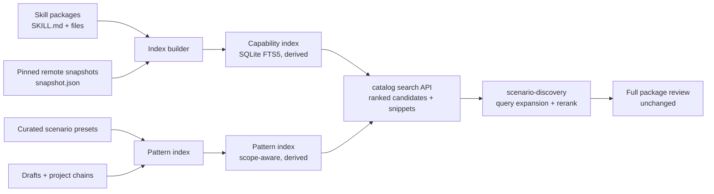

# Capability retrieval design

**Status:** Accepted design, not implemented. The decisions are recorded in [ADR-0030](../adr/0030-capability-index-and-model-reranking.md) and [ADR-0031](../adr/0031-project-scoped-chain-pattern-retrieval.md).

## Goal

Make skill and chain discovery retrieve more relevant candidates without sending skill content to a remote service. The system should:

- Search names, descriptions, frontmatter, headings, file paths, and bounded body excerpts.
- Rank candidates and return provenance and snippets.
- Merge local, extra-directory, bundled, and pinned remote skills behind one query.
- Use the existing harness model for query expansion and reranking.
- Keep package files authoritative and the index disposable.
- Keep chain patterns project-scoped unless cross-project aggregation is explicitly enabled.

## Non-goals

- Replacing full package review with search results.
- Semantic search or embeddings in the first release.
- A global chain library or implicit cross-project sharing.
- A model call inside the server.
- Indexing executable artifacts or following instructions found in skill content.

## Current baseline

- `CatalogService.getCatalog()` re-runs discovery for every request and filters with a case-insensitive substring over `name` and `description`.
- `ProjectCatalogPages` caches the merged result in memory for 2 minutes, up to 4 snapshots and 64 MiB.
- Pinned remote snapshots have `snapshot-index.sqlite`, which indexes name, description, and repository path and searches with `instr()`.
- `scenario-discovery` receives metadata entries, then reads selected packages in full for review.
- Chains contain steps, instructions, inputs, harness, session mode, and optional native-agent selection, but no summary or tags.

## Architecture



The server stays model-free. It builds indexes and serves ranked candidates. The discovery skill uses the harness model to expand the query and rerank the shortlist.

## Data model

A disposable profile-level database, for example `~/.config/loom/capability-index.sqlite`:

```text
metadata(key, value)                    -- schema version, build time, source roots
skills(
  id, harness, source, path, package_path, name, description,
  fingerprint, size, mtime_ns, license, enabled,
  remote_source_id, remote_revision, remote_repository_path
)
skill_fts USING fts5(name, description, headings, body_excerpt, tokenize='unicode61')
capabilities(skill_id, kind, value)     -- inputs, outputs, tools, tags
```

Rules:

- `id` is stable for the same harness, source, canonical path, and name.
- `fingerprint` covers the package content used for review; a mismatch invalidates the row.
- Remote rows are validated against the snapshot manifest before they are served.
- `body_excerpt` is bounded per package and excludes binary and generated files.
- The database uses a dedicated application id and schema version, a size cap, and owner-only permissions.
- FTS5 is used when available. If the bundled SQLite lacks FTS5, the builder falls back to a normalized token table and records a warning.

## Retrieval flow

1. The discovery skill states the outcome.
2. The model expands it into capabilities, synonyms, and constraints.
3. The server searches the index with a bounded, sanitized query.
4. Results include score, snippet, canonical path, harness, source, and remote identity when applicable.
5. The model reranks the shortlist and proposes a chain.
6. The user reviews the complete packages before selection or packaging.

## Phase 0: Baseline and evaluation

**Deliverables**

- A reviewed evaluation corpus of 30–50 real outcomes with expected skills or chains and acceptable alternatives.
- Instrumentation for the current substring path: query, candidate count, selected candidate, rank, empty-result rate, and elapsed time.
- A repeatable evaluation runner that reports the same metrics for every retrieval variant.

**Exit criteria**

- Baseline metrics are recorded.
- The corpus includes at least one case where the capability phrase is absent from the skill description.
- The evaluation can run without paid model calls for the lexical variants; model reranking runs are clearly labeled.

## Phase 1: Capability index

**Deliverables**

- `src/server/catalog/capability-index.ts` (name is indicative) with build, validate, read, rebuild, and dispose operations.
- Safe file handling: canonical directory, regular file, no symlink or persistent hard link, owner-only permissions, application id, schema version, size limit, and read-only queries.
- Fingerprint checks with a cheap `stat` fast path and a content hash on mismatch.
- A query API returning bounded ranked candidates, snippets, and provenance.
- Fallback to the existing fresh scan when the index is missing, stale, corrupt, unsafe, or unsupported.
- Tests for build, invalidation, fallback, unicode, path safety, corrupt data, and bounded sizes.

**Exit criteria**

- The index builds for the repository's local roots and the packaged scenario skills.
- A changed `SKILL.md` invalidates its row and the next query refreshes it.
- A corrupt or unsafe index degrades to the scan without hiding skills.
- Search latency meets the agreed budget at the corpus size.
- The feature is disabled by default behind a configuration or build flag.

## Phase 2: Discovery integration

**Deliverables**

- `catalog project page` uses the index when enabled, with the same paging contract and snapshot identity.
- Query results carry snippets and provenance; a page invalidates if the index changes mid-page.
- `scenario-discovery` gains the query-expansion and rerank steps.
- Bounded result counts, snippet lengths, and query lengths.
- A local comparison against the Phase 0 baseline.

**Exit criteria**

- The indexed path beats the baseline on recall@10 without increasing the empty-result rate.
- The discovery skill still reads every selected package in full before packaging.
- The scan fallback remains available and tested.

## Phase 3: Structured metadata

**Deliverables**

- Deterministic extraction of headings, declared tools, inputs, outputs, and optional tags.
- Optional frontmatter fields such as `when_to_use` and `tags`, validated when present.
- Filters and ranking signals that use the structured fields.
- Coverage reporting for skills with missing or low-quality metadata.

**Exit criteria**

- Metadata appears in results without changing package contents.
- Precision improves on the corpus, or the phase is abandoned and the earlier behavior retained.

## Phase 4: Chain-pattern retrieval

**Deliverables**

- A chain metadata decision: optional fields in the current strict schema versus a new chain version with `summary`, `tags`, optional `intent` and `outcome`.
- A pattern index for curated presets, profile drafts, and the current project's chains.
- Structural similarity inputs: skill sequence, step shape, declared inputs and outputs.
- Explicit opt-in for cross-project aggregation, with redaction and revocation.
- Tests proving project isolation and exclusion of inputs, run tails, credentials, and private paths.

**Exit criteria**

- A project query cannot see another project's chains.
- The default returns no cross-project results.
- Opt-in aggregation excludes sensitive fields and can be revoked.
- The removed global chain library is not recreated ([ADR-0027](../adr/0027-cli-and-skill-driven-workflow.md), [ADR-0028](../adr/0028-single-purpose-chain-editor.md)).

## Phase 5: Optional local embeddings

Only start this phase if the evaluation shows a paraphrase gap that lexical retrieval plus query expansion cannot close.

**Constraints**

- Local model only, or an explicit, documented opt-in.
- No telemetry and no hidden network access.
- Vectors keyed by model id, dimension, and package fingerprint.
- Rebuild and invalidation policy.
- A privacy review for skill bodies.
- A hybrid ranker that keeps lexical and provenance signals.

## Evaluation

The evaluation corpus should include:

- An outcome whose wording matches a skill description.
- An outcome whose wording appears only in headings or body text.
- An outcome that needs two skills composed into a chain.
- An outcome that should return no result.
- A remote snapshot case.
- A project-isolation case for chains.

Metrics:

- Recall@5 and recall@10.
- Mean reciprocal rank.
- Empty-result rate.
- Model selection accuracy after reranking.
- p95 search latency.
- Index build and rebuild time.
- Fallback count.

Suggested acceptance threshold, calibrated against the baseline: a meaningful recall@10 gain without a material latency or empty-result regression. Treat the number as a target to review, not a promise.

## Security and privacy

- The index is derived, disposable, and excluded from backups.
- Index files are owner-only; directories are canonical and unsymlinked.
- Reads use a read-only connection, `PRAGMA trusted_schema = OFF`, and `PRAGMA query_only = ON`.
- Queries are parameterized and FTS syntax is sanitized.
- Body excerpts are bounded; personal and project sources can be excluded by policy.
- Skill content is untrusted data. Indexing never executes it or follows its instructions.
- Remote entries are validated against the pinned snapshot manifest.
- A corrupt or unsafe index is deleted and rebuilt, never repaired into authority.

## Rollout and rollback

- Start behind a configuration or build flag. The existing scan remains the default.
- Compare indexed and scanned results in the evaluation before enabling by default.
- Log local counts only: build time, hit rate, fallback count, query latency, empty results. No telemetry.
- Rollback is disabling the flag and deleting the derived index; no persisted user data changes.

## Acceptance criteria

- [ ] The evaluation corpus and runner exist and record a baseline.
- [ ] The index is content-addressed and invalidates on package changes.
- [ ] A missing, corrupt, unsafe, or unsupported index falls back to a fresh scan.
- [ ] Results carry provenance and snippets, and the complete package is still reviewed.
- [ ] The indexed path improves recall without hiding skills or bypassing review.
- [ ] Chain patterns are project-scoped by default; cross-project aggregation is opt-in and redacted.
- [ ] No skill content leaves the machine for retrieval.
- [ ] `npm run check`, `npm run typecheck`, and `npm test` pass at every phase.

## Open questions

- Should body excerpts be indexed for personal skills by default, or only for project and bundled sources?
- Should the index live in the profile directory or be derived per project to simplify deletion?
- Reuse the per-snapshot remote index or fold remote entries into one profile index?
- Does chain metadata require a new chain version, or can the strict schema accept optional fields compatibly?
- Which local embedding model, if any, meets the packaging and privacy constraints?
- How much model reranking cost is acceptable per discovery request?

## Links

- [ADR-0030: Capability index and model reranking](../adr/0030-capability-index-and-model-reranking.md)
- [ADR-0031: Project-scoped chain-pattern retrieval](../adr/0031-project-scoped-chain-pattern-retrieval.md)
- [Operations guide](../OPERATIONS.md)
- [`scenario-discovery` skill](../../.github/skills/scenario-discovery/SKILL.md)
