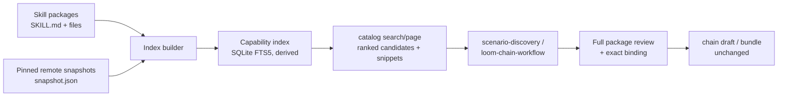

# Skill index for chain authoring

**Status:** Accepted design. Phases 0 and 1 are complete; Phase 2 has not started. The decision is recorded in [ADR-0030](../adr/0030-capability-index-and-model-reranking.md).

## Progress

| Phase | Status | Evidence |
|---|---|---|
| 0 — Baseline and evaluation | Complete — 2026-11-11 | [baseline](../evidence/retrieval-baseline-2026-11-11.json), `npm run eval:retrieval` |
| 1 — Capability index | Complete — 2026-11-11 | `tests/unit/capability-index.test.ts`, `npx vitest run tests/unit/capability-index.test.ts` |
| 2 — Authoring integration | Not started | |
| 3 — Structured metadata | Not started | |
| 4 — Optional local embeddings | Not started | |

## Goal

Help a chain author locate the right skills for an outcome. The index is a lookup service for the existing authoring flow, not a chain recommender and not a new authoring surface.

It should:

- Search names, descriptions, frontmatter, headings, file paths, and bounded body excerpts.
- Rank candidates and return snippets plus provenance.
- Return the exact identity needed to bind a remote skill step.
- Merge project, personal, extra-directory, bundled, and pinned remote skills behind one query.
- Let the authoring skill use the harness model for query expansion and reranking.
- Keep package files authoritative and the index disposable.

## Consumers

| Consumer | Use |
|---|---|
| `scenario-discovery` | Find candidates for a proposed workflow, inspect complete packages, and build a reviewed bundle. |
| `loom-chain-workflow` | Locate candidates during CLI draft creation, validation, review, and export. |
| `skill-loom catalog project page` | Return paged candidates for a registered project and harness. |
| `skill-loom catalog snapshot page` | Return paged candidates from a pinned remote snapshot. |

The chain editor only edits an existing chain; it cannot add skill steps today. An editor skill picker is a separate product decision and is not part of this plan.

## Non-goals

- Recommending existing chains or a cross-project chain library.
- Automatically selecting skills or creating a chain from search results.
- Replacing full package review with snippets.
- Semantic search or embeddings in the first release.
- A model call inside the server.
- Indexing executable artifacts or following instructions found in skill content.

## Current authoring flow

1. The user states the outcome, harness, and permitted sources.
2. `scenario-discovery` uses `catalog project page` and `catalog snapshot page` to list candidates.
3. The authoring skill reads complete packages for plausible candidates and proposes chain steps.
4. The user reviews the chain and package contents.
5. `loom-chain-workflow` creates and validates a CLI draft, then exports or imports the reviewed bundle.

The catalog re-runs discovery on every request and filters with a case-insensitive substring over `name` and `description`. Remote snapshots have `snapshot-index.sqlite`, which indexes name, description, and repository path and searches with `instr()`. Neither path searches headings or body text, ranks results, or returns a unified local/remote candidate list.

## Architecture



The server stays model-free. It builds the index and serves ranked candidates. The authoring skill uses the harness model to expand the query and rerank the shortlist.

## Data model

A disposable profile-level database, for example `~/.config/loom/capability-index.sqlite`:

```text
metadata(key, value)                    -- schema version, build time, source roots
skills(
  id, harness, source, path, package_path, name, description,
  fingerprint, size, mtime_ns, license, enabled,
  remote_source_id, remote_revision, remote_repository_path
)
skill_fts USING fts5(name, description, headings, body_excerpt, tokenize='unicode61')
capabilities(skill_id, kind, value)     -- inputs, outputs, tools, tags
```

Rules:

- `id` is stable for the same harness, source, canonical path, and name.
- `fingerprint` covers the package content used for review; a mismatch invalidates the row.
- Remote rows are validated against the snapshot manifest before they are served.
- `body_excerpt` is bounded per package and excludes binary and generated files.
- The database uses a dedicated application id and schema version, a size cap, and owner-only permissions.
- FTS5 is used when available. If the bundled SQLite lacks FTS5, the builder falls back to a normalized token table and records a warning.

## Retrieval flow for chain authoring

1. The authoring skill states the outcome, harness, and source constraints.
2. The model expands the outcome into capabilities, synonyms, and constraints.
3. The server searches the index with a bounded, sanitized query.
4. Results include score, snippet, canonical path, harness, source, and the remote binding identity when applicable.
5. The model reranks the shortlist and proposes skill steps.
6. The authoring skill reads every selected package in full.
7. The user approves the chain and package selection.
8. The existing chain draft and bundle flow binds each remote step to its exact `sourceId`, `revision`, and `repositoryPath`.

## Phase 0: Baseline and evaluation

**Status:** Complete — 2026-11-11.

**Deliverables**

- A reviewed 33-task corpus in `tests/fixtures/retrieval/chain-authoring-corpus.json`, with 14 candidate packages and description-match, body-only, compose, and negative tasks.
- Small fixture packages for capability language that is absent from the description, under `tests/fixtures/retrieval/skills/`.
- `scripts/retrieval-eval.ts`, which copies the candidates into a temporary project, runs the current catalog search, and reports recall, full recall, MRR, empty results, false positives, and latency without model calls.
- A reusable corpus loader and metric helpers in `scripts/retrieval-corpus.ts` and `scripts/retrieval-metrics.ts`, with unit tests.
- The recorded baseline at [retrieval-baseline-2026-11-11.json](../evidence/retrieval-baseline-2026-11-11.json).

**Baseline**

| Metric | Current substring search |
|---|---|
| Candidate packages | 14 |
| Tasks | 33 (31 positive, 2 negative) |
| recall@5 | 0.710 |
| recall@10 | 0.710 |
| full recall@10 | 0.645 |
| MRR | 0.710 |
| empty-result rate | 0.290 |
| false-positive rate | 0.000 |
| mean latency | 5.3 ms |
| p95 latency | 8.1 ms |
| body-only recall@10 | 0.000 (9 tasks) |
| compose full recall@10 | 0.000 (2 tasks) |

The gap is exactly where expected: description matches retrieve reliably, while body-only capability language returns nothing and composed chains retrieve only one component.

**How to run**

```bash
npm run eval:retrieval
npm run eval:retrieval -- --json
npm run eval:retrieval -- --out docs/evidence/retrieval-baseline-<date>.json
```

The runner needs no service, model, credentials, or network access. It uses a temporary project and profile, then removes them.

**Exit criteria**

- [x] Baseline metrics are recorded.
- [x] The corpus includes tasks whose capability phrase appears only in headings or body text.
- [x] Lexical variants run without paid model calls.
- [ ] Remote exact-binding verification is deferred to Phase 2, when indexed results carry remote rows. Phase 0 intentionally uses local fixtures.
- [x] The runner and metric helpers have unit tests and a documented command.

## Phase 1: Capability index

**Status:** Complete — 2026-11-11.

**Deliverables**

- `src/server/catalog/capability-index.ts` (name is indicative) with build, validate, read, rebuild, and dispose operations.
- Safe file handling: canonical directory, regular file, no symlink or persistent hard link, owner-only permissions, application id, schema version, size limit, and read-only queries.
- Fingerprint checks with a cheap `stat` fast path and a content hash on mismatch.
- A query API returning bounded ranked candidates, snippets, provenance, and remote binding identity.
- Fallback to the existing fresh scan when the index is missing, stale, corrupt, unsafe, or unsupported.
- Tests for build, invalidation, fallback, unicode, path safety, corrupt data, and bounded sizes.

**Exit criteria**

- [x] The index builds for the repository's local roots and the packaged scenario skills.
- [x] A changed `SKILL.md` invalidates its row and the next query refreshes it.
- [x] A corrupt or unsafe index degrades to the scan without hiding skills.
- [x] Search latency meets the agreed budget at the corpus size.
- [x] The feature is disabled by default behind a configuration or build flag.

**Implementation notes**

- The index is created only when a caller opts in. `LOOM_CAPABILITY_INDEX=1` enables the capability search service; no catalog command consumes it until Phase 2.
- One query merges OpenCode project, personal, extra-directory, and packaged scenario packages with verified pinned remote snapshots. Copilot discovery remains CLI-authoritative and falls back to the fresh scan.
- Tests cover FTS5 and token-table ranking, stat and content-hash invalidation, missing/corrupt/unsafe fallback, unicode, bounded sizes, project scoping, remote manifest verification and binding identity, the bundled scenario root, and the 250 ms query budget.
- The database is `~/.config/loom/capability-index.sqlite`, owner-only, capped at 64 MiB, and excluded from backups. Deleting it is always safe.

## Phase 2: Authoring integration

**Deliverables**

- `catalog project page` uses the index when enabled, with the same paging contract and snapshot identity.
- Query results carry snippets, provenance, and the exact remote binding identity.
- `scenario-discovery` and `loom-chain-workflow` gain the query-expansion and rerank steps.
- Bounded result counts, snippet lengths, and query lengths.
- A local comparison against the Phase 0 baseline.

**Exit criteria**

- The indexed path beats the baseline on candidate recall without increasing the empty-result rate.
- Remote steps still bind to one exact snapshot; name-only ambiguity does not reappear.
- The authoring skill still reads every selected package in full before packaging.
- The scan fallback remains available and tested.

## Phase 3: Structured metadata

**Deliverables**

- Deterministic extraction of headings, declared tools, inputs, outputs, and optional tags.
- Optional frontmatter fields such as `when_to_use` and `tags`, validated when present.
- Filters and ranking signals for harness, source, enabled state, declared inputs, and tools.
- Coverage reporting for skills with missing or low-quality metadata.

**Exit criteria**

- Metadata appears in results without changing package contents.
- Candidate precision improves on the corpus, or the phase is abandoned and the earlier behavior retained.

## Phase 4: Optional local embeddings

Only start this phase if the evaluation shows a paraphrase gap that lexical retrieval plus query expansion cannot close.

**Constraints**

- Local model only, or an explicit, documented opt-in.
- No telemetry and no hidden network access.
- Vectors keyed by model id, dimension, and package fingerprint.
- Rebuild and invalidation policy.
- A privacy review for skill bodies.
- A hybrid ranker that keeps lexical and provenance signals.

## Evaluation

The current corpus has 33 tasks and 14 candidates. Its baseline is recorded at [retrieval-baseline-2026-11-11.json](../evidence/retrieval-baseline-2026-11-11.json). Expand it with remote and filter cases before Phase 2 treats a score as acceptance evidence.

The corpus should include chain-authoring tasks such as:

- An outcome whose wording matches a skill description.
- An outcome whose wording appears only in headings or body text.
- An outcome that needs two skills composed into one chain.
- A remote candidate that must preserve its exact snapshot binding (Phase 2).
- An outcome that should return no result.
- A harness/source filter case (Phase 2).

Metrics:

- Candidate recall@5 and recall@10 for the expected skills.
- Exact-binding correctness for remote candidates.
- Mean reciprocal rank.
- Empty-result rate.
- Model selection accuracy after reranking.
- p95 search latency.
- Index build and rebuild time.
- Fallback count.

Suggested acceptance threshold, calibrated against the baseline: a meaningful candidate-recall gain without a material latency or empty-result regression. Treat the number as a target to review, not a promise.

## Security and privacy

- The index is derived, disposable, and excluded from backups.
- Index files are owner-only; directories are canonical and unsymlinked.
- Reads use a read-only connection, `PRAGMA trusted_schema = OFF`, and `PRAGMA query_only = ON`.
- Queries are parameterized and FTS syntax is sanitized.
- Body excerpts are bounded; personal and project sources can be excluded by policy.
- Skill content is untrusted data. Indexing never executes it or follows its instructions.
- Remote entries are validated against the pinned snapshot manifest.
- A corrupt or unsafe index is deleted and rebuilt, never repaired into authority.

## Rollout and rollback

- Start behind a configuration or build flag. The existing scan remains the default.
- Compare indexed and scanned results in the evaluation before enabling by default.
- Log local counts only: build time, hit rate, fallback count, query latency, empty results. No telemetry.
- Rollback is disabling the flag and deleting the derived index; no persisted user data changes.

## Acceptance criteria

- [ ] The evaluation corpus and runner exist and record a baseline.
- [ ] The index is content-addressed and invalidates on package changes.
- [ ] A missing, corrupt, unsafe, or unsupported index falls back to a fresh scan.
- [ ] Results carry provenance and the exact remote binding identity.
- [ ] Chain authoring still requires full-package review and explicit approval.
- [ ] The indexed path improves candidate recall without hiding skills.
- [ ] No skill content leaves the machine for retrieval.
- [ ] `npm run check`, `npm run typecheck`, and `npm test` pass at every phase.

## Open questions

- Should body excerpts be indexed for personal skills by default, or only for project and bundled sources?
- Should the index live in the profile directory or be derived per project to simplify deletion?
- Reuse the per-snapshot remote index or fold remote entries into one profile index?
- How should `scenario-discovery` treat personal/global candidates when its policy limits repository skills?
- Which local embedding model, if any, meets the packaging and privacy constraints?
- How much model reranking cost is acceptable per chain-authoring request?

## Links

- [ADR-0030: Locate chain-authoring skills through a derived capability index](../adr/0030-capability-index-and-model-reranking.md)
- [ADR-0013: Resolve bundle skills with project-local precedence](../adr/0013-deterministic-chain-bundle-skill-resolution.md)
- [ADR-0015: Ingest remote skills as pinned immutable snapshots](../adr/0015-pinned-remote-skill-snapshots.md)
- [Operations guide](../OPERATIONS.md)
- [`scenario-discovery` skill](../../.github/skills/scenario-discovery/SKILL.md)
- [`loom-chain-workflow` skill](../../.github/skills/loom-chain-workflow/SKILL.md)
