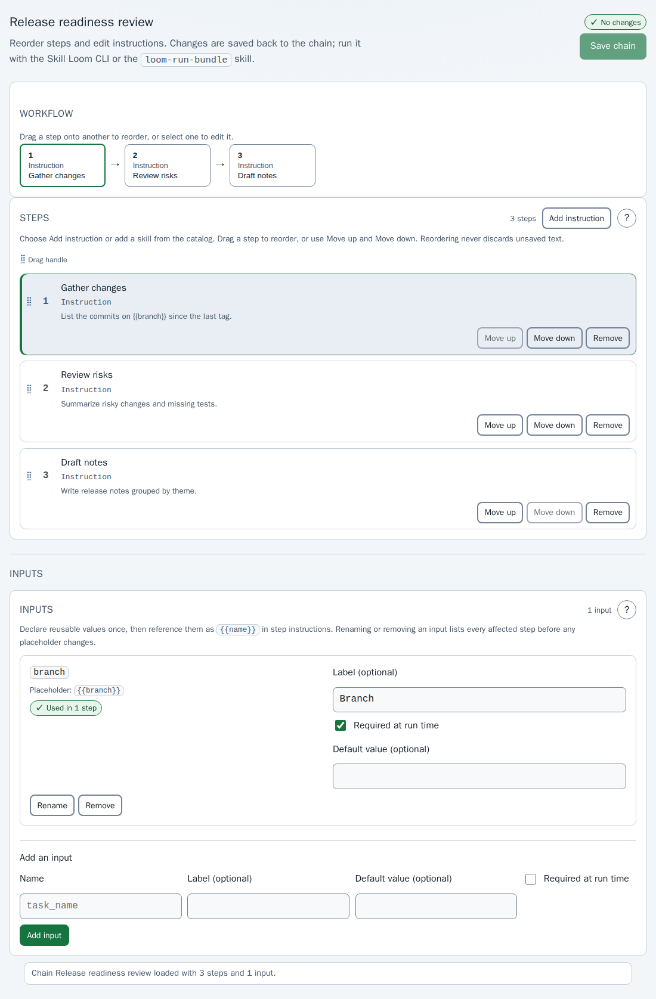

# Skill Loom User Guide

This guide is for the person using Skill Loom to design reusable skill workflows ("chains"), share them as portable bundles, and run them. Skill Loom is driven by its **CLI** and companion **Agent Skills**; its only web screen is a visual **chain editor**. Installation and machine administration are in the [administrator guide](admin-guide.md). To work with the skills alone and no Skill Loom service, see the [standalone skill guide](standalone-skill-guide.md).

## Who This Is For

Skill Loom is a **single-user, local** tool. There are no accounts, roles, sharing links, or remote services. The service binds to loopback and sends no telemetry.

## Before You Begin

- Node.js 24 or newer. The `loom-chain-workflow` and `scenario-discovery` skills offer to install the CLI when `skill-loom --version` fails, and ask for approval first. To install it yourself, follow the [administrator guide](admin-guide.md#installation).
- For managed runs or tests, the harness installed and authenticated: stable OpenCode 2.2.5 or newer, or GitHub Copilot CLI 1.0.105. Skill Loom does not install or authenticate harnesses.
- For Copilot, the project folder trusted in Copilot's own trust dialog.

On Windows, service startup also requires a protected private profile on a local fixed NTFS/ReFS drive and PowerShell 7 or Windows PowerShell 5.1 with .NET 4.7.2+. Unsafe profile ACLs are refused, not repaired. See [identity, secrets, and TLS](admin-guide.md#identity-secrets-and-tls).

## How the Pieces Fit

| You want to | Use |
|---|---|
| Find skills and propose a workflow | The `scenario-discovery` skill, or `skill-loom catalog` and `discovery` |
| Coordinate discovery, testing, import, and running | The `loom-chain-workflow` skill |
| Create, inspect, or edit chain data | `skill-loom chain ...` |
| Change step order, instructions, or inputs visually | `skill-loom edit` |
| Share a chain with its skills | `skill-loom bundle create` and `bundle inspect` |
| Run a bundle in the current agent session | The `loom-run-bundle` skill |
| Run a chain under a managed harness | `skill-loom run ...` |

Run `skill-loom --help` and, for example, `skill-loom chain --help` for the exact commands of the installed version. Structured input is passed as JSON on stdin; every command prints a versioned JSON envelope. Mutations need a review digest and explicit confirmation, so review output before approving it.

## Main Workflows

### Start the service

```sh
skill-loom service start
skill-loom service status
skill-loom service stop
```

`service start` owns the configuration profile for as long as it runs. Do not start a second owner or remove its lock. Stop refuses while a run is active or changing.

### Register a project

`skill-loom project open` reads `{"path":"/absolute/project"}` on stdin and returns a project id. Chains and run data are written under `<project>/.loom/`.

### Register remote skill repositories

`skill-loom catalog source add` reads `{"repository":"https://...","ref":"main"}`. Nothing is fetched until you run `catalog source refresh`, which pins a commit. Use `catalog snapshot page` and `catalog snapshot inspect` to review a pinned revision. Skill Loom never executes repository files while registering, refreshing, or browsing.

### Discover candidate skills

Ask an agent: **"Use scenario-discovery to propose a workflow for reviewing our API changes."** The skill asks for the outcome and whether remote repositories are in scope. It expands the outcome into a few short capability queries, searches project and approved remote skills, and reranks the shortlist before inspecting it. When the profile enables the derived capability index, `catalog project page` returns ranked matches with bounded snippets, a content fingerprint, and the exact remote `sourceId`, `revision`, and `repositoryPath`; `retrieval.mode` shows whether the index or the fresh scan answered. Treat a snippet as a ranking signal only: the skill reads every selected package in full, as untrusted data without running its scripts, then proposes ordered steps and inputs and shows every package file for your review before anything is packaged. Its result is a reviewed `.loom.json` bundle or a draft; it never imports or runs one.

### Create and edit a chain

Create a draft with `chain draft create`, or a project chain with `chain project create`; use `chain draft validate` to check it without saving. Then open it visually:

```sh
skill-loom edit --draft <draft-id>
skill-loom edit --project <project-id> --chain <chain-id>
```

The editor opens at the printed URL (a browser opens automatically on a terminal; pass `--no-open` to skip it). See the [visual tour](visual-tour.md).



In the editor you can:

- **Reorder steps** by dragging a step in the flow or the list onto another, or with **Move up** and **Move down**.
- **Edit a step** by selecting it: change its instruction and optional label.
- **Add an instruction step** or remove a step.
- **Manage inputs**: declare `{{name}}` inputs, set labels, defaults, and required flags. Renaming or removing an input lists every affected step first.
- **Save chain** writes the changes back to the chain. The draft check blocks saving while a step has no instruction or a placeholder has no declared input.

The editor cannot create chains, change a chain's harness, or add skill steps; use the CLI or skills for those. Skill Loom guarantees prompt order, not that a harness loads a named skill.

### Share a chain and its skills

```sh
skill-loom bundle create --draft <id> --output /absolute/path/chain.loom.json
skill-loom bundle create --project <id> --chain <id> --output /absolute/path/chain.loom.json
skill-loom bundle inspect --bundle /absolute/path/chain.loom.json
```

A bundle contains the chain and the complete packages of every referenced skill (version 2 also one pinned native agent). Create never overwrites an existing file. Inspect is read-only, needs no service, and reports instructions, inputs, every package file, executable bits, and conflicts with an optional `--project`. Review the packages as untrusted content before sharing or importing.

### Import a shared chain

`skill-loom bundle review` then `bundle import` (JSON on stdin) install a bundle into a project. Review reports the destination, existing-package conflicts, and a `reviewDigest`. Import needs that exact digest plus `"confirmed":true`; reusing an existing identical package needs `reuseSkills`, and differing contents need separate `differingReuseConfirmed`. Skills are installed under the project's `.agents/skills/` and an existing skill is never overwritten. Import does not start a run.

### Run an exported chain inside your harness

Install the `loom-run-bundle` skill into the target project's `.agents/skills/` (build it with `npm run build:portable-skill` in a checkout, or copy `dist/skills/loom-run-bundle/`). In your harness session, invoke it with an absolute path to the `.loom.json` bundle. It inspects, asks you to review and confirm installation, then runs exactly one step at a time. If your host catalog already reports a global package for a bundled skill, the runner can reference that package instead of copying it; you must select it explicitly, and the helper re-fingerprints it before every step so an edited package blocks the run. See the [standalone skill guide](standalone-skill-guide.md) for the full procedure, recovery, and caveats.

Portable runs are supervised by default: confirm each step, then record its outcome. Outcomes are agent-reported, not verified process exits. Only one unfinished portable run may exist in a project, and the helper records a project-local SQLite claim so current helpers reject a second preparation or step. This does not coordinate with managed runs, other profiles, or older helpers, so ensure nothing else is using the project. To inspect project coordination use `skill-loom project coordination-review`; it does not stop or change runs.

### Test in a disposable workspace

`skill-loom workspace create` copies a draft or project chain and its packages into a managed test project; the source is not changed. Use `workspace inspect` for a bounded report and `workspace evaluate` only for checks you choose. Workspaces isolate files, not processes, network, credentials, or tool permissions, and tests can modify files and call tools. Remove a workspace only after reviewing it.

### Session modes

| Mode | Behavior |
|---|---|
| **Shared** | Reuses one session id across every step. |
| **Fresh** | Creates a new session id for each step. |
| **Fork** | Asks for a new session derived from the previous step. OpenCode headless can use a native `--fork`; supervised OpenCode and all Copilot forks use a deterministic **handoff** note. |

Preflight states which mechanism applies before a run starts.

### Run a chain under a managed harness

```sh
skill-loom run preflight        # JSON on stdin; no model call
skill-loom run review-start     # review evidence and digest
skill-loom run start            # exact digest plus confirmations
skill-loom run attach --run <id>   # Ctrl-] detaches
skill-loom run events           # JSON Lines status stream
```

Preflight checks the harness executable, authentication evidence, Copilot trust, skill resolution, and inputs, and never edits files. CLI-managed starts are currently limited to reviewed instruction-only chains: skill-bearing chains and selected native agents are rejected, and OpenCode automatic starts are blocked pending live signal verification.

A step never advances because output went quiet. **Supervised** runs advance on explicit `run action` calls (`done`, `failed`, `skip`, `retry`, `abort`, or `pause`). **Automatic** runs advance only on the harness's declared signal: an OpenCode `OSC 7501` working-to-idle event, or exit of the Copilot headless step process. A missing signal, a non-zero exit, or the 30-minute per-step timeout pauses the run.

### Recover an interrupted run

If the service stops, startup recovery marks the active run `interrupted`. Use `run show` to read the bounded step tail and reason, then use `run review-action` and `run action` to retry the interrupted step, continue from the next pending step, or restart from the frozen snapshot. Do not edit run JSON by hand.

## Accessibility

The editor has a skip-to-content landmark, real headings and buttons, keyboard reordering through **Move up** and **Move down** (not only dragging), status text instead of color alone, and a persistent live region for save and load messages. The layout targets a desktop browser.

## Privacy and Data Handling

Skill Loom is loopback-only and sends no telemetry, crash reports, or remote logs. Git network access happens only when you explicitly refresh a registered repository. Credentials are not stored or logged. Run input values stay in local files under the project's `.loom/` directory.

## Troubleshooting

### `skill-loom` is not found

Let the companion skill install it with your approval, or follow the [administrator guide](admin-guide.md#installation). Confirm with `skill-loom --version`.

### Preflight reports a missing harness CLI

Confirm the binary is on the `PATH` that launched the service (`command -v opencode`, `command -v copilot`) or set `harnessCommands.opencode` / `harnessCommands.copilot` in the Skill Loom config, then restart the service.

### Authentication is blocked or unknown

Run `opencode auth login` or `copilot login` in a normal terminal and rerun preflight. Preflight reports presence only; never paste tokens into Skill Loom.

### Copilot trust is blocked

Start `copilot -C <absolute-project>` and choose **Yes, and remember this folder for future sessions**, then rerun preflight.

### A run is stuck in automatic mode

Check the step reason with `run show`. For OpenCode, use supervised mode until live signal verification is complete. For Copilot, confirm the headless process exited and the trust dialog was resolved.

### The editor says the chain changed

Another editor or the CLI saved a newer revision. Reload the page, reapply your edit, and save again.

### The service will not start

A non-loopback `LOOM_HOST` aborts startup by design. Use `127.0.0.1`, `::1`, or `localhost`. Resolve a port conflict with `--port` or `LOOM_PORT`. If another process owns the profile, stop it or use a different `--config-dir`. See the [administrator guide](admin-guide.md#troubleshooting).

## Getting Help

- [Administrator guide](admin-guide.md) — installation, configuration, backup, upgrades, and operations.
- [Standalone skill guide](standalone-skill-guide.md) — discover, inspect, and run chains with only the companion skills.
- [Visual tour](visual-tour.md) — the chain editor.
- [Operations guide](OPERATIONS.md) — the full operator contract, security model, and fork behavior.
- [Support](SUPPORT.md) — ownership, intake, and escalation.
- [Architecture decisions](adr/README.md) — why Skill Loom is local-only, CLI-driven, prompt-ordered, snapshot-based, and shell-free.
