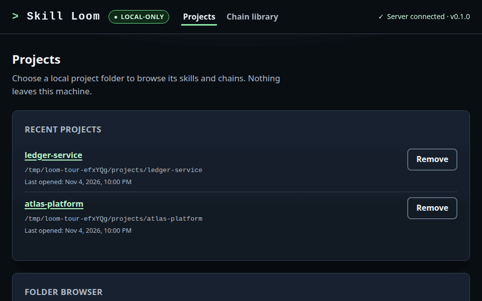
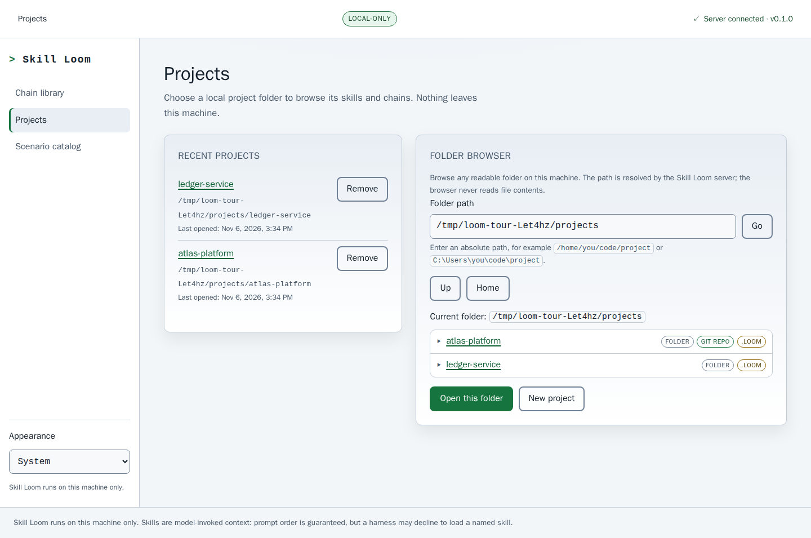
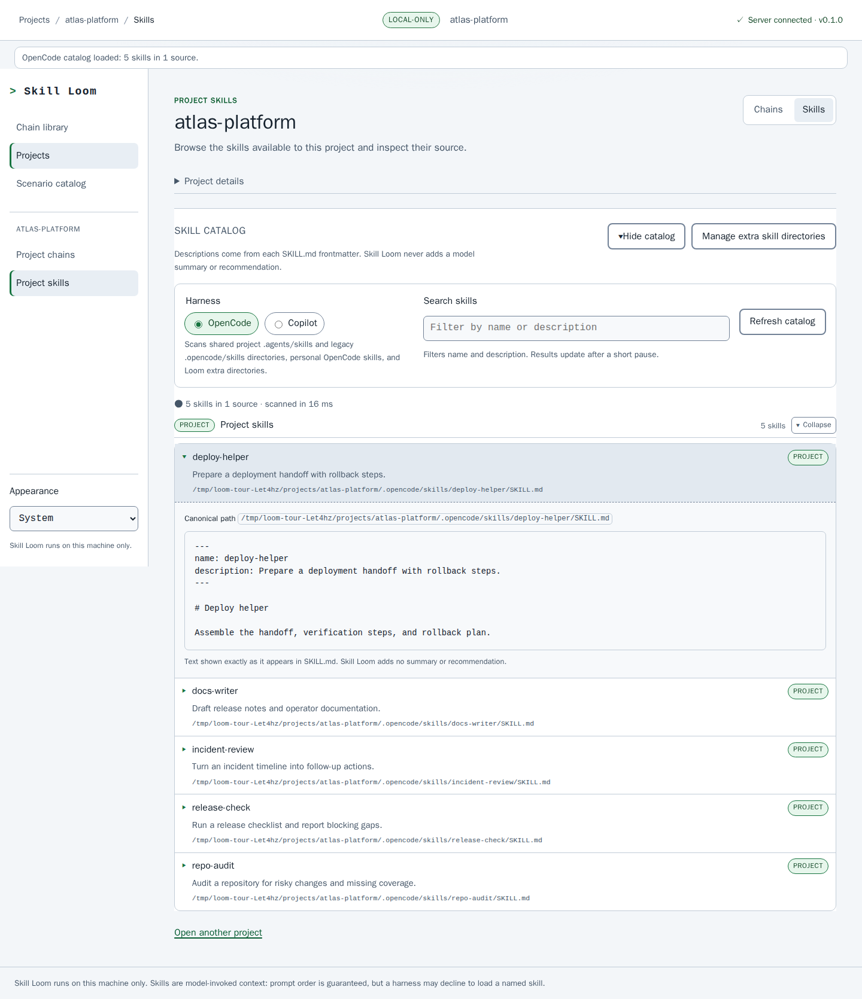
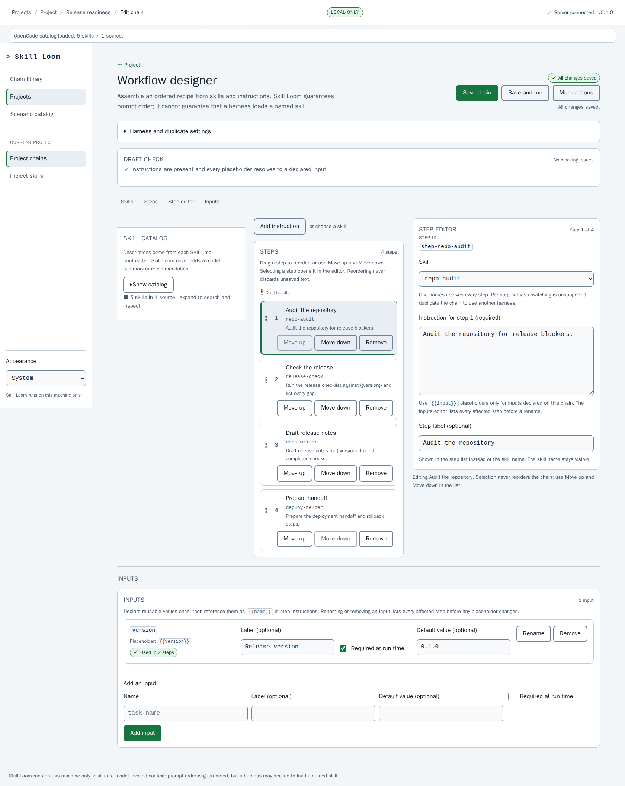
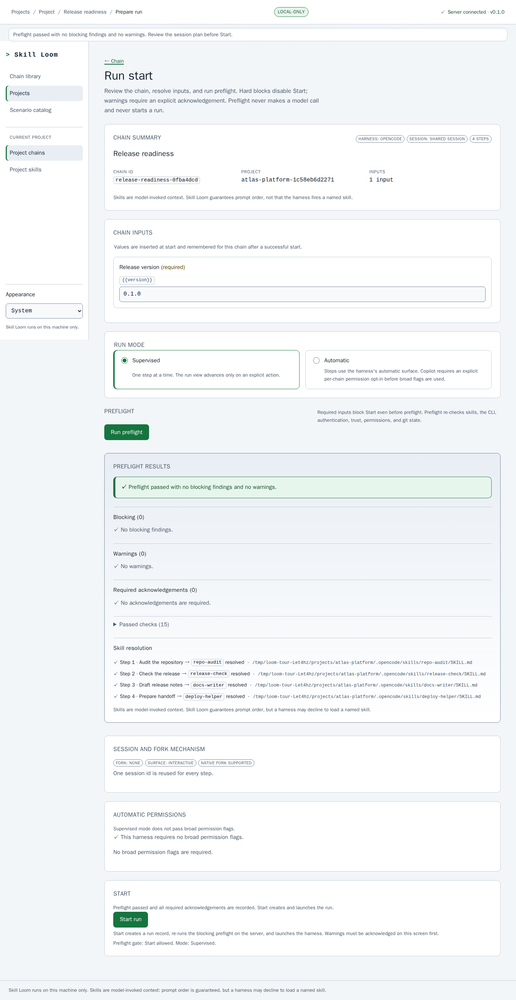
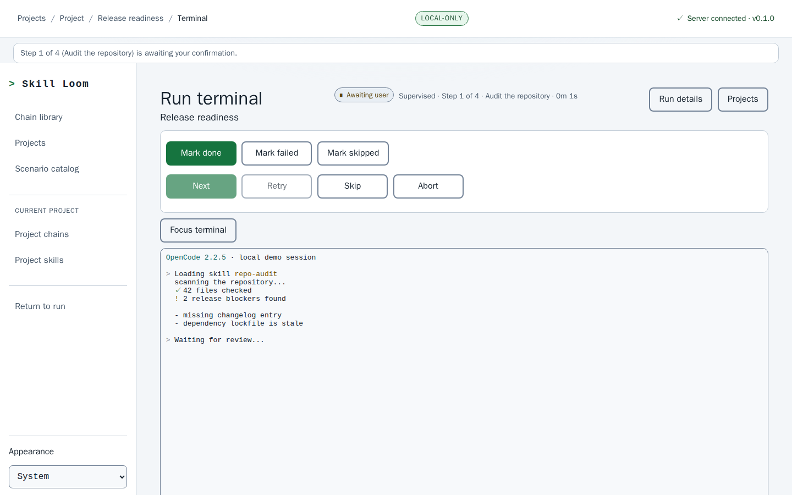
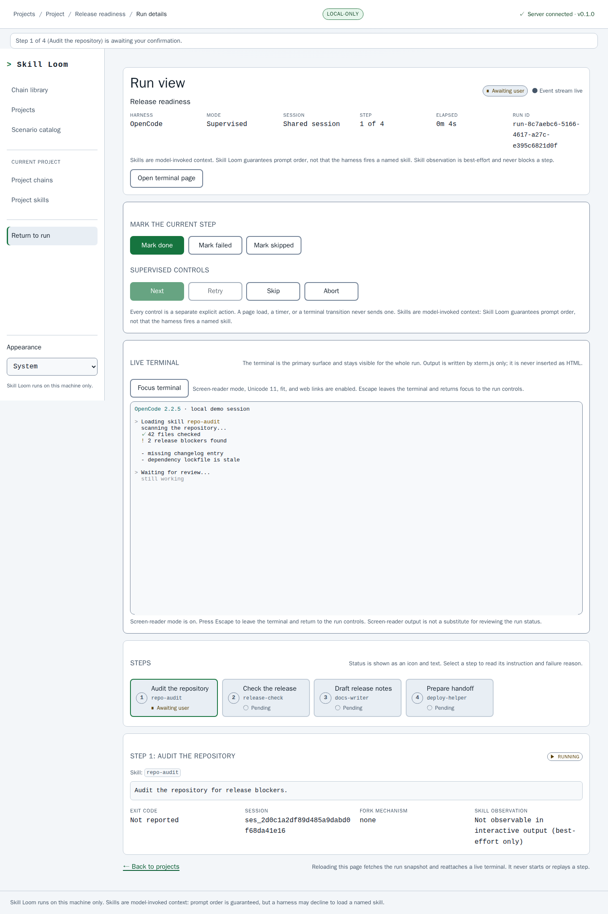
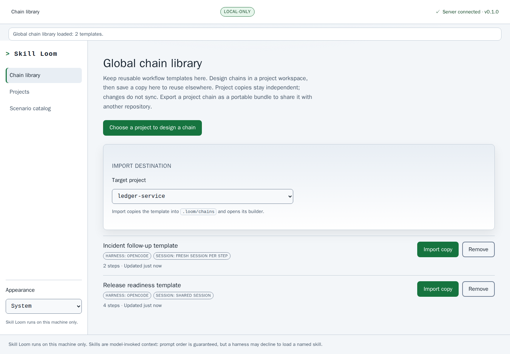

# Skill Loom visual tour

A slow, captioned pass through the local workflow: register a project, inspect the skills a harness can load, build an ordered chain, run preflight, execute a supervised step in a server-owned terminal, and review the run.

The screenshots use an isolated demo project and a scripted fixture harness. They show no personal data, credentials, or real harness output.



## Projects



Register an existing folder or create a new one. The recent-project list never deletes project files when an entry is removed.

## Project skills



Project chains and skills have separate destinations. The Skills view makes harness selection, search, and source-grouped results easy to reach. It reads `SKILL.md` metadata and shows exactly what it finds; it never adds a model summary. Project path and Git details are available on demand under **Project details**.

## Workflow designer



The wide-screen designer keeps the skill catalog, ordered steps, and selected-step editor together. Steps keep their visible order as prompt order, named inputs use `{{name}}` placeholders, and the session mode is chosen before an optional local test.

## Preflight



Preflight checks the chain, executable, authentication evidence, Copilot trust, catalog resolution, inputs, session plan, permissions, and Git state. It makes no model call and starts no run.

## Run terminal



The terminal is a server-owned PTY rendered by xterm.js. Compact controls stay in view, output scrolls inside the pane, and closing the browser does not stop the harness process.

## Run details



The run view keeps the full step rail, the current step detail, explicit outcomes, recovery actions, and the bounded terminal tail together.

## Global chain library



Templates are independent snapshots. Importing one copies it into a project with a new chain id; later edits to the template and the project copy do not sync.

## Regenerate these images

```bash
npm run docs:capture
```

The script builds the app, starts an isolated production server on a spare loopback port, seeds temporary demo projects, captures the screenshots and GIF, then removes the temporary data. Install Chromium once with `npx playwright install chromium` if it is not already available.

For the system model behind the screens, see the [end-to-end explainer](skill-loom-end-to-end.html) and the [user guide](user-guide.md).
