# Skill Loom visual tour

A slow, captioned pass through the two project-independent journeys and the existing project workflow. The screenshots use an isolated demo workspace, pinned snapshot fixture, and scripted fake harness; they contain no personal data, credentials, or real harness output.


## Start

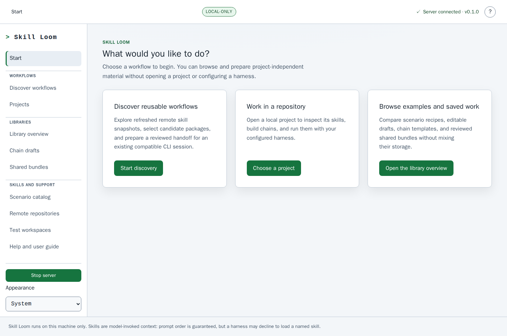

Start offers discovery, project work, and saved work as distinct journeys. Browsing does not require a registered project or configured harness.

## Discovery handoff

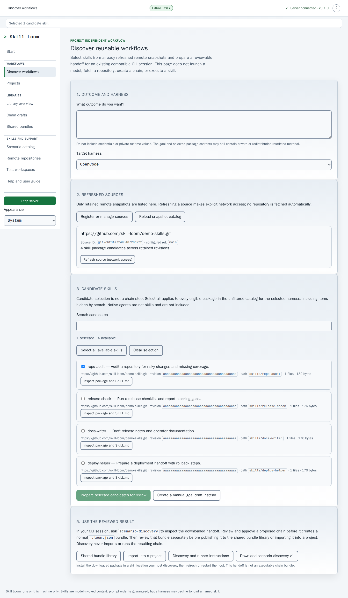

Discovery works from a verified remote snapshot and keeps candidate selection separate from chain steps. Select individually or across the complete unfiltered catalog; Skill Loom does not launch a model or execute package code.

## Libraries and saved work

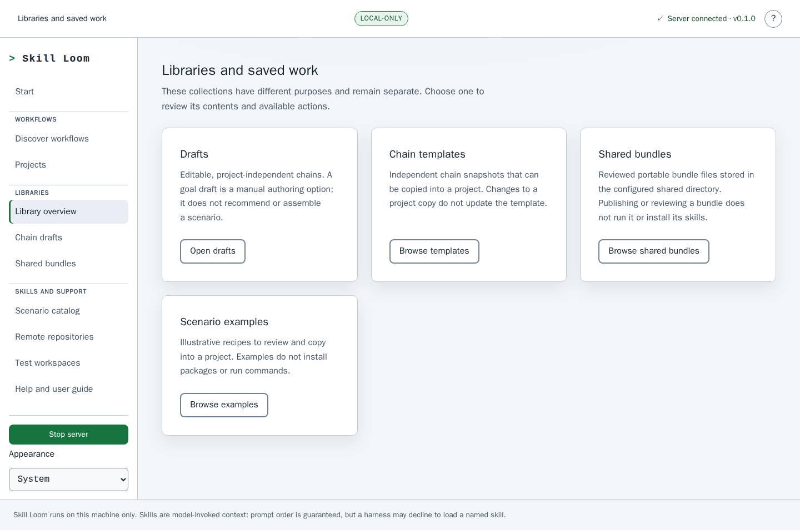

Drafts, chain templates, shared bundles, and scenario examples have different purposes and storage boundaries.

## Projects

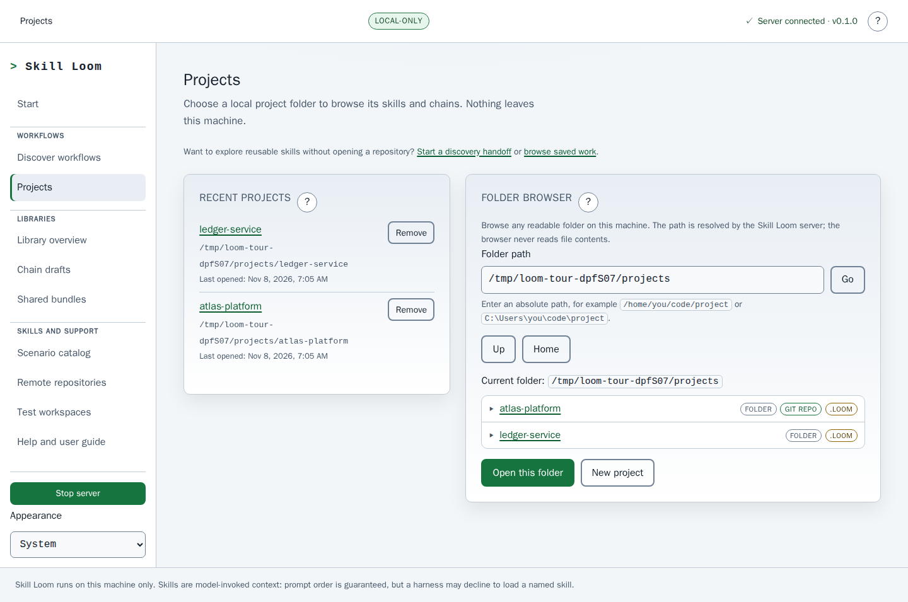

Register an existing folder or create a new one. The recent-project list never deletes project files when an entry is removed.

## Project skills

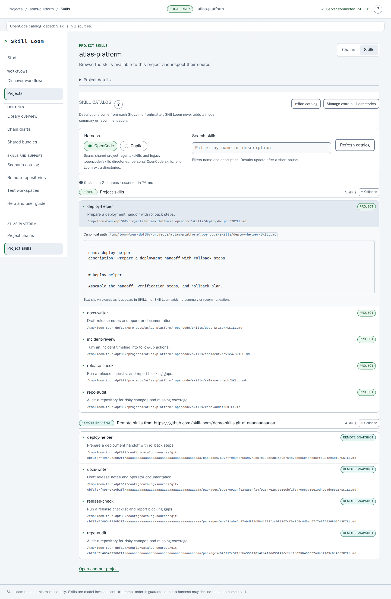

Project chains and skills have separate destinations. The Skills view makes harness selection, search, and source-grouped results easy to reach. It reads `SKILL.md` metadata and shows exactly what it finds; it never adds a model summary. Project path and Git details are available on demand under **Project details**.

## Workflow designer

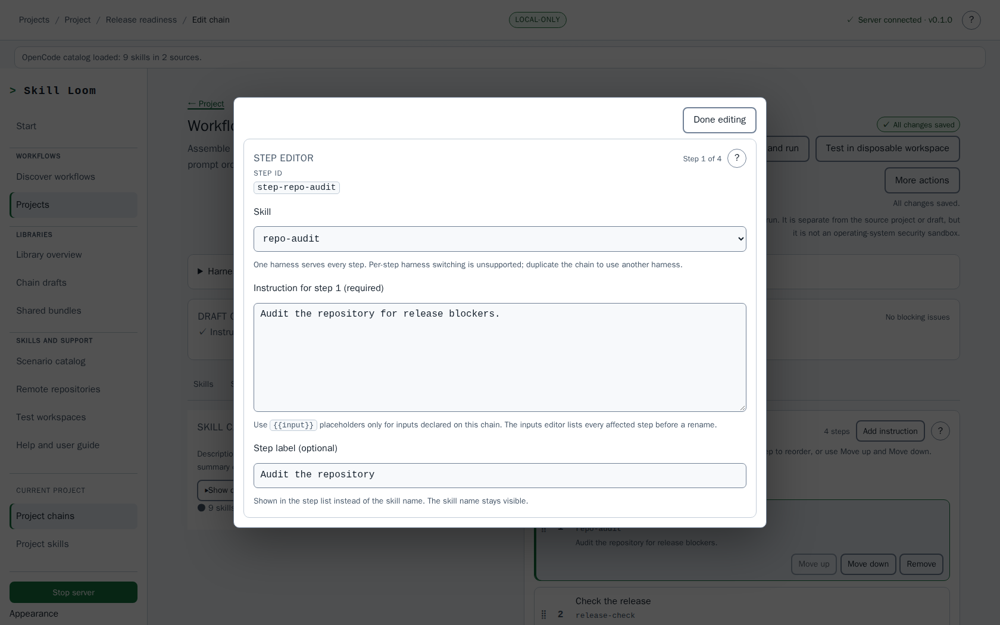

The wide-screen designer gives the skill catalog and ordered steps the main workspace. Selecting a step opens its editor in a dialog, which closes with **Done editing** or Escape. Steps keep their visible order as prompt order, named inputs use `{{name}}` placeholders, and the session mode is chosen before an optional local test.

## Preflight

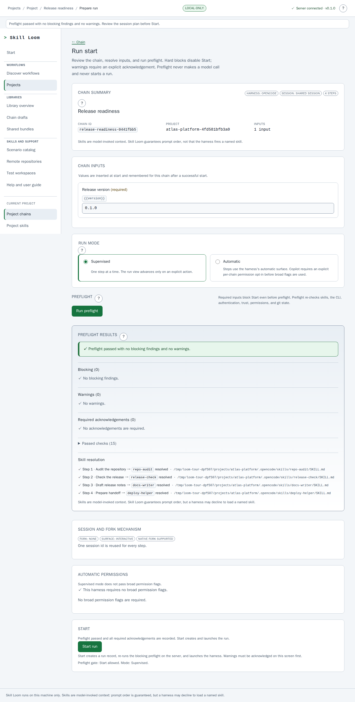

Preflight checks the chain, executable, authentication evidence, Copilot trust, catalog resolution, inputs, session plan, permissions, and Git state. It makes no model call and starts no run.

## Run terminal

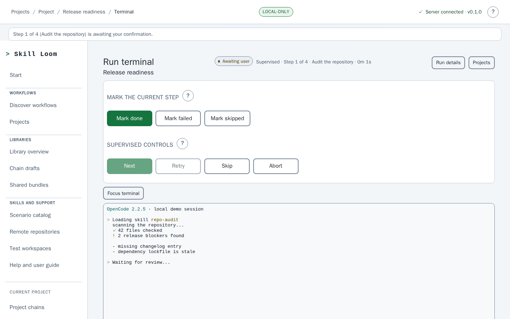

The terminal is a server-owned PTY rendered by xterm.js. Compact controls stay in view, output scrolls inside the pane, and closing the browser does not stop the harness process.

## Run details

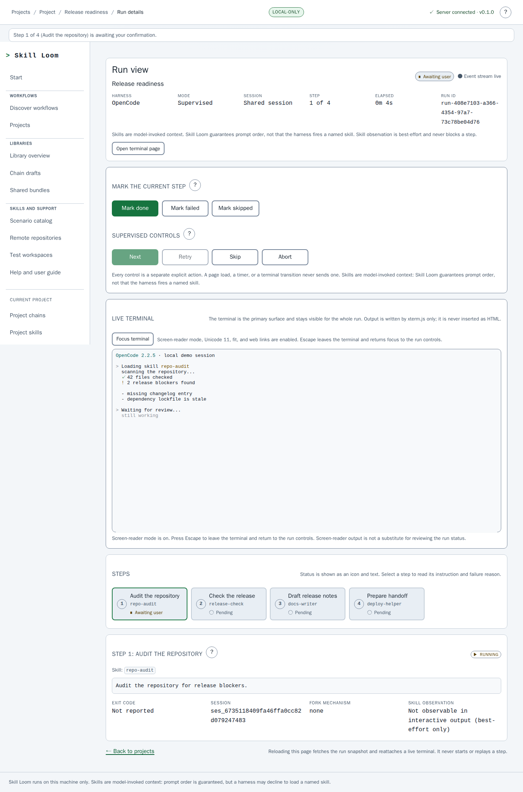

The run view keeps the full step rail, the current step detail, explicit outcomes, recovery actions, and the bounded terminal tail together.

## Chain templates

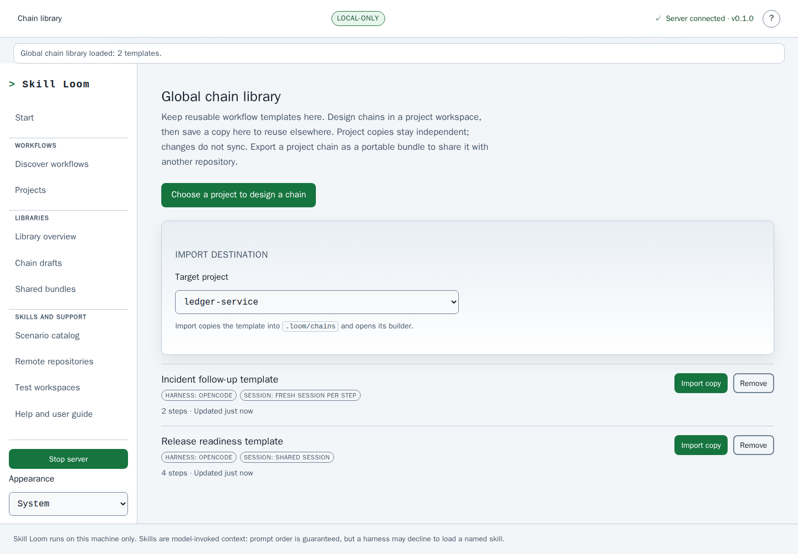

Templates are independent snapshots. Importing one copies it into a project with a new chain id; later edits to the template and the project copy do not sync.

## Shared bundles

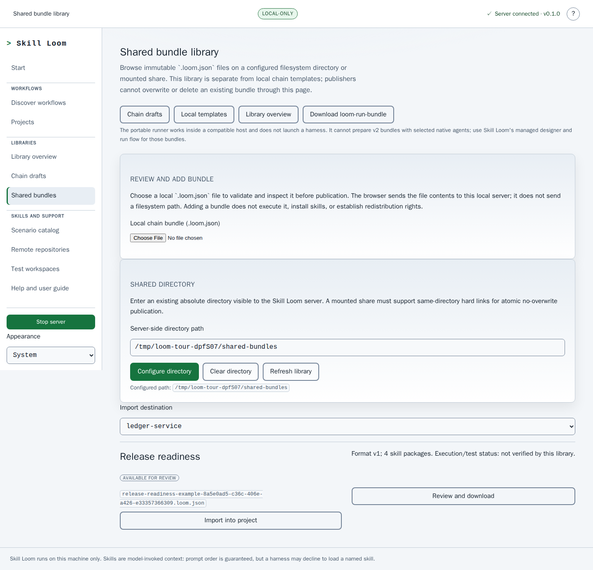

A locally selected `.loom.json` can be reviewed and published without a project. Available library entries can be reviewed and downloaded without importing; **Import into project** remains an explicit, separate action.

## Regenerate these images

```bash
npm run docs:capture
```

The script builds the app, starts an isolated production server on a spare loopback port, seeds temporary demo projects and a verified pinned-snapshot fixture, captures the screenshots and GIF, then removes the temporary data. Install Chromium once with `npx playwright install chromium` if it is not already available.

For the system model behind the screens, see the [end-to-end explainer](skill-loom-end-to-end.html) and the [user guide](user-guide.md).
